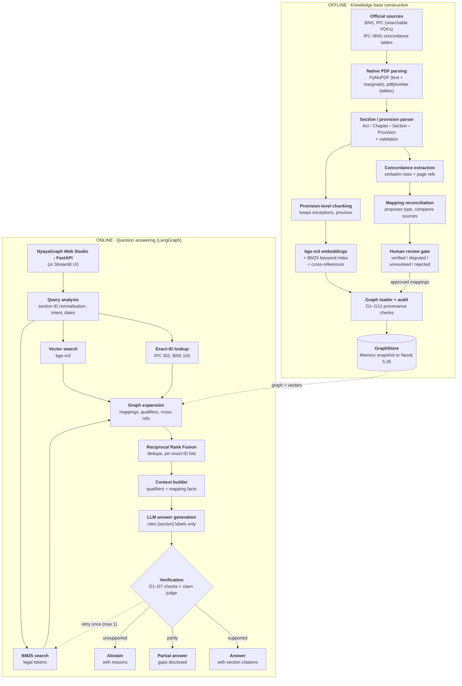
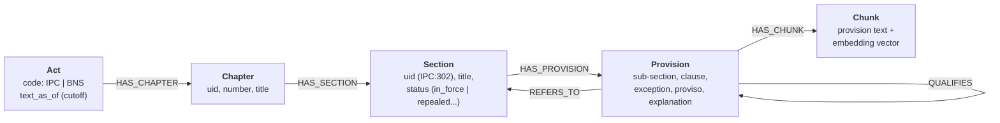
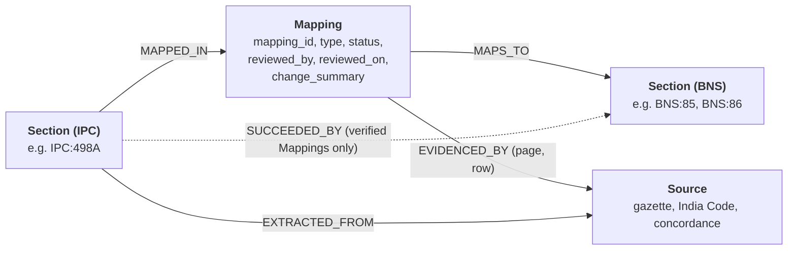
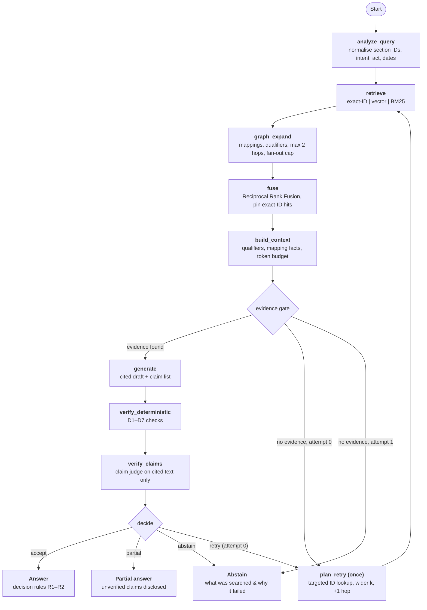

# lawrag (NyayaGraph) — Graph-Based RAG for Indian Criminal Law (IPC ↔ BNS)

Citation-grounded question answering, statutory comparison, and IPC↔BNS transition mapping over the **Indian Penal Code, 1860 (IPC)** and the **Bharatiya Nyaya Sanhita, 2023 (BNS)**, built on a knowledge graph with deterministic checks (`D1–D7`), claim-level NLI verification, one bounded retry, and justified abstention.

Implementation of [`docs/SOFTWARE_DESIGN_DOCUMENT.md`](docs/SOFTWARE_DESIGN_DOCUMENT.md).

> **Not legal advice.** “Verified” means a claim is supported by cited statutory text or recorded mapping evidence in this system, not that the legal interpretation is correct. Note that auto-extracted concordance rows in `review/approved_mappings.csv` currently carry `reviewed_by: SEED-DRAFT` and require legal-counsel review before clinical or production reliance.

## Key Features

- **Provision-Level Legal Knowledge Graph**: Models `Act → Chapter → Section → Provision → Chunk` hierarchies alongside explicit `Mapping` nodes (`IDENTICAL`, `MODIFIED`, `SPLIT`, `MERGED`, `PARTIAL`, `OMITTED`, `NEW`) and source provenance (`EVIDENCED_BY`, page/row citations).
- **4-Way Hybrid Retrieval + RRF**: Combines exact-section ID lookup (`IPC:302`, `BNS:103(1)`), dense semantic search (`BAAI/bge-m3`, 1024-d), legal-tokenized BM25, and bounded 2-hop graph expansion via Reciprocal Rank Fusion.
- **Layered Verification Gate (`D1–D7` + Claim Judge)**: Checks citation existence/context grounding, numeric punishment fidelity, mapping accuracy/provenance, temporal cutoff rules (`2024-07-01`), false premises, and per-claim textual entailment before deciding to **Answer**, **Partial Answer** (disclosing gaps), **Retry Once**, or **Abstain**.
- **Multiple Interfaces Over One Service Layer**: Unified `QAService` and `LawService` exposed via a standalone **NyayaGraph Research Studio** web frontend served directly by FastAPI (`/`), REST API (`/docs`), CLI (`lawrag`), fallback Streamlit UI (`lawrag ui`), and an optional MCP stdio server (`lawrag mcp`).
- **Dual Corpus Modes**: Includes a small `data/seed/` fixture for instant CI/testing and an end-to-end M2 PDF ingestion pipeline (`PyMuPDF` + `pdfplumber`) that ingests full Gazette/official PDFs into `data/processed/graph.json`.

---

## Table of Contents

- [Tech Stack](#tech-stack)
- [Prerequisites](#prerequisites)
- [Getting Started (Local Startup Guide)](#getting-started-local-startup-guide)
  - [1. Clone & Create Virtual Environment](#1-clone--create-virtual-environment)
  - [2. Install Dependencies](#2-install-dependencies)
  - [3. Environment Variables](#3-environment-variables)
  - [4. Configure an LLM Provider](#4-configure-an-llm-provider)
  - [5. Build & Audit the Knowledge Graph](#5-build--audit-the-knowledge-graph)
  - [6. Verify Runtime Health (`lawrag doctor`)](#6-verify-runtime-health-lawrag-doctor)
  - [7. Launch the Backend & Web UI](#7-launch-the-backend--web-ui)
- [Architecture Overview](#architecture-overview)
  - [High-Level System Pipeline](#high-level-system-pipeline)
  - [Knowledge Graph Schema](#knowledge-graph-schema)
  - [LangGraph QA Workflow](#langgraph-qa-workflow)
  - [Verification & Decision Pipeline](#verification--decision-pipeline)
  - [Repository Directory Structure](#repository-directory-structure)
  - [HTTP API Reference](#http-api-reference)
- [Configuration & Environment Variables](#configuration--environment-variables)
- [Available CLI Commands](#available-cli-commands)
- [Testing](#testing)
- [Evaluation Framework (E1–E3)](#evaluation-framework-e1e3)
- [Deployment](#deployment)
- [Troubleshooting](#troubleshooting)
- [Team](#team)

---

## Tech Stack

| Category | Technology / Choice |
|---|---|
| **Language & Runtime** | Python 3.11 or 3.12 (`>=3.11,<3.13`), Pydantic v2, httpx, Typer |
| **Graph & Vector Store** | `MemoryGraphStore` (JSON snapshot, default) or Neo4j 5.26 Community (Docker) |
| **Embeddings & Lexical Search** | `BAAI/bge-m3` via `sentence-transformers` (1024-d dense) + SQLite cache + legal BM25; `hashing-512` for dependency-free tests |
| **Orchestration** | LangGraph state machine (`analyze_query → retrieve → graph_expand → fuse → build_context → generate → verify → decide`) with plain-Python fallback |
| **LLM Providers** | Local `llama.cpp` (`llama-server` via `openai_compat`), Ollama (`llama3.2`), Anthropic (`claude-haiku-5-5` under `LAWRAG_BUDGET_USD`), or `FakeAdapter` |
| **Document Processing** | PyMuPDF (`fitz`) for statutory text & marginal notes, `pdfplumber` for concordance tables, optional Tesseract OCR experiment |
| **Web API & UI** | FastAPI + Uvicorn (single worker) serving the standalone NyayaGraph Web Studio (`src/lawrag/web/`), fallback Streamlit UI (`1.67`), optional MCP stdio server |
| **Testing & Eval** | `pytest`, `pytest-cov`, `scipy`, `pandas`, `matplotlib` |

---

## Prerequisites

- **Python**: `3.11.x` or `3.12.x` (`pyproject.toml` enforces `>=3.11,<3.13`).
- **Git** and **PowerShell** (Windows) or Bash (Linux/macOS).
- **RAM & Disk**: ~3–4 GB RAM and ~3 GB free disk space when running `BAAI/bge-m3` embeddings locally.
- **LLM Runtime** *(choose one)*:
  - **Local `llama.cpp` (`llama-server`)** exposing OpenAI-compatible HTTP on `http://127.0.0.1:8080/v1` (recommended if using `configs/providers/llama_server.yaml`).
  - **Ollama** (`http://localhost:11434`) with e.g. `ollama pull llama3.2`.
  - **Anthropic API Key** for hosted capped runs (`configs/providers/hosted_capped.yaml`).
- **Docker Desktop** *(optional)*: Required only if switching `graph.backend` from `memory` to `neo4j`.

> **Windows & OneDrive Note:** Keep your virtual environment (e.g., `C:\Users\<you>\.venvs\lawrag`) and Hugging Face cache (`HF_HOME`) **outside OneDrive** to avoid SQLite lock contention (`cache/embeddings/*.sqlite`, `cache/llm.sqlite`) and file-sync stalls.

---

## Getting Started (Local Startup Guide)

### 1. Clone & Create Virtual Environment

**Windows (PowerShell):**

```powershell
git clone <your-repo-url>
cd legal_assistant_RAG

py -3.12 -m venv "$HOME\.venvs\lawrag"
& "$HOME\.venvs\lawrag\Scripts\Activate.ps1"
```

**Linux / macOS:**

```bash
git clone <your-repo-url>
cd legal_assistant_RAG

python3.12 -m venv ~/.venvs/lawrag
source ~/.venvs/lawrag/bin/activate
```

### 2. Install Dependencies

Install `lawrag` in editable mode along with UI, dev, evaluation, PDF ingestion, and Neo4j dependencies:

```powershell
pip install -e ".[dev,ui,eval,ingest,neo4j]"
```

For real semantic embeddings (`BAAI/bge-m3`) on CPU:

```powershell
pip install torch --index-url https://download.pytorch.org/whl/cpu
pip install sentence-transformers
```

Optional extras:

```powershell
# Optional MCP server
pip install -e ".[mcp]"

# Optional OCR experiment support
pip install -e ".[ocr]"
```

### 3. Environment Variables

Copy the template environment file:

```powershell
Copy-Item .env.example .env    # Linux/macOS: cp .env.example .env
```

For the default local setup (`memory` graph + local `llama-server` or Ollama), you do not need any external API keys. Configure `.env` only for the features you use (see [Configuration & Environment Variables](#configuration--environment-variables)).

### 4. Configure an LLM Provider

Choose one of the provider overlays in `configs/providers/`:

1. **Local `llama-server` (`http://127.0.0.1:8080/v1`):**
   Start `llama-server` on port `8080`, ensure the model name in [`configs/providers/llama_server.yaml`](configs/providers/llama_server.yaml) matches `/v1/models` (currently `gemma-4-E4B-it-uncensored-Q4_K_M.gguf`), and pass `-c providers/llama_server.yaml`.
2. **Local Ollama (`http://localhost:11434`):**
   ```powershell
   ollama pull llama3.2
   ollama serve
   ```
   Pass `-c providers/ollama_local.yaml` (or omit provider flag, since `base.yaml` defaults to Ollama).
3. **Hosted Anthropic API (budget-capped):**
   Set `ANTHROPIC_API_KEY=...` in `.env` and pass `-c providers/hosted_capped.yaml`.
4. **Offline Deterministic Stub (no LLM needed):**
   Pass `-c providers/fake.yaml` for offline UI/CLI demos and tests.

### 5. Build & Audit the Knowledge Graph

You can run on the bundled seed fixture (**Path A**) or ingest the complete IPC + BNS statutory PDFs (**Path B**).

#### Path A — Fast Seed Build (Testing / Demo)

Builds a minimal graph snapshot from `data/seed/` using the fast lexical `hashing-512` embedder:

```powershell
lawrag load
lawrag audit
```

#### Path B — Full Statutory Corpus from Official PDFs (Production Data)

1. Place your official searchable PDFs in `data/raw/` (`ipc_1860.pdf`, `bns_2023.pdf`, `concordance_ipc_bns.pdf`) and register them:
   ```powershell
   lawrag sources register data/raw/ipc_1860.pdf --kind india_code --authority-rank 1 --title "Indian Penal Code, 1860" --source-id SRC-IPC-OFFICIAL
   lawrag sources register data/raw/bns_2023.pdf --kind gazette --authority-rank 1 --title "Bharatiya Nyaya Sanhita, 2023" --source-id SRC-BNS-GAZETTE-2023
   lawrag sources register data/raw/concordance_ipc_bns.pdf --kind concordance --authority-rank 2 --title "IPC-BNS Comparative Concordance Table" --source-id SRC-CONCORDANCE-A
   ```
2. Parse act PDFs into structured trees (`data/processed/ipc.tree.json`, `data/processed/bns.tree.json`):
   ```powershell
   lawrag ingest act data/raw/ipc_1860.pdf --code IPC --name "Indian Penal Code" --year 1860 --text-as-of 2024-06-30 --source-id SRC-IPC-OFFICIAL --expected data/expected/IPC.txt
   lawrag ingest act data/raw/bns_2023.pdf --code BNS --name "Bharatiya Nyaya Sanhita" --year 2023 --text-as-of 2024-07-01 --source-id SRC-BNS-GAZETTE-2023 --expected data/expected/BNS.txt
   ```
3. Extract concordance tables, generate the review queue, and validate `review/approved_mappings.csv`:
   ```powershell
   lawrag ingest concordance data/raw/concordance_ipc_bns.pdf --source-id SRC-CONCORDANCE-A --ipc-col 0 --bns-col 1
   lawrag review queue
   # Inspect/approve review/queue.csv into review/approved_mappings.csv
   lawrag review validate review/approved_mappings.csv
   ```
4. Assemble, embed with `BAAI/bge-m3`, and save `data/processed/graph.json`:
   ```powershell
   # First run downloads ~2.2 GB BAAI/bge-m3 weights and encodes all chunks on CPU (caches to cache/embeddings/BAAI_bge-m3.sqlite)
   lawrag load --source processed -c embedding/bge_m3.yaml
   ```
5. Run graph integrity rules `G1–G12`:
   ```powershell
   lawrag audit -c embedding/bge_m3.yaml
   ```

> **Important:** Once `data/processed/graph.json` is built with `BAAI/bge-m3`, always pass `-c embedding/bge_m3.yaml` to `lawrag audit`, `lawrag ask`, `lawrag serve`, and `lawrag doctor`. [`load_graph_data`](src/lawrag/services/container.py) guards against silent seed overwrites and raises `ConfigError` if the active embedding config doesn't match the snapshot.

### 6. Verify Runtime Health (`lawrag doctor`)

```powershell
lawrag doctor -c embedding/bge_m3.yaml -c providers/llama_server.yaml
```

Expected output shows `OK` for Python (`3.11–3.12`), graph backend, `BAAI/bge-m3` (`dim 1024`), and a live JSON probe against your LLM.

### 7. Launch the Backend & Web UI

**Option 1 — Single CLI query:**

```powershell
lawrag ask "What is the punishment for theft under BNS?" -c embedding/bge_m3.yaml -c providers/llama_server.yaml
```

**Option 2 — NyayaGraph Web Studio + REST API (Single Server — Recommended):**

Start FastAPI (`lawrag serve`)—it serves both the standalone editorial Web Studio UI at **`http://127.0.0.1:8000/`** and OpenAPI docs at **`http://127.0.0.1:8000/docs`**:

```powershell
lawrag serve -c embedding/bge_m3.yaml -c providers/llama_server.yaml
```

The Web Studio includes four workspaces:
- **Research Desk** (`POST /ask`): Split workspace with clickable inline citation chips, live inference stopwatch, interactive SVG concordance lineage diagrams, `D1–D7` / Claim NLI tabs, and `localStorage` session history.
- **Statutes & Concordance** (`GET /sections/{uid}`, `GET /mappings/{uid}`, `POST /search`, `Ctrl+K` quick jump): Direct UID inspection and hybrid semantic/BM25 search.
- **Redline Diff** (`POST /compare`): Synchronized word-level statutory diff viewer.
- **Verification & System** (`GET /health`, `POST /verify`): Live runtime telemetry and interactive `D1–D7` verifier sandbox.

**Option 3 — Optional Streamlit UI (`:8501`):**

If you also want the fallback Streamlit client alongside `lawrag serve`, run in a second terminal:

```powershell
lawrag ui
```

---

## Architecture Overview

### High-Level System Pipeline



### Knowledge Graph Schema

Statutes are modeled hierarchically, and IPC↔BNS transitions flow through explicit `Mapping` nodes linked to documentary evidence rather than unattributed edges:





| Attribute | Supported Values |
|---|---|
| `type` | `IDENTICAL` · `MODIFIED` · `SPLIT` · `MERGED` · `PARTIAL` · `OMITTED` · `NEW` |
| `status` | `proposed` · `verified` · `disputed` · `unresolved` · `rejected` |

### LangGraph QA Workflow



### Verification & Decision Pipeline

Every draft passes two sequential verification stages:
1. **Deterministic Checks (`D1–D7`)**:
   - `D1` Cited sections exist in the graph.
   - `D2` Every citation `[ACT:SECTION]` appeared in the retrieved context passed to the LLM.
   - `D3` Punishments (imprisonment years, life/death, fine amounts) match verbatim statutory text.
   - `D4` Mapping claims (`replaced`, `split`, `merged`, `omitted`) match recorded graph `Mapping` edges.
   - `D5` Mapping provenance (`Source` + evidence page/row) is present.
   - `D6` Temporal applicability honors the `2024-06-30` (IPC) / `2024-07-01` (BNS) cutoff.
   - `D7` False premises (e.g., repealed/nonexistent section assertions) are flagged cleanly.
2. **Claim-Level Judge**: Splits the answer into atomic claims and evaluates each claim solely against its cited passages (`SUPPORTED`, `CONTRADICTED`, `NOT_ENOUGH_INFO`). Partial answers never retain `CONTRADICTED` claims.

### Repository Directory Structure

```text
├── .streamlit/
│   └── config.toml                 # Editorial light theme, headless & XSRF settings
├── configs/
│   ├── base.yaml                   # Default configuration (merged under overlays)
│   ├── embedding/                  # bge_m3.yaml, bge_small.yaml
│   ├── providers/                  # llama_server.yaml, ollama_local.yaml, hosted_capped.yaml, fake.yaml
│   ├── retrieval/                  # bm25_only, vector_only, graph_assisted, hybrid_rrf, hybrid_rrf_no_graph
│   ├── verification/               # off, deterministic, full
│   ├── workflow/                   # retry0, retry1
│   ├── experiments/                # rerank_crossencoder, rerank_llm
│   └── matrices/                   # smoke, e1_retrieval, e2_verification, e3_retry_abstain, ...
├── data/
│   ├── raw/                        # Registered official PDFs + sources.json manifest
│   ├── expected/                   # Expected section number lists (IPC.txt, BNS.txt)
│   ├── interim/                    # Extracted PDF blocks (.blocks.jsonl) & concordance CSVs
│   ├── processed/                  # Statutory ActTrees (*.tree.json) & compiled graph.json
│   ├── seed/                       # Small M1 seed corpus (ipc.yaml, bns.yaml, mappings.yaml)
│   ├── gold/                       # smoke_v0.jsonl evaluation set
│   └── ocr_experiment/             # Isolated OCR experiment artifacts
├── review/
│   ├── queue.csv                   # Reconciled candidate mappings pending review
│   ├── approved_mappings.csv       # Reviewed IPC↔BNS mapping registry loaded into the graph
│   └── overrides.yaml              # Manual parser overrides for irregular sections
├── docs/                           # SDD, annotation/review guides, data sources, slides
├── src/lawrag/
│   ├── cli.py                      # `lawrag` Typer CLI entrypoint
│   ├── config.py                   # Pydantic RunConfig + overlay & ${ENV:default} expansion
│   ├── errors.py                   # Domain exceptions mapped to HTTP error codes
│   ├── legal/                      # Canonical UIDs, act aliases, section-ref & punishment normalizers
│   ├── ingest/                     # PDF parser, section splitter, concordance extractor, reconciler, xrefs
│   ├── graph/                      # GraphData, MemoryGraphStore, Neo4jGraphStore, loader, audit G1–G12
│   ├── index/                      # Chunker, legal tokenizer, BM25, embedders + SQLite embed cache
│   ├── retrieval/                  # QueryAnalyzer, retrievers, graph_expand, RRF, rerank, context builder
│   ├── llm/                        # LLMRegistry, BudgetGuard, SQLite LLM cache, prompts & adapters
│   ├── verify/                     # Deterministic checks D1–D7, claim decomposition, judge, decide
│   ├── qa/                         # LangGraph QA state machine & retry planner
│   ├── services/                   # Deps container, QAService, LawService
│   ├── api/                        # FastAPI app factory, CORS, exception handlers, static mount & routes
│   ├── web/                        # Standalone NyayaGraph Web Studio (index.html, styles.css, app.js)
│   ├── ui/                         # Fallback Streamlit UI (streamlit_app.py) + pure formatting helpers
│   ├── mcp_server/                 # Optional stdio MCP server over QAService / LawService
│   └── eval/                       # Gold validation, split lock, paired experiment runner, reports
├── tests/
│   ├── unit/                       # Tokenizer, UIDs, ingestion, index, decide/retry, UI formatting
│   ├── integration/                # FastAPI routes, graph stores, LangGraph workflow paths, MCP
│   └── adversarial/                # D1–D7 adversarial safety tests
├── docker-compose.yml              # Neo4j 5.26 Community service
├── pyproject.toml                  # Package metadata, extras, pytest markers
└── .env.example                    # Environment variable template
```

### HTTP API Reference

When running `lawrag serve`, FastAPI exposes interactive OpenAPI docs at `http://127.0.0.1:8000/docs` and the following endpoints (`src/lawrag/api/routes.py`):

| Method | Path | Description |
|---|---|---|
| `GET` | `/`, `/static/*` | Serves the standalone NyayaGraph Research Studio web frontend (`src/lawrag/web/`) |
| `GET` | `/health` | Graph status, embedder model ID, BM25 status, LLM reachability, cutoff dates, snapshot/corpus hashes, remaining hosted budget |
| `POST` | `/ask` | Runs the full QA workflow (`{"question": "...", "options": {"debug": false}}`) |
| `GET` | `/sections/{uid}` | Retrieves full section text, sub-provisions, qualifiers, amendment notes, and source citation |
| `GET` | `/mappings/{uid}` | Lists IPC↔BNS `MappingFact` cards for a UID (`?direction=ipc_to_bns\|bns_to_ipc&include_unverified=false`) |
| `POST` | `/compare` | Word-level side-by-side statutory diff (`{"left_uid": "IPC:304A", "right_uid": "BNS:106"}` or auto-mapped target) |
| `POST` | `/search` | Raw retrieval candidates (`mode`: `hybrid`, `vector`, `bm25`, `graph`) |
| `POST` | `/verify` | Runs deterministic checks `D1–D7` directly against an answer + context UIDs |

---

## Configuration & Environment Variables

`load_config(overlays)` starts from [`configs/base.yaml`](configs/base.yaml), deep-merges any `-c <overlay>` files in order, loads `.env` via `os.environ.setdefault`, and expands `${ENV:default}` placeholders.

| Variable | Description | Default / Example |
|---|---|---|
| `LAWRAG_CONFIG` | Comma-separated config overlays when running `uvicorn lawrag.api.app:create_app --factory` directly | `embedding/bge_m3.yaml,providers/llama_server.yaml` |
| `LAWRAG_API` | Backend URL read by the Streamlit UI (`lawrag ui`) | `http://localhost:8000` |
| `LAWRAG_BUDGET_USD` | Hard spend cap in USD enforced by `BudgetGuard` for non-local providers | `5` |
| `OLLAMA_HOST` | Ollama server base URL | `http://localhost:11434` |
| `ANTHROPIC_API_KEY` | Required only when using `provider: anthropic` (`hosted_capped.yaml`) | *(empty)* |
| `OPENAI_API_KEY` | Optional Bearer token sent by `openai_compat` if your endpoint requires auth | *(empty)* |
| `NEO4J_URI` | Bolt URI for Neo4j backend | `bolt://localhost:7687` |
| `NEO4J_USER` | Neo4j username | `neo4j` |
| `NEO4J_PASSWORD` | Neo4j password (required only when `graph.backend: neo4j`) | `lawrag-dev-password` |
| `HF_HOME` | Optional custom directory for Hugging Face model weights | *(HF default)* |
| `HF_TOKEN` | Optional Hugging Face token to silence unauthenticated download warnings | *(empty)* |

---

## Available CLI Commands

Run `lawrag --help` for full option lists:

| Command | Description |
|---|---|
| `lawrag doctor [-c ...]` | Check Python version, graph backend, embedder throughput/RSS, and live LLM JSON probe |
| `lawrag sources register <pdf> ...` | Copy PDF into `data/raw/` and record SHA-256 + metadata in `data/raw/sources.json` |
| `lawrag ingest act <pdf> ...` | Parse Act PDF (`PyMuPDF`) into `data/processed/<act>.tree.json` |
| `lawrag ingest concordance <pdf> ...` | Extract IPC–BNS comparative tables (`pdfplumber`) into `data/interim/` |
| `lawrag review queue` | Reconcile concordance CSVs against Act trees into `review/queue.csv` |
| `lawrag review validate [csv]` | Validate `review/approved_mappings.csv` UIDs, sources, and review fields |
| `lawrag load [--source seed\|processed] [-c ...]` | Build chunks, embeddings, cross-references, and write `graph.json` (and Neo4j if enabled) |
| `lawrag audit [-c ...]` | Run graph integrity rules `G1–G12` and write JSON/Markdown reports to `reports/audit/` |
| `lawrag ask "<question>" [-c ...] [--debug] [--as-json]` | Run a single verified QA query from the terminal |
| `lawrag serve [-c ...] [--host 127.0.0.1] [--port 8000]` | Start single-worker FastAPI server |
| `lawrag ui [--port 8501] [--api http://localhost:8000]` | Launch Streamlit web UI |
| `lawrag mcp [-c ...]` | Run optional stdio MCP server exposing the law graph |
| `lawrag eval validate / lock / run` | Validate gold dataset, lock test split hash, and run E1–E3 matrices |
| `lawrag report <experiment>` | Render `reports/<experiment>/report.md` from saved runs |

---

## Testing

All fast unit, integration, and adversarial tests run offline using `hashing-512` and `FakeAdapter`:

```powershell
# Fast offline suite (191 tests: skips slow model-download, Neo4j, and live Ollama tests)
pytest -m "not slow and not neo4j and not ollama"

# With coverage report
pytest -m "not slow and not neo4j and not ollama" --cov=lawrag
```

To syntax-check the Web Studio JS and run Streamlit UI headless smoke checks:

```powershell
node --check src/lawrag/web/app.js
python -c "from streamlit.testing.v1 import AppTest; AppTest.from_file('src/lawrag/ui/streamlit_app.py').run(timeout=15)"
```

---

## Evaluation Framework (E1–E3)

Reproducibility relies on pinned model configs, `temperature: 0`, cached responses (`cache/llm.sqlite`), and per-run manifests.

```powershell
# Smoke evaluation with fake LLM
lawrag eval run smoke.yaml --split smoke -c providers/fake.yaml

# E1 retrieval ablation on smoke questions
lawrag eval run e1_retrieval.yaml --split smoke --dataset data/gold/smoke_v0.jsonl

# Generate markdown report from saved runs
lawrag report e1_retrieval
```

Note: The full human-reviewed gold set (`data/gold/qa_v1.jsonl`) is not included yet; `lawrag eval run --split test` refuses execution until `docs/ANALYSIS_PLAN.md` is frozen and `lawrag eval lock` has been run.

---

## Deployment

### 1. Optional Neo4j Container (`docker-compose.yml`)

The repo includes [`docker-compose.yml`](docker-compose.yml) for **Neo4j 5.26 Community** with persistent named volume `lawrag_neo4j_data`:

```powershell
# Set NEO4J_PASSWORD in .env first (e.g. lawrag-dev-password)
docker compose up -d
```

Then pass a config overlay setting `graph: {backend: neo4j}` to `lawrag load` and `lawrag serve`. If using the default `memory` backend (`data/processed/graph.json`), Docker/Neo4j is not needed.

### 2. Production Web Process Architecture

> **Single-worker requirement:** Always run FastAPI with `--workers 1` (`uvicorn ... --workers 1` or `lawrag serve`). `MemoryGraphStore`, the BM25 index, and `SentenceTransformerEmbedder` (`BAAI/bge-m3`) live in-process; multiple workers multiply RAM usage (~2 GB per worker) and do not share the in-memory budget guard.

Because there is no app-level `Dockerfile` yet, deploy on a VM/container host behind a reverse proxy (e.g. Nginx/Caddy) or containerize Python 3.12. Running FastAPI alone serves **both** the REST API and the NyayaGraph Web Studio frontend at `/`:

```bash
# Primary server: FastAPI API + NyayaGraph Web Studio at http://0.0.0.0:8000/
export LAWRAG_CONFIG="embedding/bge_m3.yaml,providers/llama_server.yaml"
uvicorn lawrag.api.app:create_app --factory --host 0.0.0.0 --port 8000 --workers 1

# Optional fallback Streamlit UI (only if deploying :8501 separately)
export LAWRAG_API="http://127.0.0.1:8000"
streamlit run src/lawrag/ui/streamlit_app.py --server.port 8501 --server.address 0.0.0.0
```

### Pre-Deployment Production Checklist

1. Replace `reviewed_by: SEED-DRAFT` in `review/approved_mappings.csv` with verified legal sign-off (`lawrag review validate`).
2. Ensure `data/processed/graph.json` is built with `BAAI/bge-m3` (`lawrag audit -c embedding/bge_m3.yaml` passes G1–G12).
3. Point the LLM overlay to a reachable production server (`hosted_capped.yaml` with `ANTHROPIC_API_KEY`, Ollama, or `llama-server`) and raise `LAWRAG_BUDGET_USD` if using hosted APIs.
4. Set `api.timeout_s` and `llm.timeout_s` appropriately for your hardware (local 4B quantized models on CPU/iGPU typically need `300s`; hosted APIs succeed within `30–60s`).

---

## Troubleshooting

- **`ConfigError: snapshot ... uses 'BAAI/bge-m3', active config uses 'hashing-512'`**
  You ran a command without `-c embedding/bge_m3.yaml` after building `graph.json` with `bge-m3`. Pass `-c embedding/bge_m3.yaml` on all commands.
- **`BudgetExceeded: no price configured for openai_compat/...`**
  `BudgetGuard` only treats `ollama` and `fake` as zero-cost by default. Ensure `llm.prices_per_mtok` contains `"openai_compat/<model>": {input: 0.0, output: 0.0}` (already configured in [`configs/providers/llama_server.yaml`](configs/providers/llama_server.yaml)).
- **`Request timed out` in Streamlit UI or `/ask`**
  Local LLMs run two sequential passes (`generate` + `verify_claims`). Ensure `llm.timeout_s` and `api.timeout_s` are set to `>=300` (already set in `configs/providers/llama_server.yaml` and `streamlit_app.py`).
- **`lawrag load -c embedding/bge_m3.yaml` appears stuck after `Loading weights: 100%`**
  `SentenceTransformerEmbedder` runs on CPU with `show_progress_bar=False` and writes all ~3,135 vectors to SQLite once complete (takes ~20–30 minutes on laptop CPUs on the very first run, then `<1s` from cache afterward).
- **`[ABSTAINED] generator unavailable: ... No connection could be made`**
  Neither `llama-server` (`:8080`) nor Ollama (`:11434`) is running for your selected provider overlay, or no `-c providers/...` overlay was passed.
- **SQLite `database is locked` on Windows**
  Move your repository cache or virtual environment out of OneDrive-synced folders.

---

## Team

Mini project, Department of Computer Science & Engineering, B.M.S. College of Engineering.
Guide: **Ms. Pavitra**

| Name | USN |
|---|---|
| Siddhanth Narendra Kuthnikar | 1WN24CS277 |
| Shreya Sharma | 1WN24CS270 |
| Reva Kumari | 1WN24CS227 |
| Sanika Raj | 1WN24CS245 |
