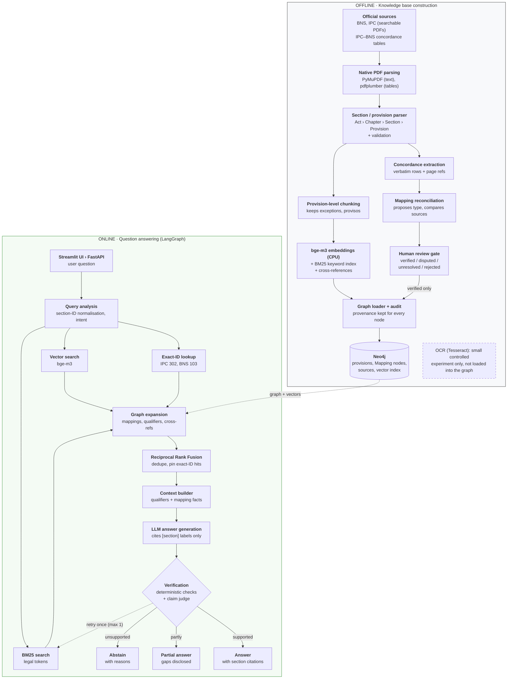
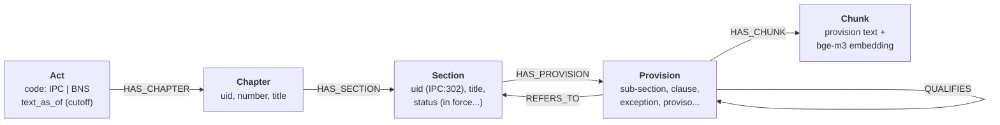
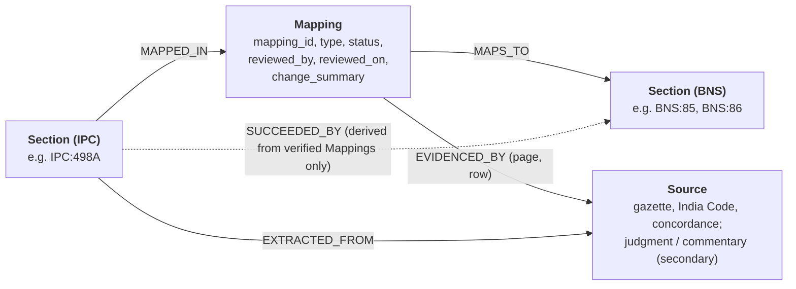
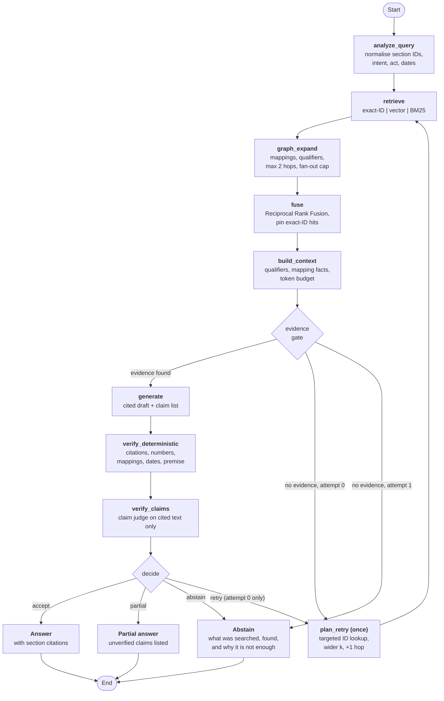
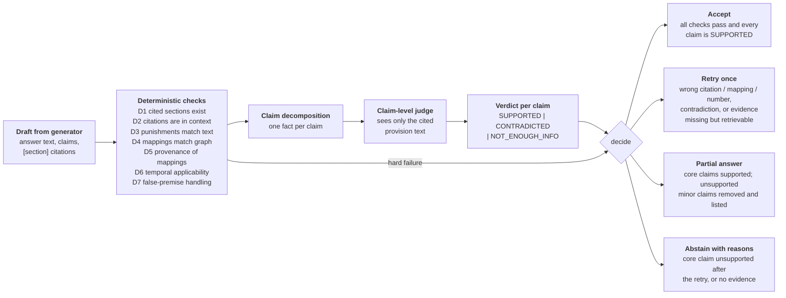

# lawrag — Graph-Based RAG for Indian Criminal Law (IPC ↔ BNS)

Cited, verified answers about the **Indian Penal Code, 1860 (IPC)** and the **Bharatiya Nyaya Sanhita, 2023
(BNS)**, with explicit, human-reviewed IPC↔BNS mappings stored in a knowledge graph, layered verification
(deterministic checks D1–D7 + a claim-level judge), one bounded retry, and justified abstention.

Implementation of [`docs/SOFTWARE_DESIGN_DOCUMENT.md`](docs/SOFTWARE_DESIGN_DOCUMENT.md).

> **Not legal advice.** The bundled seed corpus (`data/seed/`) was drafted from memory and is marked
> **VERIFY**: every provision text and mapping must be checked against the official PDFs, and every
> `reviewed_by: SEED-DRAFT` replaced by a human reviewer, before any result is reported.

---

## Contents

- [Why this project](#why-this-project)
- [High-level design](#high-level-design)
- [Knowledge graph schema](#knowledge-graph-schema)
- [LangGraph QA workflow](#langgraph-qa-workflow)
- [Verification and decision](#verification-and-decision)
- [Tech stack](#tech-stack)
- [Quick start](#quick-start-windows-cpu-only)
- [Repository layout](#repository-layout)
- [Evaluation](#evaluation)
- [Team](#team)

---

## Why this project

Since **1 July 2024** the BNS has replaced the IPC, so citizens, police and lawyers must translate between
old and new section numbers. Wrong or outdated section numbers lead to incorrect charges, filings and advice.

Typical legal RAG systems rely on vector similarity alone: they retrieve text that *sounds* similar but cannot
follow how an IPC section maps to a BNS section (**identical, modified, split, merged, partial, omitted, new**),
and they rarely check that the answer is actually supported by the retrieved law.

**lawrag** addresses this by:

1. **Knowledge graph** — IPC and BNS provisions linked through *Mapping* nodes that record mapping type,
   source evidence and human-review status. Only **verified** mappings are used as facts.
2. **Hybrid retrieval** — exact-section lookup + vector search + BM25 + graph traversal, fused with
   Reciprocal Rank Fusion and orchestrated with LangGraph.
3. **Answer verification** — deterministic citation / number / mapping checks plus claim-level judging;
   retry once, answer partially, or abstain with reasons.

---

## High-level design

The system has an **offline** pipeline that builds the knowledge base and an **online** pipeline that answers
questions.



---

## Knowledge graph schema

Statutes are stored as a hierarchy, and IPC↔BNS links go through explicit, evidenced `Mapping` nodes rather
than direct edges. A `SUCCEEDED_BY` shortcut is derived **only** from verified mappings.





| Mapping attribute | Values |
|---|---|
| `type` | `IDENTICAL` · `MODIFIED` · `SPLIT` · `MERGED` · `PARTIAL` · `OMITTED` · `NEW` |
| `status` | `proposed` · `verified` · `disputed` · `unresolved` · `rejected` |

Only verified mappings are used as facts. "No equivalent" requires a verified `OMITTED` or `NEW` mapping with
evidence — never just a missing edge.

---

## LangGraph QA workflow



---

## Verification and decision



**Safety rules**

- The LLM judge checks consistency with the cited text; it is **not** legal authority.
- Partial answers never keep a `CONTRADICTED` claim.
- MCP (optional): the same service functions are exposed to MCP clients; not used in experiments.

---

## Tech stack

| Category | Choice |
|---|---|
| Language & tools | Python 3.11, Git, pytest; Docker Desktop for Neo4j |
| Graph + vector store | Neo4j Community (graph, native vector index, full-text index); in-memory backend for dev/tests |
| Retrieval | BAAI/bge-m3 embeddings (lighter model as fallback), BM25, Reciprocal Rank Fusion, optional reranker |
| Workflow | LangGraph state machine with one bounded retry (plain-Python fallback) |
| LLM | Local model via Ollama (e.g. Llama 3.2) for near-zero cost; hosted model only under a budget cap |
| Document processing | PyMuPDF (text), pdfplumber (tables); Tesseract OCR as an isolated experiment |
| Interfaces | FastAPI backend, Streamlit UI, CLI (`lawrag`), optional MCP server |

---

## Quick start (Windows, CPU-only)

```powershell
# venv outside OneDrive (SDD 4.4)
py -3.11 -m venv C:\Users\<you>\.venvs\lawrag
C:\Users\<you>\.venvs\lawrag\Scripts\Activate.ps1
pip install -e ".[dev,ui,eval,ingest,neo4j]"
copy .env.example .env

lawrag load                                   # seed corpus -> graph snapshot (memory backend)
lawrag audit                                  # G1-G12 -> reports/audit/
lawrag ask "What replaced IPC 498A?" -c providers/fake.yaml   # offline, deterministic fake LLM
lawrag ask "What replaced IPC 498A?"          # local Ollama (llama3.2), zero API cost
lawrag serve                                  # FastAPI on :8000   (docs at /docs)
lawrag ui                                     # Streamlit on :8501
pytest                                        # 190 tests; Neo4j test skipped unless NEO4J_PASSWORD is set
```

Real embeddings (bge-m3, needs ~2–3 GB RAM):

```powershell
pip install torch --index-url https://download.pytorch.org/whl/cpu
pip install sentence-transformers
lawrag load -c embedding/bge_m3.yaml ; lawrag serve -c embedding/bge_m3.yaml
```

Neo4j backend: start Docker Desktop, set `NEO4J_PASSWORD` in `.env`, `docker compose up -d`, then use
`graph: {backend: neo4j}` (e.g. `lawrag load -c <overlay with graph.backend: neo4j>`).

---

## Repository layout

| Path | What |
|---|---|
| `configs/` | `base.yaml` + overlays (retrieval variants R-V/R-B/R-G/R-H/R-H−G, verification V0/V-D/V-DJ, retry0/1, providers) and experiment matrices E1–E3 |
| `src/lawrag/legal` | canonical uids, act aliases, section-reference extraction, punishment-term normalisation |
| `src/lawrag/ingest` | source registry, PyMuPDF parser, section/provision splitter, concordance extractor, reconciler, review gate, xrefs, OCR experiment |
| `src/lawrag/graph` | `GraphStore` (memory + Neo4j), named Cypher queries, schema DDL, loader, audit G1–G12 |
| `src/lawrag/index` | provision-level chunker, legal tokenizer, BM25, embedders + cache |
| `src/lawrag/retrieval` | query analyzer, exact-ID / vector / BM25 retrievers, graph expansion, RRF, optional reranker, context builder |
| `src/lawrag/verify` | D1–D7, claim decomposition, claim judge, decision table |
| `src/lawrag/qa` | LangGraph workflow (with plain-Python fallback), nodes, retry planner |
| `src/lawrag/services` | `QAService`, `LawService` — the only entry points for API, CLI, eval and MCP |
| `src/lawrag/api`, `ui` | FastAPI backend, Streamlit UI |
| `src/lawrag/mcp_server` | optional MCP server exposing the law graph |
| `src/lawrag/eval` | dataset validation + split lock, runner (resumable, manifests), metrics, statistics, eval judge, reports |
| `data/seed`, `data/gold/smoke_v0.jsonl` | M1 seed corpus and smoke questions (VERIFY) |
| `docs/` | design document, data sources, annotation and review guides, Review 2 slides |

---

## Evaluation

```mermaid
flowchart LR
    QT["<b>Question types</b><br/>lookups · mappings both ways<br/>split / merged / new · comparisons<br/>scoped scenarios · false premises<br/>unresolved mappings · should-decline"]
    GD["<b>Gold dataset</b><br/>pilot 20–30 (dev),<br/>expanded to 75–100 reviewed;<br/>test split locked before tuning"]

    subgraph EXP["Experiments (paired, same questions)"]
        E1["<b>E1 Retrieval</b><br/>vector-only | BM25-only |<br/>graph-assisted | hybrid RRF<br/>(+ hybrid without graph)"]
        E2["<b>E2 Verification</b><br/>none | deterministic |<br/>deterministic + claim judge"]
        E3["<b>E3 Retry & abstention</b><br/>retry 0 vs retry 1"]
        OPT["<b>Optional</b><br/>RRF vs reranker;<br/>OCR on selected pages"]
    end

    subgraph MET["Metrics"]
        M1["<b>Retrieval</b><br/>Recall@k, Precision@k,<br/>MRR, nDCG, mapping-hit rate"]
        M2["<b>Answers</b><br/>correctness, citation validity,<br/>claim-support rate"]
        M3["<b>Safety</b><br/>hallucination rate,<br/>appropriate / false abstention"]
        M4["<b>Cost</b><br/>latency, API cost, memory"]
    end

    AN["<b>Analysis</b><br/>McNemar, Wilcoxon,<br/>bootstrap 95% CI,<br/>Holm correction,<br/>error categories"]
    RP["<b>Reports</b><br/>rebuilt from saved runs"]

    QT --> GD --> EXP --> MET --> AN --> RP
    style OPT stroke-dasharray: 5 5
```



Reproducibility: frozen models, temperature 0, cached responses and per-run manifests.

```powershell
lawrag eval run smoke.yaml --split smoke -c providers/fake.yaml
lawrag eval run e1_retrieval.yaml --split smoke --dataset data/gold/smoke_v0.jsonl
lawrag report e1_retrieval
```

The real gold set (`data/gold/qa_v1.jsonl`, 75–100 human-reviewed items) does not exist yet. The runner
refuses the `test` split until `docs/ANALYSIS_PLAN.md` is frozen (start from `ANALYSIS_PLAN.template.md`)
and `lawrag eval lock` has been run. All E1–E3 results are **PENDING**.

---

## Team

Mini project, Department of Computer Science & Engineering, B.M.S. College of Engineering.
Guide: **Ms. Pavitra**

| Name | USN |
|---|---|
| Siddhanth Narendra Kuthnikar | 1WN24CS277 |
| Shreya Sharma | 1WN24CS270 |
| Reva Kumari | 1WN24CS227 |
| Sanika Raj | 1WN24CS245 |
