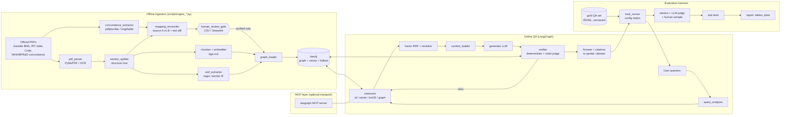

# Design Document — Graph-Based RAG for Indian Criminal Law (IPC ↔ BNS)

**Status:** DRAFT v0.1 — for review. No implementation code has been written.
**Date:** 2026-10-29
**Scope:** Indian Penal Code, 1860 (IPC) and Bharatiya Nyaya Sanhita, 2023 (BNS) only. BNSS (replaces CrPC) and BSA (replaces the Evidence Act) are **out of scope** unless you decide otherwise (see §6).

> **Convention.** Items marked **VERIFY** are facts about Indian law or official documents that I am not certain of. Check each one against the primary source (Gazette or India Code) before it goes into code, gold data, or the report. The section numbers used in examples are believed correct but are illustrative until verified.

---

## 0. Executive Summary (the opinionated version)

| Decision | Recommendation | One-line reason |
|---|---|---|
| Storage | **Neo4j only** (graph + native vector index), with BM25 computed in-process (`bm25s`) over chunks exported from Neo4j | Corpus is small (~5–10k chunks). One store means one source of truth and simpler provenance. In-process BM25 gives deterministic, legal-aware tokenisation. |
| Mapping model | **Reified `:Mapping` node** (many-to-many hub) plus a materialised `SUCCEEDED_BY` convenience edge | Split, merge, omitted and new cases can't be modelled cleanly with plain edges. A hub node carries provenance and review status. |
| Granularity | **Provision-level nodes** (section → sub-section → clause/explanation/exception/illustration/proviso), **chunk = one provision plus its section header** | Legal citations are section- or sub-section-level. Fixed-size chunks break exceptions away from the rule they qualify. |
| Embeddings | **BAAI/bge-m3** (local, 1024-d), with an option for an API embedder | Strong multilingual/English retrieval, long context, free. |
| Reranker | **BAAI/bge-reranker-v2-m3** (local cross-encoder) | Biggest cheap accuracy gain in small-corpus RAG. |
| Fusion | **Reciprocal Rank Fusion (k=60)** then cross-encoder rerank | Parameter-light, robust, easy to ablate. |
| Orchestration | **LangGraph** state machine with typed state, a deterministic router, and a bounded retry loop (max 2) | Required, and a good fit for the verify → retry/abstain loop. |
| Verification | **Layered:** (1) deterministic citation/number/mapping checks → (2) claim decomposition → (3) per-claim LLM-NLI judge against the cited text | Deterministic checks catch the most dangerous errors (invented sections or punishments) cheaply and reproducibly. |
| MCP | **Thin, optional layer.** Same tool functions are exposed as an MCP server; the workflow calls them in-process by default (`tools.transport: inprocess \| mcp`) | MCP adds interoperability and a good demo, not accuracy. It shouldn't sit on the critical path of experiments. |
| Doc processing | **PyMuPDF** (native text) + **pdfplumber** (native tables); **Tesseract OCR** + **img2table** for the scanned arm; Docling as the fallback/alternative | Lightweight, works on Windows, and a deliberate contrast for the scanned experiment. |
| Mappings provenance | Extracted from official concordance tables → cross-checked against a second source and text diff → **human review gate** → only `status = verified` is loaded | Satisfies "no LLM-guessed mappings". |
| Config | Pydantic-validated YAML + run manifest (config hash, git SHA, model IDs, index snapshot hash) + LLM response cache | Reproducibility: every experimental variable is a flag. |

---

## 1. Architecture Options and Recommendations

### 1.1 Storage

| Option | Complexity | Cost | Accuracy | Fit |
|---|---|---|---|---|
| **A. Neo4j only** (nodes + native vector index + fulltext index) | Low: one service, one loader | Free (Community via Docker or Neo4j Desktop) | Vector ANN (HNSW) recall is fine at this corpus size. Lucene fulltext is decent but tokenisation of `304A`, `376(2)(a)` needs care. | ★★★ Required anyway. Provenance and vectors live with the graph. |
| B. Neo4j + separate vector DB (Qdrant/Chroma/FAISS) | Medium: two stores and ID sync | Free | Marginally better ANN and filtering features, which are irrelevant at <20k vectors | ★★ Adds sync bugs with no measurable benefit here |
| C. Neo4j (graph) + Elasticsearch/OpenSearch (BM25 + vector) | High: JVM-heavy second service | Free but resource-hungry on a laptop | Best-in-class BM25 | ★ Overkill for a solo 12-week project |

**Recommendation: A, with one refinement.** Store everything (text, embeddings, provenance) in Neo4j. Compute BM25 **in-process** with `bm25s` from a snapshot of `:Chunk` nodes taken at startup. BM25 is treated as a derived, rebuildable index, not a store. Reasons:
- You control tokenisation, so section IDs like `304A`, `498A`, `s.376(2)(a)` and `120-B` become normalised tokens. The Lucene standard analyser splits or lowercases these in unhelpful ways.
- BM25 scores are deterministic and identical across machines, which helps reproducibility.
- The Neo4j fulltext index is still created and used for the **exact-title / fuzzy-title lookup** tool.

Neo4j version: **5.x LTS or newer** (vector indexes are GA from 5.13+; **VERIFY** your installed version supports `CREATE VECTOR INDEX`). Community Edition supports only one user database, so corpus variants are separated by **label** (`:TextChunk`, `:ScanChunk`) with **one vector index per label**. Separate databases aren't needed.

### 1.2 Graph Schema and Mapping Types

#### Mapping types to support

| Type | Meaning | Cardinality (IPC→BNS) | Example (**VERIFY all**) |
|---|---|---|---|
| `IDENTICAL` | Same text, renumbered | 1:1 | IPC 378 (theft def.) → BNS 303(1) |
| `MODIFIED` | Same offence; text, punishment or scope changed | 1:1 | IPC 302 → BNS 103(1) (punishment for murder) |
| `SPLIT` | One IPC provision → several BNS provisions | 1:N | IPC 498A → BNS 85 (offence) + BNS 86 (definition of cruelty) |
| `MERGED` | Several IPC provisions → one BNS provision | N:1 | Scattered IPC definitions (ss. 6–52A) → BNS 2 (definitions consolidated) |
| `PARTIAL` | BNS provision covers only part of the IPC provision, or vice versa; "partial successor" | 1:1 or N:M, flagged | IPC 124A (sedition) ↔ BNS 152 — contested whether successor. **VERIFY how the official tables describe this; do not assert succession unless the source does.** |
| `OMITTED` | IPC provision has no BNS counterpart | 1:0 | IPC 377 (as read down), IPC 497 (adultery, struck down in *Joseph Shine*, 2018) — **VERIFY** |
| `NEW` | BNS provision with no IPC predecessor | 0:1 | BNS 111 (organised crime), BNS 113 (terrorist act), BNS 304 (snatching), BNS 69 (intercourse by deceitful means) — **VERIFY** |
| `RELOCATED` (optional) | Provision moved to a different law (e.g., to BNSS or a special Act) | 1:0 in BNS | Only if a concordance source says so — **VERIFY** whether any exist |

#### Options

| Option | Description | Split/merge | Provenance | Query ergonomics | Fit |
|---|---|---|---|---|---|
| A. Direct edges `(:Section)-[:MAPS_TO {type}]->(:Section)` | Simplest | Split = several edges, but you lose the fact that they form *one* mapping event | Properties on each edge, duplicated | Easiest | ★★ |
| **B. Reified `:Mapping` hub node** | `(ipc)-[:MAPPED_IN]->(m:Mapping {type})-[:MAPS_TO]->(bns)` | Native N:M. One node = one mapping decision. | `(m)-[:EVIDENCED_BY {page,row}]->(:Source)`, plus review fields on `m` | One extra hop (trivial) | ★★★ |
| C. Hybrid: B plus a materialised direct edge | B, plus `(ipc)-[:SUCCEEDED_BY {mapping_id,type}]->(bns)` written by the loader | Native | Lives on the hub; the edge is derived | Fast 1-hop traversal for retrieval | ★★★ (recommended) |

**Recommendation: C.** The `:Mapping` hub is the **source of truth** and carries provenance and review status. `SUCCEEDED_BY` is a derived edge, regenerated by the loader, used by the graph retriever. `OMITTED` is a hub with no outgoing `MAPS_TO`; `NEW` is a hub with no incoming `MAPPED_IN`. This makes "no replacement exists" a **positive, citable fact** in the graph, which matters for abstention and trap questions. It is never inferred from a missing edge.

Mapping granularity: map at the **provision** level where the source does (e.g., `IPC:376(2)` → `BNS:64(2)`). Otherwise map at section level. Store `granularity: section | provision` on the hub.

### 1.3 Chunking

| Option | Pros | Cons | Fit |
|---|---|---|---|
| Fixed-size (e.g., 512 tokens, overlap 64) | Trivial | Splits exceptions from rules. Chunks span sections, so citations are ambiguous. | ★ |
| Section-level (1 chunk per section) | Clean citations | Long sections (e.g., BNS 2 definitions, IPC 375/376) exceed useful context. Illustrations dilute embeddings. | ★★ |
| **Provision-level, structure-aware** | Citation-exact. Exceptions and illustrations are retrievable on their own and linked to their parent. | Needs a good structural parser | ★★★ |

**Recommendation: structure-aware provision chunks.**
- **Unit:** one `:Provision` (sub-section / clause / Explanation / Exception / Illustration / Proviso), with a cap of about 400 tokens. Very long clauses are split at sentence boundaries into `part` children that keep the same citation.
- **Contextual header:** every chunk's *embedded text* is prefixed with `"[IPC s.300 — Murder] Exception 1 — "`, so the vector carries section identity and title. The *displayed/cited text* is the raw provision.
- **Explanations / Exceptions / Provisos:** separate chunks with `kind` set and a `QUALIFIES` edge to the provision they modify. The context builder **always pulls the qualifiers of any retrieved rule** (deterministic sibling expansion). For example, murder vs. culpable homicide hinges on IPC 300 Exceptions.
- **Illustrations:** separate chunks with `kind = illustration`, down-weighted in fusion (×0.7, configurable). They are excellent for *scenario* questions but noisy for lookups. The flag `chunking.include_illustrations` exists for ablation.
- **Amendments:** index the text **as in force on a declared cutoff date**: IPC as of 30 June 2024 (day before BNS commencement; **VERIFY** commencement 1 July 2024), BNS as of your cutoff (§6). Inline footnotes ("Subs. by Act 13 of 2013, s. 9") are stripped from embedded text but kept in `amendment_notes` for display. Repealed or struck-down IPC provisions keep their node, with `status` set, so they can be cited as "struck down/omitted" rather than silently missing.
- **Section-level parent chunk:** also store one `:SectionSummary` chunk per section (title plus first ~150 tokens). Used for vector recall of "which section deals with X"; never cited by itself.

### 1.4 Embeddings and Reranking

| Option | Type | Cost | Legal/Indian-English fit | Notes |
|---|---|---|---|---|
| **BAAI/bge-m3** | Local, 568M, 1024-d, 8k ctx | Free; ~2–3 GB VRAM or slow-but-OK CPU for ~10k chunks | Good general retrieval. Multilingual, so a future Hindi BNS text is possible. | Also emits sparse/lexical weights (optional) |
| BAAI/bge-large-en-v1.5 / e5-large-v2 | Local, 335M, 1024-d, 512 ctx | Free | Good English; short context is fine for provision chunks | Fallback if bge-m3 is too heavy |
| OpenAI `text-embedding-3-large` / Voyage `voyage-law-2` | API | Low (one-time corpus embed is cheap; check current pricing) | voyage-law-2 is legal-tuned (US/UK-centric) | Adds API dependency to retrieval. Results drift if the provider updates models. |
| InLegalBERT (law-ai) | Local, Indian-legal MLM | Free | Pretrained on Indian legal text, but **not** a sentence embedder | Would need contrastive fine-tuning. Out of scope; mention as future work. |

**Recommendation:** bge-m3 dense for the main experiments, with `embedding.model` as a flag. Run **one small side-comparison** on the dev set (bge-m3 vs bge-large-en vs one API model) in week 5, then freeze the choice. Don't let embedding choice become a fourth experimental axis.

**Reranker:** `BAAI/bge-reranker-v2-m3` cross-encoder over the top 30 fused candidates → top 8. Flag `rerank.enabled`. On CPU, 30 pairs × ~300 tokens takes about 2–4 s per query, which is acceptable.

**Indian-English / legal phrasing:** handle with **query normalisation** (deterministic), not model choice:
- Synonym/alias table: "s." / "sec." / "u/s" → "section"; "IPC 420" → `IPC:420`; "cheating case" → no change. "302 case", "498A case" are common colloquialisms, so they get detected as IDs.
- Act aliases: "Indian Penal Code", "IPC", "I.P.C.", "Bharatiya Nyaya Sanhita", "BNS", "new criminal law", "Nyaya Sanhita".
- Legacy terms such as "lunatic", "unsoundness of mind" and "outraging modesty" are kept as is, since the statutory text uses them.

### 1.5 Retrieval Strategies

| Strategy | When | Mechanism | Flag |
|---|---|---|---|
| **Exact ID lookup** | Query mentions a section ID | Regex + normaliser → `MATCH (p:Provision {uid})`. Returns the provision plus its qualifiers. | `retrieval.id_lookup` |
| **Vector** | Always (unless disabled) | Neo4j `db.index.vector.queryNodes` top-k=30 on the active corpus label | `retrieval.vector` |
| **BM25** | Always in hybrid modes | `bm25s` top-k=30, legal tokeniser | `retrieval.bm25` |
| **Graph expansion** | After seed retrieval, in graph mode | From the top-m=5 seeds: follow `SUCCEEDED_BY` (both directions), `QUALIFIES`, `REFERS_TO`, `PART_OF` (to section header). **Max 2 hops**, edge-type whitelist depends on intent. | `retrieval.graph_expand`, `graph.max_hops`, `graph.edge_types` |
| **Mapping lookup** | Intent = mapping/comparison | Direct hub traversal: `(:Provision {uid})-[:MAPPED_IN]->(m)-[:MAPS_TO]->(t)`. Returns the hub, its type and its sources. | part of `id_lookup` + `graph_expand` |

**Graph expansion edge whitelist by intent:**

| Intent | Edges | Hops |
|---|---|---|
| lookup | `QUALIFIES`, `PART_OF` | 1 |
| mapping | `MAPPED_IN/MAPS_TO`, `QUALIFIES` | 1 (+1 for qualifiers) |
| comparison | `MAPPED_IN/MAPS_TO`, `QUALIFIES`, `REFERS_TO` | 2 |
| scenario | `REFERS_TO`, `QUALIFIES`, `SUCCEEDED_BY` | 2 |
| unanswerable | same as detected sub-intent | — |

**Fusion:** RRF over {id_lookup, vector, bm25, graph}. ID-lookup hits get a **pinned** position (always included, rank 0), because an explicitly named section must be in context. Graph-expanded nodes enter RRF with their seed's rank + hop penalty. Then rerank, then top-n=8, then add qualifiers (which don't count against n, up to a token budget).

**Recommendation:** implement all four; the experiment flags select subsets (see §4.3).

### 1.6 Orchestration (LangGraph)

| Option | Description | Fit |
|---|---|---|
| A. Linear chain (retrieve → generate → verify) | Simple; no retry | ★ Doesn't meet objective 3 |
| **B. State machine with deterministic router + bounded verify loop** | Typed state; rule-based query analysis with an LLM fallback; conditional edges on the verification verdict | ★★★ |
| C. ReAct-style agent that chooses tools freely | Flexible | ★ Non-deterministic paths ruin ablations and reproducibility |

**Recommendation: B.** The LLM never decides control flow beyond what the state machine permits. Retries are capped (`workflow.max_retries = 2`). Each retry changes something concrete: the query rewrite, a widened k, more hops, or the edge types. A retry never just re-runs the same thing. Full state and flow are in §2.2.

### 1.7 Verification

| Option | Catches | Cost | Reproducibility | Fit |
|---|---|---|---|---|
| D. Deterministic checks | Non-existent sections, citations not present in context, punishment numbers not present in cited text, mapping claims contradicting the graph | ~0 | Perfect | ★★★ must-have |
| C. Claim decomposition + per-claim NLI (local model, e.g., DeBERTa-v3 MNLI) | Unsupported claims | Low, local | High | ★★ Legal text is long and conditional; general NLI models are weak here |
| J. Claim decomposition + per-claim LLM judge (entailment prompt with cited text only) | Unsupported or contradicted claims, paraphrase-aware | Medium (1–2 extra LLM calls) | Medium (temp 0 + cache) | ★★★ |

**Recommendation: D → J layered**, with a local NLI model as an optional cheap pre-filter (nice-to-have).

**Deterministic checks (D):**
1. **Citation existence:** every cited uid matches `^(IPC|BNS):\d+[A-Z]*(\(\d+\))?(\([a-z]+\))?$` and exists in the graph.
2. **Citation grounding:** every cited uid is in the context passed to the generator.
3. **Numeric fidelity:** every number of years, fine amount and term phrase ("imprisonment for life", "death", "rigorous") in the answer appears in the text of a cited provision. Extraction is regex-based.
4. **Mapping fidelity:** every claim of the form "IPC X corresponds to BNS Y" in the answer (extracted by regex/LLM into a structured list) must match a `verified` `:Mapping` hub. Claims of "no equivalent" must match an `OMITTED` hub.
5. **Temporal sanity:** if the question gives an offence date before BNS commencement, the answer must reference IPC (savings clause, BNS s.358 — **VERIFY**).

**Claim-level (J):** an LLM decomposes the answer into atomic claims, each with its citation(s). A judge prompt then checks each claim against **only** the cited provision text and labels it SUPPORTED / CONTRADICTED / NOT_ENOUGH_INFO.

**Decision policy:**

| Condition | Action |
|---|---|
| Any D1/D4 failure (invented section or mapping) | **Hard fail.** Retry with failure feedback. If retries are exhausted → abstain. |
| All claims SUPPORTED and D passes | **Accept** |
| ≥1 CONTRADICTED | Regenerate once with "remove/correct claim X". Still contradicted → drop the claim if non-core, else abstain. |
| NOT_ENOUGH_INFO claims, and the evidence-gap looks retrievable (claim names a section not in context, or a mapping) | **Re-retrieve** (targeted: ID lookup of the named section, or a wider graph expansion) |
| Supported-claim ratio ≥ τ_partial (default 0.6) but core claim(s) supported, after retries | **Partial answer:** keep supported claims and state explicitly what couldn't be verified |
| Core claim unsupported after retries, or ratio < τ_partial | **Abstain** with an explanation: what was searched, what was found, why it's insufficient |

"Core claim" means the claim answering the question's main ask (punishment, mapping target, ingredient). The decomposer marks it. Thresholds are tuned on **dev only**.

### 1.8 MCP

| Option | Value | Cost | Fit |
|---|---|---|---|
| A. No MCP | — | 0 | ✗ Violates requirement |
| **B. Thin MCP server wrapping the same tool functions; workflow uses in-process calls by default** | Interoperability (Claude Desktop / other MCP clients can query the law graph), a clean tool contract, a demo | Low (FastMCP, ~1 day) | ★★★ |
| C. Workflow calls all retrieval through MCP | "Pure" architecture | Adds latency and failure modes to every experiment | ★ |

**Recommendation: B.** Honest assessment: MCP **won't improve accuracy**. Its value is (a) a standard tool interface other agents can use, (b) a demo, and (c) separation of the legal-data layer from the reasoning layer. Make transport a flag (`tools.transport: inprocess | mcp`). Run the final best config once with `mcp` to show equivalence (identical outputs given the cache) and report the latency overhead.

**Tools exposed (one server, `lawgraph`):**

| Tool | Args | Returns |
|---|---|---|
| `get_section` | `uid: str`, `include_qualifiers: bool = True` | Provision text, title, status, qualifiers, source |
| `map_section` | `uid: str`, `direction: "ipc_to_bns" \| "bns_to_ipc"` | Mapping hubs: type, targets, provenance, review status |
| `search_law` | `query: str`, `act: str \| None`, `k: int = 8`, `mode: str = "hybrid"` | Ranked chunks with uids and scores |
| `get_cross_references` | `uid: str`, `depth: int = 1` | Referenced/referencing provisions |
| `verify_citations` | `answer: str`, `context_uids: list[str]` | Deterministic check report (D1–D4) |
| `ask` (optional) | `question: str`, `config: str` | Full pipeline answer (wraps LangGraph) |

Resources (optional): `lawgraph://section/{uid}`. Also optional: a second **read-only Neo4j Cypher MCP server** (Neo4j publishes an official `mcp-neo4j-cypher` server — **VERIFY** current name and status) for exploratory use only, never in experiments.

### 1.9 Document Processing

| Option | Native PDFs | Scanned | Tables | Windows install | Fit |
|---|---|---|---|---|---|
| **PyMuPDF + pdfplumber** | ★★★ fast, layout-aware | ✗ | pdfplumber ★★ for ruled tables | Easy (pip) | ★★★ native arm |
| Camelot (lattice/stream) | — | ✗ | ★★★ ruled tables | Needs Ghostscript | ★★ alternative |
| **Tesseract (pytesseract) + OpenCV preprocessing** | — | ★★ for clean English print | ✗ (needs table layer) | Installer + PATH | ★★★ scanned arm |
| img2table (+ Tesseract) | — | ★★ | ★★ table detection on images | pip | ★★★ scanned tables |
| Docling (IBM) | ★★★ | ★★ (built-in OCR) | ★★★ (TableFormer) | pip; heavy models | ★★ strong alternative, one-stop |
| PaddleOCR / PP-Structure | — | ★★★ | ★★★ | Painful on Windows | ★ |
| LLM-vision OCR | — | ★★★ | ★★★ | API | ✗ Violates "no LLM guesses" for mapping tables, and costly |

**Recommendation:** PyMuPDF + pdfplumber for the text arm. Tesseract + img2table for the scanned arm. Use Docling as the fallback if the concordance PDF tables defeat pdfplumber.

**Scanned experiment design (key point):** build the scanned corpus **two ways**:
1. **Controlled:** rasterise the *same* native PDFs at 200 dpi with mild noise, skew and JPEG compression, then OCR. Gold labels transfer exactly, so differences are attributable purely to OCR/table extraction.
2. **Natural:** any genuinely scanned official documents you have (older gazette scans, scanned concordance handouts). Smaller, qualitative-plus-quantitative.

**Hindi/Devanagari:** the Gazette is bilingual for some notifications (**VERIFY** which PDFs mix Hindi and English). Filter Devanagari blocks out of the English corpus via Unicode range detection.

---

## 2. System Design

### 2.1 Component Diagram



### 2.2 LangGraph State and Flow

**State (TypedDict / Pydantic; signatures only):**

```python
class QueryAnalysis(TypedDict):
    intent: Literal["lookup", "mapping", "comparison", "scenario", "unknown"]
    section_ids: list[str]           # normalised uids found in query, e.g. "IPC:302"
    acts: list[Literal["IPC", "BNS"]]
    direction: Literal["ipc_to_bns", "bns_to_ipc", None]
    offence_date: str | None         # ISO date if stated (temporal applicability)
    rewritten_query: str
    analyzer: Literal["rules", "llm"]

class Candidate(TypedDict):
    uid: str; chunk_id: str; text: str; kind: str
    scores: dict[str, float]         # per-retriever raw scores
    ranks: dict[str, int]
    via: list[str]                   # provenance: ["vector", "graph:SUCCEEDED_BY"]

class Claim(TypedDict):
    text: str; citations: list[str]; core: bool
    verdict: Literal["SUPPORTED", "CONTRADICTED", "NEI", None]

class VerificationReport(TypedDict):
    deterministic: dict[str, list[str]]   # check_name -> failures
    claims: list[Claim]
    support_ratio: float
    failure_kind: Literal["none", "hallucinated_citation", "missing_evidence",
                          "contradiction", "numeric_mismatch", "mapping_mismatch"]

class QAState(TypedDict):
    run_id: str
    config_hash: str
    question: str
    analysis: QueryAnalysis
    candidates: list[Candidate]
    context: list[Candidate]          # final, ordered, budgeted
    mapping_facts: list[dict]         # verified :Mapping hubs touched
    draft_answer: str
    citations: list[str]
    verification: VerificationReport | None
    attempt: int                      # 0..max_retries
    retry_actions: list[str]          # audit trail of what changed per retry
    outcome: Literal["answered", "partial", "abstained", None]
    final_answer: str
    trace: list[dict]                 # per-node timing, tokens, cost
```

**Flow:**

```
                ┌──────────────┐
   question ──▶ │ analyze_query│  (rules first; LLM fallback if intent unknown)
                └──────┬───────┘
                       ▼
                ┌──────────────┐
                │  retrieve    │  runs enabled retrievers per config:
                │              │  id_lookup | vector | bm25 | (graph_expand)
                └──────┬───────┘
                       ▼
                ┌──────────────┐
                │ fuse_rerank  │  RRF → cross-encoder → top-n
                └──────┬───────┘
                       ▼
                ┌──────────────┐
                │build_context │  + qualifiers, + mapping facts, token budget
                └──────┬───────┘
                       ▼
          ┌─── evidence_gate ───┐  (cheap: is ANY candidate above min score
          │                     │   or any ID hit? if not → abstain early)
          ▼ ok                  ▼ empty
   ┌──────────────┐        ┌────────┐
   │   generate   │        │abstain │
   └──────┬───────┘        └────────┘
          ▼
   [verification.enabled?] ── no ──▶ finalize
          │ yes
          ▼
   ┌──────────────┐
   │    verify    │  D-checks → claim decomposition → judge
   └──────┬───────┘
          ▼
   ┌──────────────┐   accept ─────────────────────────▶ finalize
   │    decide    │   regenerate (contradiction, attempt<max) ─▶ generate
   └──────┬───────┘   re_retrieve (missing evidence, attempt<max) ─▶ plan_retry ─▶ retrieve
          │           partial ──▶ finalize(partial)
          └──────────▶ abstain ──▶ finalize(abstained)
```

`plan_retry` is deterministic: (1) add ID lookups for uids named in failed claims, (2) widen vector k 30→60, (3) graph hops +1, (4) LLM query rewrite (only on the 2nd retry). Each step is logged in `retry_actions`.

### 2.3 Neo4j Schema

**Nodes:**

| Label | Key | Properties |
|---|---|---|
| `:Act` | `code` (IPC/BNS) | `name`, `year`, `act_number`, `commenced_on`, `repealed_on`, `text_as_of` |
| `:Chapter` | `uid` (`BNS:CH-VI`) | `number`, `title`, `act` |
| `:Section` | `uid` (`IPC:302`) | `act`, `number` (str), `sort_key` (int + suffix), `title`, `status` (`in_force` / `repealed` / `struck_down` / `omitted_by_amendment` / `not_yet_in_force`), `text` (full), `amendment_notes`, `source_id`, `page_start`, `page_end` |
| `:Provision` | `uid` (`BNS:103(2)`, `IPC:300:Exc1`, `IPC:300:Ill(a)`) | `kind` (`subsection` / `clause` / `explanation` / `exception` / `illustration` / `proviso` / `body`), `label`, `text`, `status`, `in_force` (bool; e.g., BNS 106(2) — **VERIFY** whether it was notified), `order` |
| `:Chunk` + `:TextChunk` \| `:ScanChunk` | `chunk_id` | `provision_uid`, `embed_text`, `display_text`, `kind`, `tokens`, `embedding` (float[1024]), `corpus_variant`, `ocr_confidence` (scan only) |
| `:Mapping` | `mapping_id` | `type` (enum §1.2), `granularity`, `direction_note`, `change_summary` (human-written or source-quoted, never LLM-generated), `text_similarity` (difflib ratio), `status` (`candidate` / `verified` / `disputed` / `rejected`), `reviewed_by`, `reviewed_on`, `review_note`, `sources_agree` (bool) |
| `:Source` | `source_id` | `title`, `publisher`, `url`, `sha256`, `retrieved_on`, `kind` (`gazette` / `india_code` / `concordance` / `commentary`), `authority_rank` (1 = Gazette) |
| `:Term` (nice-to-have) | `uid` (`BNS:term:dishonestly`) | `term`, `definition_uid` |

**Relationships:**

| Type | From → To | Properties |
|---|---|---|
| `HAS_CHAPTER` | Act → Chapter | |
| `HAS_SECTION` | Chapter → Section | |
| `HAS_PROVISION` | Section → Provision; Provision → Provision (nesting) | `order` |
| `QUALIFIES` | Provision(explanation/exception/proviso/illustration) → Provision or Section | `kind` |
| `HAS_CHUNK` | Provision → Chunk | |
| `REFERS_TO` | Provision → Section/Provision | `raw_text` ("section 34"), `resolved_by` (`regex` / `manual`) |
| `MAPPED_IN` | Section/Provision (IPC) → Mapping | `role` (`primary` / `partial`) |
| `MAPS_TO` | Mapping → Section/Provision (BNS) | `role` |
| `EVIDENCED_BY` | Mapping → Source | `page`, `row`, `raw_row` (verbatim extracted row) |
| `SUCCEEDED_BY` (derived) | IPC node → BNS node | `mapping_id`, `type` |
| `EXTRACTED_FROM` | Section → Source | `page_start`, `page_end` |
| `DEFINES` / `USES_TERM` (nice-to-have) | Provision → Term | |

**Constraints and indexes (DDL, part of the design):**

```cypher
CREATE CONSTRAINT act_code     IF NOT EXISTS FOR (a:Act)       REQUIRE a.code IS UNIQUE;
CREATE CONSTRAINT section_uid  IF NOT EXISTS FOR (s:Section)   REQUIRE s.uid IS UNIQUE;
CREATE CONSTRAINT prov_uid     IF NOT EXISTS FOR (p:Provision) REQUIRE p.uid IS UNIQUE;
CREATE CONSTRAINT chunk_id     IF NOT EXISTS FOR (c:Chunk)     REQUIRE c.chunk_id IS UNIQUE;
CREATE CONSTRAINT mapping_id   IF NOT EXISTS FOR (m:Mapping)   REQUIRE m.mapping_id IS UNIQUE;
CREATE CONSTRAINT source_id    IF NOT EXISTS FOR (s:Source)    REQUIRE s.source_id IS UNIQUE;

CREATE INDEX section_act_num IF NOT EXISTS FOR (s:Section) ON (s.act, s.number);
CREATE INDEX mapping_status  IF NOT EXISTS FOR (m:Mapping) ON (m.status, m.type);

CREATE FULLTEXT INDEX section_title_ft IF NOT EXISTS
  FOR (s:Section) ON EACH [s.title, s.text];

CREATE VECTOR INDEX text_chunk_vec IF NOT EXISTS FOR (c:TextChunk) ON c.embedding
  OPTIONS {indexConfig: {`vector.dimensions`: 1024, `vector.similarity_function`: 'cosine'}};
CREATE VECTOR INDEX scan_chunk_vec IF NOT EXISTS FOR (c:ScanChunk) ON c.embedding
  OPTIONS {indexConfig: {`vector.dimensions`: 1024, `vector.similarity_function`: 'cosine'}};
```

Property-existence constraints (e.g., `Mapping.status IS NOT NULL`) need Enterprise. Enforce them in the loader instead, plus a `graph_audit` script (see §3.6).

**Integrity rules the audit script enforces:**
- Every `:Mapping` with `status = verified` has ≥1 `EVIDENCED_BY` and a non-null `reviewed_by`.
- `OMITTED` ⇒ 0 `MAPS_TO`; `NEW` ⇒ 0 `MAPPED_IN`; `SPLIT` ⇒ ≥2 `MAPS_TO`; `MERGED` ⇒ ≥2 `MAPPED_IN`.
- Every IPC section has ≥1 mapping hub (coverage report), and so does every BNS section.
- `SUCCEEDED_BY` edges exactly equal the derivation from verified hubs (recomputed and diffed).

### 2.4 Data Flow per Query Type (section numbers **VERIFY**)

**(a) Lookup — "What is the punishment for murder under BNS?"**
1. Analyzer: intent=lookup, acts=[BNS], no ID. Rewritten query: "punishment for murder Bharatiya Nyaya Sanhita".
2. Vector + BM25 → BNS 103(1) and BNS 101 high. Graph (lookup whitelist): `PART_OF` → BNS 103 header, `QUALIFIES` → any explanation.
3. Context: BNS 103(1), 103(2), 101 (definition).
4. Generate: "death or imprisonment for life, and fine [BNS:103(1)]".
5. Verify: D3 finds "death", "imprisonment for life" and "fine" in the BNS:103(1) text ✓. Claim judge ✓. Answered.

**(b) IPC → BNS mapping — "What replaced IPC 498A?"**
1. Analyzer (rules): `IPC:498A`, intent=mapping, direction=ipc_to_bns.
2. ID lookup pins IPC:498A. Mapping lookup → hub `M-0498A` type=SPLIT → BNS:85, BNS:86, with sources [MHA concordance p.X row Y; BPR&D table p.Z].
3. Context: IPC 498A text, BNS 85, BNS 86, plus mapping facts (type, provenance).
4. Generate: "IPC 498A is split into BNS 85 (punishment) and BNS 86 (definition of cruelty) [IPC:498A][BNS:85][BNS:86] (Source: …)".
5. Verify: D4 compares the claimed pairs {(498A,85),(498A,86)} against the verified hub ✓. Answered.

**(c) Comparison — "How does the BNS change the offence of causing death by negligence compared to the IPC?"**
1. Analyzer: intent=comparison. No ID. Rewritten query mentions "death by negligence".
2. Vector/BM25 → IPC 304A, BNS 106. Graph: IPC:304A –SUCCEEDED_BY(MODIFIED)→ BNS:106. Hop 2 → 106(1), 106(2).
3. Context includes the `in_force` flag on BNS 106(2) (**VERIFY** commencement status).
4. Generate a side-by-side comparison: punishment terms and the new hit-and-run sub-section.
5. Verify: D3 checks every year figure ("two years", "five years", "ten years" — **VERIFY**) in the cited texts. If the answer omits the 106(2) commencement caveat, the judge marks the core claim NEI → regenerate with the caveat. Answered or partial.

**(d) Scenario — "A pushes B during an argument; B falls, hits his head and dies. A had no intention to kill. Which BNS sections may apply?"**
1. Analyzer: intent=scenario, act=BNS.
2. Vector/BM25 over illustrations and definitions → BNS 100 (culpable homicide), 101 (murder + exceptions), 105, 106, 115/117 (hurt). Graph: `QUALIFIES` pulls exceptions; `SUCCEEDED_BY` pulls IPC equivalents for context.
3. Generate a **hedged, conditional** analysis: "depending on knowledge or intention…". Each element is cited, with the disclaimer "not legal advice".
4. Verify: claims about ingredients are judged against the cited definitions. Unsupported speculative claims get dropped, and the outcome becomes partial if needed.

**(e) Unanswerable / trap — "What is the punishment for adultery under BNS section 497?"**
1. Analyzer: `BNS:497` detected. ID lookup → **not found** (BNS has 358 sections — **VERIFY**). Mapping lookup on the *concept* via IPC:497 → hub type=OMITTED (verified, sourced).
2. Evidence gate: the false premise is detected (the ID doesn't exist). Context gets IPC 497's status (`struck_down`) and the OMITTED mapping fact.
3. Generate (or a template): "BNS has no section 497, and adultery is not an offence under BNS. IPC s.497 was struck down by the Supreme Court in *Joseph Shine v. Union of India* (2018) and has no BNS counterpart [IPC:497][mapping M-0497, source …]." The case citation appears only if it's in the corpus as a note; otherwise the system states only what the graph says. **VERIFY** the struck-down note source.
4. Verify: D1 confirms BNS:497 isn't cited as an existing section ✓. Outcome: answered (premise correction). If no OMITTED hub existed → **abstain** with an explanation.

---

## 3. Module-by-Module Implementation Plan

Common conventions: Python 3.11; `pydantic` models for all cross-module data; `typer` CLI; `pytest` with fixtures from a **mini-corpus** (about 15 hand-picked IPC and 15 BNS sections plus 10 mappings covering every mapping type), which every module test uses.

### 3.1 `ingest/pdf_parser.py` — PDF parsing
- **Purpose:** turn PDFs (native or scanned) into ordered text blocks with page, bbox and font metadata.
- **I/O:** `Path` → `list[Block]` saved as `data/interim/<source_id>.blocks.jsonl`.
- **Key API:**
  - `class Block(BaseModel): page:int; bbox:tuple[float,...]; text:str; font_size:float|None; bold:bool|None; ocr_conf:float|None`
  - `def parse_native(pdf: Path) -> list[Block]`
  - `def parse_scanned(pdf: Path, dpi: int = 300, lang: str = "eng") -> list[Block]`
  - `def detect_mode(pdf: Path) -> Literal["native","scanned","mixed"]`
  - `def rasterize_with_noise(pdf: Path, out: Path, dpi:int, noise:NoiseSpec, seed:int) -> Path` (controlled scan arm)
  - `def strip_headers_footers(blocks: list[Block]) -> list[Block]`
- **Libraries:** PyMuPDF, pytesseract, OpenCV, Pillow.
- **Edge cases:** two-column layouts; Hindi pages in English gazette; marginal notes (section titles in the margin in older IPC prints); footnotes with amendment history; hyphenated line breaks; ligatures.
- **Failure modes:** reading-order errors merge two sections. OCR confuses `l/1`, `O/0`, `S/5`, which is catastrophic for section numbers.
- **Tests:** golden snapshot on 3 pages per source; OCR character error rate (CER) on the controlled arm vs native text (target CER <2%); section-number OCR accuracy reported separately.

### 3.2 `ingest/section_splitter.py` — structural parsing
- **Purpose:** build the Act → Chapter → Section → Provision tree.
- **I/O:** `list[Block]` → `ActTree` → `data/processed/<act>.tree.json`.
- **Key API:**
  - `class ProvisionNode(BaseModel): uid:str; kind:ProvisionKind; label:str; text:str; children:list["ProvisionNode"]; qualifies:str|None`
  - `class SectionNode(BaseModel): uid:str; number:str; title:str; status:SectionStatus; provisions:list[ProvisionNode]; amendment_notes:list[str]; pages:tuple[int,int]`
  - `def split_act(blocks: list[Block], act: ActCode, rules: SplitRules) -> ActTree`
  - `def parse_section_header(line: str) -> tuple[str, str] | None`
  - `def split_provisions(section_text: str) -> list[ProvisionNode]`  (regex: `^\(\d+\)`, `^\([a-z]\)`, `^Explanation`, `^Exception`, `^Illustrations?`, `^Provided that`)
  - `def make_uid(act, number, path) -> str`
  - `def validate_tree(tree: ActTree, expected_count: int) -> list[str]`
- **Edge cases:** lettered sections (IPC 120A, 304B, 376AB); "[Omitted]" or "Rep. by" stubs; "Exception 1.—" vs "Exception.—"; illustrations with nested (a)(b); sub-section numbering restarting inside provisos; BNS sections with clauses inside sub-sections, e.g. 2(1)(a) style (**VERIFY** BNS's exact numbering style).
- **Failure modes:** a missed section header silently merges two sections. Mitigation: `validate_tree` checks a monotonic section sequence against the expected list (IPC 1–511 + lettered; BNS 1–358 — **VERIFY**) and fails loudly.
- **Tests:** count assertions; 30 hand-verified sections compared field by field; property test that `uid` is unique and round-trips through the normaliser.

### 3.3 `ingest/concordance_extractor.py` — mapping table extraction
- **Purpose:** extract IPC↔BNS rows from official concordance tables with verbatim provenance.
- **I/O:** PDF → `list[RawMappingRow]` → `data/interim/concordance_<source>.csv`.
- **Key API:**
  - `class RawMappingRow(BaseModel): source_id:str; page:int; row_idx:int; raw_cells:list[str]; ipc_ref:str|None; bns_ref:str|None; subject:str|None; remark:str|None; extractor:str; confidence:float`
  - `def extract_tables_native(pdf: Path, cfg: TableCfg) -> list[RawMappingRow]`
  - `def extract_tables_scanned(pdf: Path, cfg: TableCfg) -> list[RawMappingRow]`
  - `def normalise_refs(cell: str, act: ActCode) -> list[str]`  ("Sec. 376(2)(a) & (b)" → 2 uids; "299 to 304" → range; "New" / "Deleted" / "—" → markers)
- **Edge cases:** rows spanning pages; merged cells for split/merge mappings; remarks like "Partly", "Modified", "New section", "Deleted" in different wording across sources; tables that map at sub-section level.
- **Failure modes:** a wrong column assignment produces systematically wrong mappings. Mitigation: per-page column-header detection plus a sanity check (the IPC column must contain only IPC-valid uids; the same for BNS).
- **Tests:** 50 hand-transcribed rows as gold; row-level exact match ≥98% for native; the scanned arm's accuracy is *measured*, not gated.

### 3.4 `ingest/mapping_reconciler.py` + `review/` — human-review gate
- **Purpose:** combine sources, propose mapping *type* deterministically, and route everything through a human.
- **I/O:** raw rows (≥2 sources) + both ActTrees → `review/queue.csv` → (human) → `review/approved_mappings.csv` (versioned in git).
- **Key API:**
  - `class MappingCandidate(BaseModel): mapping_id:str; ipc_uids:list[str]; bns_uids:list[str]; proposed_type:MappingType; type_basis:str; text_similarity:float|None; evidence:list[RawMappingRow]; sources_agree:bool`
  - `def group_rows(rows: list[RawMappingRow]) -> list[MappingCandidate]`  (connected components over IPC–BNS pairs → split/merge detection)
  - `def propose_type(c: MappingCandidate, trees: dict) -> tuple[MappingType, str]`  (rules: cardinality; source remark keywords; difflib ratio ≥0.97 ⇒ IDENTICAL candidate)
  - `def build_review_queue(cands) -> Path`
  - `def ingest_review(csv: Path) -> list[ApprovedMapping]`  (rejects rows missing reviewer/date/status)
  - Optional `review/app.py` (Streamlit): shows both texts side by side with a diff highlight and source snippets, and records the decision.
- **Policy:**
  - Auto-*suggest*, never auto-*approve*.
  - Rows where sources agree and similarity is high can be bulk-approved by the reviewer in one action, but the action is still recorded as human.
  - An LLM may be used **only** to draft a non-authoritative `change_summary` that the reviewer edits, behind a flag, defaulting **off**. It never proposes pairs or types.
  - `disputed` rows are kept out of the graph and listed in the report as a limitation.
- **Edge cases:** sources disagree (e.g., one says 124A→152, the other "deleted"). In that case the status is `disputed` and an `authority_rank` tie-break suggestion is shown to the reviewer.
- **Tests:** connected-component grouping on synthetic data; the loader refuses any row without `status=verified`; a CSV schema test.

### 3.5 `ingest/xref_extractor.py`
- `def extract_refs(p: ProvisionNode, act: ActCode) -> list[RawRef]`. Handles "section 34", "sections 299 to 304", "this Code", "sub-section (2)", and "the preceding section".
- Unresolvable references are logged, not guessed. Test: 40 hand-labelled references, with precision ≥95% required.

### 3.6 `graph/loader.py` and `graph/audit.py`
- **Key API:**
  - `class GraphLoader: def __init__(self, driver, cfg)`; `def apply_schema(self)`; `def load_acts(self, trees)`; `def load_chunks(self, chunks, variant: CorpusVariant)`; `def load_mappings(self, approved: list[ApprovedMapping])`; `def derive_succeeded_by(self)`; `def snapshot_hash(self) -> str`
  - `def audit(driver) -> AuditReport` (integrity rules from §2.3 plus coverage stats)
- Idempotent `MERGE`-based loads; batch with `UNWIND` (500 rows); wipe-and-reload is per-label.
- **Tests:** the mini-corpus loads into a throwaway Neo4j (Docker; `testcontainers` optional); the audit passes; reloading twice gives the same `snapshot_hash`.

### 3.7 `index/chunker.py`, `index/embedder.py`, `index/bm25.py`
- `def make_chunks(tree: ActTree, cfg: ChunkCfg) -> list[Chunk]`
- `class Embedder(Protocol): model_id:str; dim:int; def embed(self, texts: list[str]) -> np.ndarray` — implementations `BGEM3Embedder`, `APIEmbedder`; embeddings are cached on disk by `(model_id, sha1(text))`.
- `class LegalTokenizer: def __call__(self, text:str) -> list[str]` keeps `304a`, `376(2)(a)` → `376`, `376_2`, `376_2_a`.
- `class BM25Index: def build(chunks) ; def search(query, k, label) -> list[tuple[str,float]]`
- **Tests:** tokenizer unit tests on 30 legal strings; the chunk count and token-length distribution are reported; no chunk crosses a section boundary (assertion).

### 3.8 `qa/query_analyzer.py`
- `def analyze(question: str, cfg) -> QueryAnalysis`; `def extract_section_ids(text) -> list[str]`; `def classify_intent_rules(text, ids) -> Intent | None`; `def classify_intent_llm(text) -> Intent` (fallback, JSON-schema output).
- **Edge cases:** "302 IPC", "u/s 302", "Section 302 r/w 34" (two ids); "S. 2(1)(a)"; ambiguous bare numbers ("what does section 103 say?" with no act → if both acts have 103, return both, and the generator must disambiguate); typos ("498 A").
- **Tests:** a 100-string ID-extraction table (precision/recall = 1.0 required on it); intent accuracy on dev ≥90%.

### 3.9 `qa/retrievers/` — `id_lookup.py`, `vector.py`, `bm25.py`, `graph.py`
- `class Retriever(Protocol): name:str; def retrieve(self, analysis: QueryAnalysis, k:int) -> list[Candidate]`
- `IdLookupRetriever(driver)`, `VectorRetriever(driver, embedder, label)`, `BM25Retriever(index, label)`, `GraphExpander(driver, whitelist: dict[Intent, EdgeSpec], max_hops:int)` with `expand(seeds: list[Candidate], intent) -> list[Candidate]`
- Cypher queries live in `graph/queries.cypher` as named, parameterised queries (no string-built Cypher, which rules out injection and keeps queries easy to review).
- **Failure modes:** a graph explosion on hub nodes (e.g., BNS 2 definitions referenced everywhere). Mitigation: a degree cap per hop (`graph.max_fanout = 10`) and excluding `BNS:2`/`IPC:6–52A` from `REFERS_TO` expansion unless the query is definitional.
- **Tests:** each retriever on the mini-corpus with known expected top-3; graph expansion respects hops, whitelist and fanout.

### 3.10 `qa/fusion.py`
- `def rrf(lists: dict[str, list[Candidate]], k:int=60, weights: dict[str,float]|None=None, pinned: list[str]=()) -> list[Candidate]`
- `class Reranker: def rerank(self, query:str, cands:list[Candidate], top_n:int) -> list[Candidate]`
- **Tests:** RRF math against a hand-computed example; pinned items survive rerank truncation.

### 3.11 `qa/context_builder.py`
- `def build_context(cands, analysis, driver, budget_tokens:int=3500) -> tuple[list[Candidate], list[MappingFact]]`
- Adds qualifiers and section headers, groups by section, orders by act and then section, and attaches `MappingFact`s (type plus source string) as structured text blocks. Each block is labelled `[uid]` so the generator can cite exact ids.
- **Tests:** the budget is respected; qualifiers are always included for included rules; deterministic output for identical input.

### 3.12 `qa/generator.py`
- `class LLMClient(Protocol): def complete(self, system:str, messages:list, schema:type|None, temperature:float=0) -> LLMResult` (provider adapters plus a SQLite response cache keyed by `sha256(model, prompt, params)`)
- `def generate(question, context, mapping_facts, feedback: str|None) -> Draft` where `Draft = {answer:str, citations:list[str], claims_hint:list[str]}`
- Prompt rules: cite only `[uid]`s present in the context; quote punishments verbatim; say "the provided sources do not state…" instead of guessing; add a "not legal advice" footer; state the temporal applicability when relevant.
- **Tests:** contract tests with a fake LLM; prompt snapshot tests; a cache hit gives an identical output.

### 3.13 `qa/verifier.py`
- `def deterministic_checks(draft, context, driver) -> dict[str, list[str]]`
- `def extract_numeric_terms(text) -> set[str]` ("seven years", "7 years", "life", "fine", "rigorous", "simple", "death", "community service")
- `def extract_mapping_claims(text) -> list[tuple[str,str|None]]`
- `def decompose_claims(draft) -> list[Claim]`
- `def judge_claims(claims, context) -> list[Claim]`
- `def decide(report, attempt, cfg) -> Literal["accept","regenerate","re_retrieve","partial","abstain"]`
- **Tests:** an adversarial unit set of 40 hand-made drafts (invented section, wrong years, wrong mapping, correct paraphrase, uncited claim). D-checks must catch 100% of the invented-section and wrong-number cases. The judge's agreement with human labels is measured.

### 3.14 `qa/workflow.py` — LangGraph
- `def build_graph(cfg: RunConfig, deps: Deps) -> CompiledGraph`
- Node functions `analyze_query(state) -> dict` … `finalize(state) -> dict`, and router functions `route_after_gate(state) -> str` and `route_after_decide(state) -> str`.
- `Deps` bundles driver, retrievers, LLM clients and tools (in-process or MCP client stubs with the same interface).
- **Tests:** a path test per outcome with a fake LLM scripted to fail or succeed (accept, regenerate, re-retrieve, partial, abstain); the retry cap is enforced; the trace is complete.

### 3.15 `mcp_server/lawgraph_server.py`
- Built with FastMCP from the official `mcp` Python SDK. Tools from §1.8 are thin wrappers over `qa/tools.py` functions, which the workflow also calls directly.
- **Edge cases:** malformed uids → a structured error rather than an exception; large outputs → truncation with a `truncated: true` flag.
- **Tests:** in-process MCP client round-trip per tool; output equality vs direct calls.

### 3.16 `eval/` — runner, metrics, stats, reporting
- `eval/dataset.py`: `class GoldItem(BaseModel)` (schema §4.1); `def load(path, split) -> list[GoldItem]`; `def validate(items) -> list[str]` (every gold uid exists in the graph; every abstain item has a reason).
- `eval/runner.py`: `def run_matrix(matrix: Path, split: str, repeats:int=1) -> list[RunResult]`. Writes `runs/<run_id>/{manifest.json, predictions.jsonl, traces.jsonl}`.
- `eval/metrics.py`: `recall_at_k`, `mrr`, `citation_prf`, `faithfulness`, `hallucination_flags`, `abstention_prf`, `latency_stats`, `cost`.
- `eval/judge.py`: `def judge_correctness(item, pred) -> JudgeScore` (rubric 0/1/2 with rationale; judge model ≠ generator model).
- `eval/stats.py`: `mcnemar_exact(a,b)`, `wilcoxon_paired(a,b)`, `paired_bootstrap_ci(a,b,metric,n=10000,seed)`, `holm(pvals)`, `cohen_kappa`, `krippendorff_alpha`.
- `eval/report.py`: `def build_report(run_ids) -> Path` (Markdown + CSV + matplotlib plots; per-category breakdown; error-analysis samples).
- **Tests:** metric unit tests on toy data with hand-computed values; stats functions vs `scipy`/`statsmodels` reference outputs; the runner is resumable (skips completed items).

---

## 4. Evaluation Design

### 4.1 Dataset Schema (`data/gold/qa_v1.jsonl`)

```json
{
  "id": "MAP-017",
  "split": "test",
  "category": "mapping",
  "subtype": "split",
  "question": "Which BNS provisions replace Section 498A IPC?",
  "gold_answer": "BNS 85 (cruelty by husband or relative) and BNS 86 (definition of cruelty).",
  "gold_sections": ["IPC:498A", "BNS:85", "BNS:86"],
  "gold_mappings": [{"from": "IPC:498A", "to": ["BNS:85", "BNS:86"], "type": "SPLIT"}],
  "key_facts": ["maps to BNS 85", "maps to BNS 86", "type split"],
  "should_abstain": false,
  "abstain_reason": null,
  "trap_type": null,
  "difficulty": "medium",
  "corpus_subset": ["text", "scan"],
  "authored_by": "dev",
  "reviewed_by": "LS-1",
  "review_status": "verified",
  "notes": "VERIFY against MHA table p.__"
}
```

### 4.2 Category Mix (target 90 items; works for 75–100)

| Category | n | Notes |
|---|---|---|
| Lookup (definition, punishment, ingredients) | 20 | Half IPC, half BNS; half with explicit ID, half descriptive |
| Mapping (IPC→BNS and BNS→IPC) | 22 | ≥2 each of IDENTICAL, MODIFIED, SPLIT, MERGED, PARTIAL, OMITTED, NEW |
| Comparison / multi-hop | 16 | "What changed…", "Is X still an offence…", chains through cross-references |
| Scenario (fact pattern → applicable sections) | 14 | Graded on sections identified and reasoning cited |
| Unanswerable / trap | 18 | Non-existent section (6), false premise (6, e.g., "punishment for sedition under BNS 124A"), out-of-scope (3: bail/procedure = BNSS; specific case law), mapping that doesn't exist (3) |

- **Split:** stratified by category and subtype. **Dev = 25** (for prompt tuning, thresholds τ and the embedding choice) and **Test = 65** (locked). Test is created before tuning starts and stored with a hash in the run manifest. Opening test early is logged.
- **Scanned subset:** 30 items (from both splits; lookup and mapping heavy) whose gold sections lie in documents present in both corpus variants.
- **Leakage guard:** questions are written by the developer from the statute text, **not** from LLM generation. The reviewer verifies all of them. At most 20% may be LLM-drafted, and those are flagged `authored_by: llm-draft` and analysed separately.

### 4.3 Metrics

| Group | Metric | Definition |
|---|---|---|
| Retrieval | Recall@k (k=5, 8) | \|gold_sections ∩ retrieved section uids@k\| / \|gold_sections\|, measured at **section** level (provision hits roll up to section) |
| | MRR | Reciprocal rank of the first gold section |
| | Mapping-hit rate | Mapping items: was the correct verified hub in context? |
| Generation | Correctness | LLM judge rubric (0 wrong / 1 partially correct / 2 fully correct) over `key_facts`. Binary "correct" = 2. **Human-graded on a 30% sample** to calibrate (report κ). |
| | Citation precision | Cited uids that are (in gold_sections) or (judged to support a claim) / all cited |
| | Citation recall | gold_sections cited / gold_sections |
| | Faithfulness | SUPPORTED claims / all claims (judge sees only the cited text). Computed by an **evaluation** judge separate from the pipeline's verifier. |
| Safety | Hallucination rate | % answers with ≥1 of: non-existent section cited, punishment not in cited text, mapping not in verified graph. **Fully deterministic** (D-checks run by the evaluator). |
| | Abstention P/R/F1 | Positive class = should_abstain. Partial answers on answerable items count as non-abstain. |
| | Selective accuracy and coverage | Accuracy on items answered; % answered (risk–coverage view) |
| Cost | Latency p50/p95, LLM calls, tokens, USD | From the trace |
| Data | Mapping extraction P/R/F1 (text vs scan arm) | Edge-level vs approved mappings |
| | OCR CER, section-number accuracy | Scan arm only |

### 4.4 Experiment Matrix

All runs use frozen models, temperature 0, the response cache on, and the test split, unless noted.

**E1 — Retrieval mode (verification OFF, text corpus):**

| Config | id_lookup | vector | bm25 | graph_expand | rerank |
|---|---|---|---|---|---|
| R1 vector-only (baseline) | ✗ | ✓ | ✗ | ✗ | ✓ |
| R2 hybrid | ✗ | ✓ | ✓ | ✗ | ✓ |
| R3 hybrid + ID | ✓ | ✓ | ✓ | ✗ | ✓ |
| **R4 graph-RAG (full)** | ✓ | ✓ | ✓ | ✓ | ✓ |

Primary comparison: **R1 vs R4**. R2 and R3 are ablations that show *where* the gain comes from, so it isn't all credited to "the graph". (Optional R5 = R4 without rerank, if time allows.)

**E2 — Verification (text corpus):**

| Config | Retrieval | Verification |
|---|---|---|
| V0-R1 | R1 | off |
| V1-R1 | R1 | on |
| V0-R4 | R4 | off |
| V1-R4 | R4 | on |

This is a 2×2 design, so it also shows whether verification helps more for the weaker retriever (interaction). V0-R1 and V0-R4 are reused from E1.

**E3 — Corpus variant (30-item scan subset, verification ON):**

| Config | Corpus | Retrieval |
|---|---|---|
| C-text-R1 | text | R1 |
| C-scan-R1 | scan (controlled) | R1 |
| C-text-R4 | text | R4 |
| C-scan-R4 | scan (controlled) | R4 |
| C-scanN-R4 (optional) | scan (natural) | R4 |

Note on E3: in the scan arm, the **mapping hubs are built from OCR-extracted tables run through the same reconciliation but without human correction**. They're marked `status = experimental_scan` and loaded only into the scan arm, so the experiment measures the real cost of noisy tables. The production graph never uses them.

Total: about 9 unique configs on 65 items and 5 on 30. Primary configs (R1, R4, V1-R4) are run with **3 repeats** (cache disabled for those repeats, temperature 0) to measure API non-determinism variance.

### 4.5 Statistical Tests (small-sample appropriate)

| Metric type | Test | Notes |
|---|---|---|
| Binary per item (correct, hallucinated, abstained correctly) | **Exact McNemar** (paired) | Same questions across configs |
| Ordinal/continuous per item (rubric 0–2, Recall@k, faithfulness, MRR) | **Wilcoxon signed-rank** (paired) + **paired bootstrap 95% CI** (10k resamples, fixed seed) on the mean difference | Report the CI as the headline; p-values are secondary |
| Multiple comparisons | **Holm–Bonferroni** within each experiment family (E1, E2, E3) | |
| 2×2 interaction (E2) | Bootstrap CI on difference-in-differences | Avoids distributional assumptions |
| Agreement | Cohen's κ (2 annotators on a 30% overlap); judge-vs-human κ (weighted for 0/1/2) | Target κ ≥ 0.6; report it whatever the value |
| Effect size | Matched-pairs rank-biserial r for Wilcoxon; odds ratio of discordant pairs for McNemar | |

**Power caveat (stated in the report):** with n=65 paired items, only large effects (roughly ≥15 percentage points in binary accuracy) are reliably detectable. Treat per-category results as descriptive, with no significance claims on n<20 strata.

### 4.6 Threats to Validity and Mitigations

| Threat | Mitigation |
|---|---|
| **LLM-judge bias** (self-preference, verbosity, leniency) | Judge model from a different family than the generator; rubric anchored on `key_facts`; the judge sees the gold answer; human grading of a 30% stratified sample with κ reported; deterministic metrics (hallucination, citation P/R, abstention) as primary safety metrics |
| **Verifier-evaluator circularity** | The evaluation faithfulness judge uses a different prompt and model than the pipeline verifier; hallucination is measured deterministically |
| **Data leakage / tuning on test** | Locked test split hashed in manifests; all tuning on dev; questions written from the statute, not LLM-generated |
| **LLM pretraining knowledge** (the model "knows" IPC 302) | Add a closed-book baseline (no retrieval; nice-to-have) to quantify; citation and faithfulness metrics reward grounding, not recall |
| **Annotator expertise / agreement** | Reviewer is a law student or practitioner; a written guideline; a second reviewer on a 30% overlap (or a structured self-re-review after 2 weeks if no second reviewer exists — report as a limitation) |
| **Gold depends on mapping sources that may disagree** | `disputed` mappings are excluded from gold or included only as "sources differ" items with a gold answer that says so |
| **Small sample** | Paired tests, bootstrap CIs, effect sizes, explicit power caveat |
| **Non-determinism of API models** | Temperature 0, response cache, pinned model IDs in the manifest, 3 repeats on primary configs |
| **Construct validity of "scanned"** | The controlled rasterisation arm isolates the OCR effect; the natural arm reports realism |
| **Law changes after cutoff** | Declared `text_as_of` date; out-of-date answers are not counted as errors if correct as of the cutoff |

---

## 5. Repository Structure, Build Order, Risks

### 5.1 Folder Layout

```
rag_law_project/
├── README.md
├── pyproject.toml                 # uv or pip-tools; pinned versions
├── docker-compose.yml             # neo4j:5.x (+ APOC optional)
├── .env.example                   # NEO4J_URI, API keys (never committed)
├── configs/
│   ├── base.yaml                  # all defaults
│   ├── retrieval/{r1_vector,r2_hybrid,r3_hybrid_id,r4_graph}.yaml
│   ├── verification/{off,on}.yaml
│   ├── corpus/{text,scan_controlled,scan_natural}.yaml
│   └── matrices/{e1,e2,e3}.yaml   # experiment matrices
├── data/
│   ├── raw/                       # original PDFs + SOURCES.md (url, sha256, date)
│   ├── interim/                   # blocks, raw concordance rows
│   ├── processed/                 # act trees, chunks
│   └── gold/                      # qa_v1.jsonl, annotation guideline, splits.lock
├── review/
│   ├── queue.csv
│   ├── approved_mappings.csv      # the authoritative mapping file (git-tracked)
│   └── app.py                     # optional Streamlit review UI
├── src/lawrag/
│   ├── config.py                  # pydantic RunConfig, config hashing
│   ├── ingest/{pdf_parser,section_splitter,concordance_extractor,
│   │           mapping_reconciler,xref_extractor}.py
│   ├── graph/{loader,audit}.py, queries.cypher, schema.cypher
│   ├── index/{chunker,embedder,bm25}.py
│   ├── qa/{query_analyzer,fusion,context_builder,generator,verifier,
│   │       workflow,tools,state}.py
│   ├── qa/retrievers/{id_lookup,vector,bm25,graph}.py
│   ├── llm/{client,cache,prompts/}.py
│   ├── mcp_server/lawgraph_server.py
│   └── eval/{dataset,runner,metrics,judge,stats,report}.py
├── scripts/                       # thin typer CLIs: ingest, load, audit, ask, eval
├── tests/
│   ├── fixtures/mini_corpus/      # ~30 sections, 10 mappings, all types
│   └── test_*.py
├── runs/                          # gitignored; manifests + predictions
├── reports/                       # generated results
└── docs/
    ├── DESIGN.md                  # this file
    ├── DATA_SOURCES.md
    └── ANNOTATION_GUIDE.md
```

### 5.2 Phased Build Order (with exit criteria)

| Phase | Deliverable | Exit criterion (testable) |
|---|---|---|
| P0 Setup & sources | Repo, Neo4j in Docker, sources downloaded and hashed, `DATA_SOURCES.md` | `docker compose up` → Neo4j reachable; every source has url + sha256; VERIFY list reviewed |
| P1 Parsing | pdf_parser + section_splitter for BNS and IPC (text arm) | Section counts match the expected lists; 30-section spot check is 100% correct |
| P2 Mappings | Concordance extraction, reconciler, review queue, **first review pass** | ≥95% of IPC sections have an approved hub (or an explicit `disputed`); audit integrity rules pass |
| P3 Graph + index | Loader, chunks, embeddings, BM25, xrefs, audit | `audit` is green; `snapshot_hash` is stable over reloads; vector query returns BNS 103 for "punishment for murder" |
| P4 Baseline QA | LangGraph linear path, R1 vector-only, generator with citations | End-to-end answer with valid citations on 10 dev items; run manifest written |
| P5 Graph-RAG | ID lookup, BM25, graph expansion, RRF, reranker, context builder | Dev Recall@8 for R4 ≥ R1 (any direction is informative, but the pipeline must run) |
| P6 Verification | D-checks, claim judge, decide/retry/abstain loop | Adversarial verifier suite: 100% catch on invented section and wrong number; all 5 workflow paths tested |
| P7 Gold data | 90 items written, reviewed, split locked | Reviewer sign-off; `dataset.validate` is clean; κ on the overlap computed |
| P8 Eval harness | Runner, metrics, judge, stats, report | E1 on dev produces the full report end to end |
| P9 Scan arm | Rasterisation, OCR, img2table, scan corpus and scan-mapping arm | CER and mapping-extraction P/R reported; scan chunks indexed under `:ScanChunk` |
| P10 MCP | lawgraph server + equivalence run | Tool round-trip tests pass; MCP vs in-process outputs identical on 10 items |
| P11 Experiments & write-up | E1–E3 on test, error analysis, report | All tables and figures regenerate from `runs/` with one command |

### 5.3 Week-by-Week Plan (12 weeks)

| Week | Focus | Phases | Notes |
|---|---|---|---|
| 1 | Sources, setup, VERIFY list, annotation guideline draft; **book the reviewer** | P0 | Start gold-question drafting in parallel (biggest calendar risk) |
| 2 | PDF parsing + section splitter (BNS first, then IPC) | P1 | |
| 3 | Concordance extraction + reconciler + review queue; reviewer starts mapping review | P2 | Review runs asynchronously during weeks 3–5 |
| 4 | Graph loader, schema, chunker, embeddings, BM25, xrefs, audit | P3 | |
| 5 | Baseline LangGraph QA (R1), LLM client and cache, config system; embedding side-check on dev | P4 | Freeze embedding model at end of week |
| 6 | ID lookup, graph expansion, fusion, reranker, context builder | P5 | Gold set: 60 drafted by now |
| 7 | Verifier (deterministic + claim judge) + decide loop | P6 | Gold set: 90 drafted, review in progress |
| 8 | Eval harness: metrics, judge, stats, report; **lock test split** | P7, P8 | Tune τ on dev only |
| 9 | Scanned arm: rasterise, OCR, tables, scan mapping arm | P9 | Cut to controlled-only if late |
| 10 | MCP server; run E1, E2 on test | P10, P11 | |
| 11 | E3, repeats, human grading sample, error analysis | P11 | |
| 12 | Write-up, figures, demo, buffer | P11 | **Buffer week; protect it** |

### 5.4 Top 10 Risks

| # | Risk | Type | Likelihood / Impact | Mitigation |
|---|---|---|---|---|
| 1 | Official concordance sources disagree or are incomplete (sub-section level, contested items like sedition) | Legal-data | High / High | ≥2 sources; `disputed` status; report disagreements as findings; never resolve by LLM |
| 2 | Reviewer availability or slow turnaround (mappings + 90 gold items) | Process | High / High | Book in week 1; batch reviews; Streamlit UI to speed it up; bulk-approve agreeing rows; fallback reduces gold to 75 |
| 3 | Section splitter errors on IPC prints (marginal notes, footnotes, lettered sections) | Technical | Medium / High | Prefer India Code per-section text if available (**VERIFY** download options); count validation; fix by rules, plus a small manual override file (`overrides.yaml`) with provenance |
| 4 | OCR mangles section numbers in the scan arm | Technical | High / Medium | That's the measured effect, not a bug; still report section-number accuracy separately; use preprocessing (deskew, binarise) |
| 5 | Wrong cutoff/commencement facts (e.g., BNS 106(2) status, later BNS amendments) | Legal-data | Medium / High | `text_as_of` date; VERIFY list; commencement notifications as `:Source` nodes |
| 6 | LLM judge unreliable for legal nuance | Eval | Medium / High | Rubric with key facts; human sample + κ; deterministic primary safety metrics |
| 7 | Graph expansion adds noise and *hurts* accuracy | Technical | Medium / Medium | Intent-specific whitelists, fanout cap, hop penalty, ablations R2/R3; a negative result is still a valid result |
| 8 | Windows tooling pain (Tesseract, Ghostscript, Docker/WSL2, GPU drivers) | Technical | Medium / Medium | Use Docker Desktop for Neo4j; pip-only libraries where possible; document install steps in week 1; CPU-only fallback for embeddings (one-time cost) |
| 9 | API cost or model deprecation mid-project | Ops | Low–Med / Medium | Response cache; pin model IDs; budget alarm in the runner (stop at $X); small, cheap model for analysis/decomposition |
| 10 | Scope creep (BNSS/BSA, case law, Hindi, UI) | Process | High / Medium | Strict scope (§0); "future work" section; cut list below |

Additional legal risk: the system may be perceived as giving legal advice. Mitigation: disclaimers, hedged scenario answers, and abstention.

### 5.5 Cut List

| Must-have (the project fails without these) | Nice-to-have (cut in this order, last first) |
|---|---|
| BNS + IPC text arm parsed into provisions | 6. Natural-scan arm (keep controlled scan only) |
| Verified mapping hubs with provenance (all mapping types) | 5. Streamlit review UI (use CSV) |
| Neo4j graph + vector index | 4. `:Term` definition nodes and `DEFINES` edges |
| R1 vs R4 retrieval comparison | 3. Ablations R2/R3 (keep R1 vs R4) — **cut late; they make the analysis credible** |
| Deterministic verifier + abstain/retry loop | 2. LLM claim judge (fall back to deterministic-only + an NLI pre-filter) |
| 75+ reviewed gold questions, locked split | 1. Closed-book baseline, embedding side-comparison, 3× repeats |
| Eval harness with paired stats | Optional: Cypher MCP server, `ask` MCP tool |
| Controlled scan arm (smaller subset, E3) | |
| Thin MCP server with ≥3 tools | |

---

## 6. Open Questions (with defaults)

| # | Decision | Default recommendation | Why |
|---|---|---|---|
| 1 | **LLM provider for generation** | Claude **Sonnet 5.5** (`claude-sonnet-5-5`) via API, temperature 0 | Strong instruction-following and citation discipline at moderate cost |
| 2 | **Cheap LLM for query analysis / claim decomposition / verifier judge** | Claude **Haiku 5.5** (`claude-haiku-5-5`) | Frequent, structured, short calls |
| 3 | **Evaluation judge model** | A **different family** from the generator (e.g., a GPT or Gemini model), calibrated against human grades | Reduces self-preference bias; if you only want one provider, use Claude Opus 5.5 and lean harder on human grading |
| 4 | Local LLM option? | No for main experiments (quality); optional Ollama adapter for a cost note | Legal accuracy > budget for generation |
| 5 | **Embedding model** | `BAAI/bge-m3` local | Free, strong; API embedder only in the side-check |
| 6 | **Hardware** | Tell me: GPU (model/VRAM)? RAM? | bge-m3 + reranker run on CPU but slowly (one-time embed ~10–30 min; rerank ~2–4 s/query) |
| 7 | Neo4j edition / hosting | Neo4j 5.x Community in Docker Desktop (or Neo4j Desktop on Windows) | Free; local; reproducible |
| 8 | **Source documents you already have** | Need list: BNS Gazette PDF, IPC (India Code), MHA/BPR&D concordance PDFs, any scanned copies | Determines P1–P2 effort. **VERIFY** which official concordance(s) exist and their exact publishers/titles. |
| 9 | **Who reviews gold data and mappings; one or two reviewers?** | One law-student reviewer for all items, plus a second on a 30% overlap | Needed for κ; if there's only one, the threat is acknowledged |
| 10 | Legal cutoff date | IPC as of 30 Jun 2024; BNS as of the date you download the Gazette/India Code text (record it) | Avoids moving targets |
| 11 | Scope: BNS only, or also BNSS/BSA? | **BNS only** | 12-week budget |
| 12 | Granularity of mappings | Provision-level where the source gives it, else section | Matches sources; doesn't invent precision |
| 13 | Include case law (e.g., *Joseph Shine*) as context? | **No**, except a `status_note` on struck-down sections, sourced | Case law is a separate corpus and outside "statute QA" |
| 14 | User interface | CLI + MCP (Claude Desktop) demo; optional minimal Streamlit | Spend time on evaluation, not UI |
| 15 | Budget cap for API spend | Set a hard cap (e.g., US$30–50 total); the runner stops at the cap | Check current pricing; caching keeps reruns ~free |
| 16 | Hindi support | Out of scope; filter Devanagari | Future work (bge-m3 makes it feasible) |

---

## Appendix A — VERIFY Checklist (consolidated)

1. BNS commencement date (1 July 2024) and the notification number; whether any BNS provision (e.g., **106(2)**) was excluded from commencement, and its current status.
2. Total BNS sections (believed to be 358) and its numbering style for sub-clauses.
3. Savings/repeal clause of BNS (believed to be **s.358**) and how it treats offences committed before commencement.
4. Every example mapping used in this document: 302→103, 300→101, 299→100, 304A→106, 304B→80, 498A→85/86, 378→303, 420→318, 120B→61, 34→3(5), 124A↔152, 377 (omitted?), 497 (omitted), 309 (omitted / partially covered by BNS 226?), new offences 69/111/112/113/304, community service as a punishment.
5. Exact names, publishers and versions of the official concordance tables (MHA, BPR&D, NCRB "Sankalan" app content, state police handbooks); which are "official".
6. Whether India Code offers per-section downloads or APIs for IPC and BNS (licence/terms of use).
7. Any amendments to BNS between 2024 and your cutoff date.
8. Whether any IPC provisions moved to special Acts or to BNSS rather than BNS ("relocated").
9. Neo4j version on your machine supports vector indexes (5.13+) and the official `mcp-neo4j-cypher` server's current status.
10. Bilingual (Hindi/English) layout of the Gazette PDF you'll use.

---

*End of design. Awaiting review — no repository scaffolding or implementation code will be created until you approve or amend this document.*
