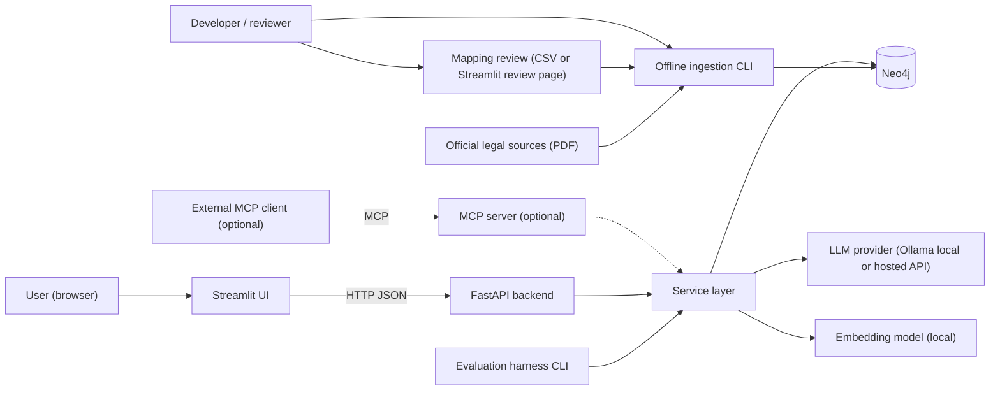
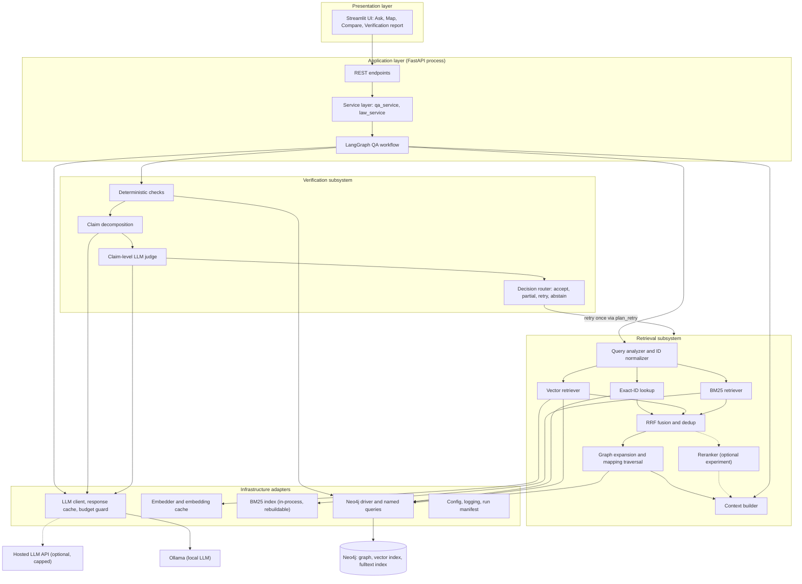
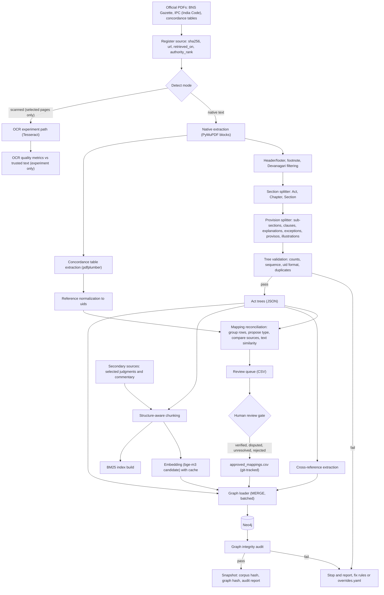
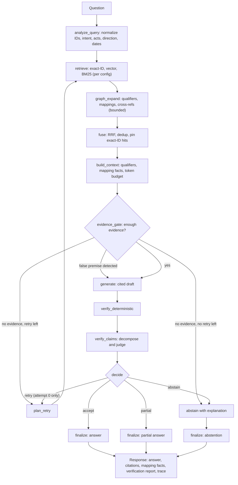
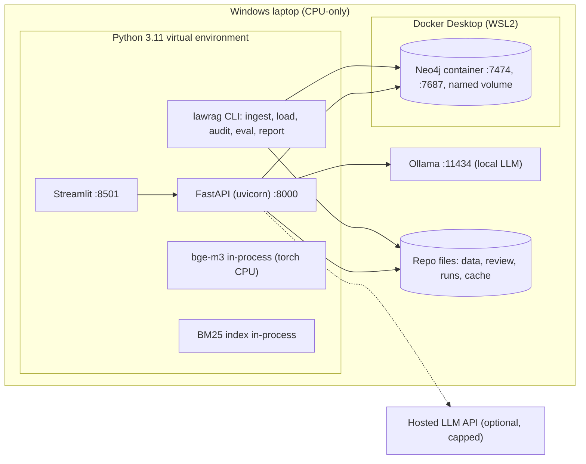
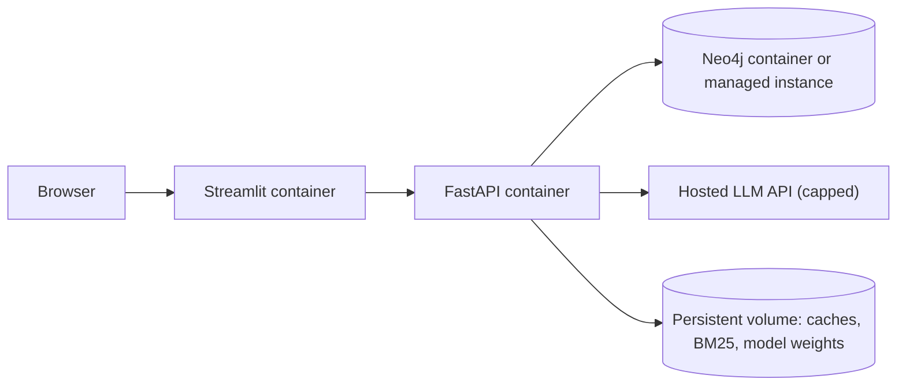
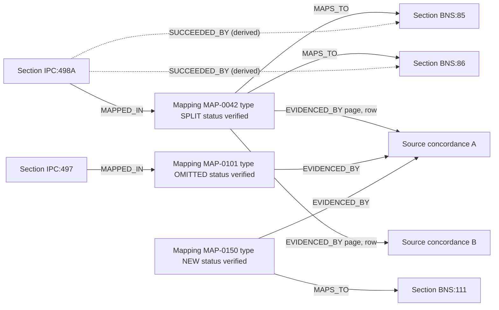
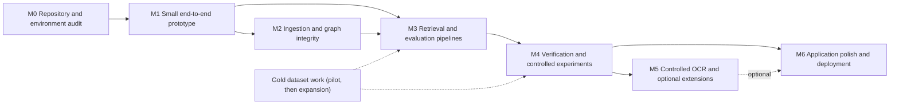

# Software Design Document — IPC ↔ BNS Graph RAG

**Project:** Graph-based Retrieval-Augmented Generation for Indian criminal law (Indian Penal Code, 1860 ↔ Bharatiya Nyaya Sanhita, 2023)
**Document:** `docs/SOFTWARE_DESIGN_DOCUMENT.md`
**Version:** 1.0 (design baseline; no implementation code yet)
**Date:** 2026-10-30
**Status:** For review. This is the implementation blueprint.
**Primary reference:** `docs/DESIGN.md` (Design Document v0.1, 2026-10-29). That file is kept unchanged as the original design record. This SDD supersedes it wherever the two differ; every difference is listed in §0.3.

---

## 0. Front Matter

### 0.1 How to read this document

Every statement belongs to one of the categories below. Labels appear inline where the category isn't obvious.

| Label | Meaning |
|---|---|
| **DECIDED** | A finalized scope decision (§8.1). Don't swap it for an alternative without a recorded change decision. |
| **PROPOSED** | A design choice the author recommends. It can change during implementation if evidence supports the change. |
| **VERIFIED-ENV** | Observed on the development machine on 2026-10-30 (§4.1). |
| **VERIFY** | A fact about Indian law, an official document, or a third-party tool that hasn't been confirmed against a primary source. It must be confirmed before it enters code, gold data, or the report. |
| **ASSUMPTION** | Something taken as true for planning purposes. Listed in §8.3. |
| **EMPIRICAL** | A decision to be settled by measurement. The milestone that decides it is named. |
| **PENDING** | A result that doesn't exist yet. Evaluation numbers are always PENDING until measured. |

Section numbers of IPC/BNS used in examples are **illustrative and VERIFY** unless a later version of this document marks them verified with a source citation.

### 0.2 Executive summary

The system answers questions about the IPC and the BNS: provision lookups, IPC→BNS and BNS→IPC mapping, provision comparisons, and carefully scoped scenarios. Every answer carries evidence-backed citations and a verification report, and the system abstains, with a justification, when the evidence isn't enough.

Key design points:

1. **Graph as source of truth.** Official statutory text is parsed into an `Act → Chapter → Section → Provision` tree in **Neo4j**. Neo4j also holds the chunk embeddings (native vector index) and the provenance (`:Source`) nodes.
2. **Mappings are first-class evidence.** Each IPC↔BNS correspondence is an explicit `:Mapping` node. It records its type (IDENTICAL, MODIFIED, SPLIT, MERGED, PARTIAL, OMITTED, NEW), its review status (proposed, verified, disputed, unresolved, rejected), and `EVIDENCED_BY` links to source rows. A mapping is authoritative only after a human-review gate. A "no direct equivalent" answer requires a *verified hub with evidence*, and is **never** inferred from a missing edge.
3. **Hybrid retrieval.** Exact section-ID lookup, dense vector search (`BAAI/bge-m3` as the initial candidate), BM25 with a legal-aware tokenizer, and bounded graph expansion/mapping traversal are fused with **Reciprocal Rank Fusion (RRF)**. An LLM reranker is an optional, controlled experiment only.
4. **A deterministic LangGraph workflow with layered verification.** Deterministic checks (citations, section existence, numbers, mappings, provenance, temporal applicability) run first, followed by claim-level LLM judging (`SUPPORTED` / `CONTRADICTED` / `NOT_ENOUGH_INFO`). The router can accept, return a partial answer, retry **once**, or abstain. The LLM judge is a consistency check, never a legal authority.
5. **Built for a CPU-only laptop at near-zero API cost.** Local embeddings, a local LLM option through Ollama, response and embedding caches, and a hard budget cap.
6. **Delivery order.** A small end-to-end vertical slice comes first (Milestone 1). Ingestion at full scale, evaluation, experiments, an optional OCR experiment, optional MCP, and optional deployment follow.
7. **Evaluation.** A gold set of about 75–100 human-reviewed questions (pilot of 20–30), with a locked test split and three pre-registered experiments (E1 retrieval, E2 verification, E3 retry/abstention). Analysis uses paired statistics.

### 0.3 Changes from `docs/DESIGN.md` v0.1

`DESIGN.md` remains the detailed technical reference. Its module APIs, schema DDL, edge cases, and VERIFY list are carried into this SDD. The finalized scope decisions change the following points.

| # | Topic | DESIGN.md v0.1 | This SDD (DECIDED) | Reason |
|---|---|---|---|---|
| 1 | Retry budget | `max_retries = 2` | **1** bounded retry (shared across re-retrieval and regeneration) | Scope decision; simpler control flow, lower cost, cleaner E3 |
| 2 | Reranker | Cross-encoder `bge-reranker-v2-m3` in the main pipeline | **RRF only** initially; reranker (LLM-based, with local cross-encoder as a cheaper variant) is an **optional controlled experiment** | Scope decision; CPU and cost limits |
| 3 | UI | CLI + MCP demo; Streamlit optional | **Streamlit UI + FastAPI backend** is the first UI | Scope decision |
| 4 | MCP | Required thin layer, P10 | **Optional**, Milestone 5, only if the core is stable; never a dependency of retrieval experiments | Scope decision |
| 5 | Scanned documents | Full scan arm, experiment E3 (corpus variant) with scan-derived mapping graph | **Small controlled OCR experiment** on selected pages; searchable PDFs first | Scope decision |
| 6 | Experiments | E1 retrieval (R1–R4 with reranker), E2 verification 2×2, E3 corpus variant | **E1** retrieval (vector, BM25, graph-assisted, hybrid RRF), **E2** verification, **E3** retry & abstention; optional reranker and OCR studies | Scope decision |
| 7 | Mapping statuses | `candidate / verified / disputed / rejected` | `proposed / verified / disputed / unresolved / rejected`, plus explicit "no-direct-equivalent" outcomes (verified OMITTED/NEW) | Scope decision: unresolved ≠ omitted |
| 8 | Secondary sources | Case law excluded | **Selected judgments and authoritative commentary allowed as secondary sources**, labelled as such. They never establish a mapping on their own. | Scope decision |
| 9 | LLM provider | Hosted Claude Sonnet/Haiku by default | **Provider abstraction**. Local Ollama is the zero-cost default for development. A hosted low-cost model is used only under a hard budget cap; the final choice is EMPIRICAL (M1/M3). | Near-zero API cost |
| 10 | Build order | Ingestion-first phases P0–P11 over 12 weeks | **Milestones 0–6**, starting with a small end-to-end prototype on hand-verified seed data | Scope decision |
| 11 | Embeddings | bge-m3 frozen after a 3-way side check (incl. API embedder) | bge-m3 as the **initial candidate**, benchmarked against **one lighter local model** under CPU/RAM limits | CPU-only laptop |
| 12 | Schema scope | IPC/BNS only | IPC/BNS only, **with identifiers and labels extensible to BNSS/BSA** | Scope decision |

### 0.4 Document map

| § | Section | Core? |
|---|---|---|
| 1 | Project Overview and Objectives | ★ |
| 2 | High-Level Design (HLD) | ★ |
| 3 | Detailed Design (LLD) | ★ |
| 4 | Software and Hardware Requirements | ★ |
| 5 | Module-Wise Functionalities and Responsibilities | ★ |
| 6 | Proposed Implementation Plan | ★ |
| 7 | Evaluation Plan | ★ |
| 8 | Scope, Assumptions, Limitations | |
| 9 | Risk Register | |
| 10 | Requirements Traceability Matrix | |
| 11 | Glossary | |
| 12 | References | |
| A–D | Appendices: VERIFY checklist, configuration sketch, consistency check record, open decisions | |

---

## 1. Project Overview and Objectives

### 1.1 Problem statement

The Bharatiya Nyaya Sanhita, 2023 (BNS) replaced the Indian Penal Code, 1860 (IPC) as India's principal substantive criminal law (commencement believed to be 1 July 2024, **VERIFY**). Practitioners, students, police, and citizens now work with two numbering systems. Offences committed before commencement remain governed by the IPC under the savings provision (**VERIFY** BNS s.358). Existing case law, FIRs, textbooks, and court records cite IPC section numbers.

The IPC→BNS correspondence is not a renumbering table:

- Some provisions are carried over verbatim (**IDENTICAL**) or with changes in text or punishment (**MODIFIED**).
- One IPC section may be **SPLIT** across several BNS sections, or several IPC sections **MERGED** into one.
- Some IPC provisions have no BNS counterpart (**OMITTED**), and the BNS introduces offences with no IPC predecessor (**NEW**).
- Some correspondences are partial or contested (**PARTIAL**, *disputed*). For example, the relationship between IPC 124A and BNS 152 is described differently by different commentators (**VERIFY** what the official tables say).

General-purpose LLMs answer such questions fluently and often wrongly: they invent section numbers, mix up IPC and BNS numbering, misquote punishments, and assert equivalences that no source supports. In a legal setting these errors are costly. They are also hard for a non-expert to spot.

### 1.2 Motivation

- **Accuracy where fluency is dangerous.** A legal answer needs exact section citations, exact punishment terms, and the qualifiers (exceptions, explanations, provisos) that change the meaning of a rule.
- **Structured legal knowledge.** Statutes are hierarchical and cross-referenced, and the IPC↔BNS correspondence is many-to-many. A graph models this structure directly. Flat vector retrieval doesn't.
- **Auditable answers.** Every claim should be traceable to a provision and a source document. A reviewer should be able to see *why* the system answered or declined.
- **Research value.** The project measures, on the same questions, whether graph-assisted retrieval, layered verification, and a bounded retry improve correctness and safety over simpler baselines.

### 1.3 Intended users

| User | Typical need | Design implication |
|---|---|---|
| Law students and teachers | "What replaced IPC 498A?", "Compare IPC 304A with BNS 106" | Mapping and comparison views; citations to the text |
| Legal-aid volunteers and paralegals | Fast lookup of the current section for an old IPC citation | Exact-ID lookup; clear mapping type and caveats |
| Researchers (this project) | Reproducible experiments | Config flags, run manifests, evaluation harness |
| Developers or integrators (later) | Use the law graph from other tools | FastAPI contracts; optional MCP server |

**Not intended for:** legal advice to a specific person, bail or procedure questions (BNSS, out of scope), or case-outcome prediction. The UI and every answer carry a "not legal advice" notice.

### 1.4 Scope (DECIDED)

**In scope**

- Statutory text of the **IPC** (as in force on the declared cutoff date) and the **BNS** (as in force on the declared cutoff date).
- IPC↔BNS mapping evidence from official concordance material, reconciled and human-reviewed.
- Selected judgments and authoritative commentary as **secondary** sources, labelled as such (for example, a judgment that struck down an IPC provision).
- Functional capabilities: legal Q&A, IPC→BNS and BNS→IPC mapping, provision comparison, evidence-backed citations, verification reports, justified abstention, and partial answers.
- Searchable (native-text) PDFs as the primary ingestion path. A **small controlled OCR experiment** on selected scanned pages.
- A Streamlit UI on a FastAPI backend, and an evaluation harness.

**Out of scope (initial)**

- BNSS (procedure) and BSA (evidence). The schema stays extensible to them (§3.1.6).
- Hindi text. Devanagari blocks are filtered out of the English corpus.
- Full case-law corpus, outcome prediction, and drafting.
- Multi-user accounts and production hosting. Deployment is optional (Milestone 6).

**Optional later extensions:** an LLM reranker experiment, an MCP server, and deployment.

### 1.5 Objectives

| ID | Objective | Measured by |
|---|---|---|
| O1 | Build a provenance-preserving knowledge graph of IPC and BNS provisions and their reviewed mappings | Graph audit passes; section counts match expected lists; every verified mapping has evidence |
| O2 | Provide hybrid retrieval (exact-ID, vector, BM25, graph) with RRF fusion | E1 retrieval metrics vs single-method baselines |
| O3 | Generate cited answers whose claims are checked deterministically and at claim level | E2: citation validity, unsupported-claim rate, hallucination rate |
| O4 | Recover from insufficient evidence with one bounded retry, and otherwise abstain or answer partially with a justification | E3: recovery rate, appropriate abstention, false abstention |
| O5 | Run on a CPU-only laptop at near-zero API cost, reproducibly | Resource measurements; cost logs; run manifests that regenerate every report |
| O6 | Offer a usable interface for Q&A, mapping, comparison, and verification reports | Streamlit demo of all functional flows; API contract tests |

### 1.6 Expected outcomes

1. A Neo4j knowledge graph of IPC and BNS provisions with reviewed mapping nodes, sources, and chunk embeddings, plus an audit report.
2. A FastAPI service and a Streamlit UI that answer questions with citations, mapping provenance, and verification reports.
3. A versioned gold dataset of about 75–100 reviewed questions with a locked test split.
4. Experiment results for E1–E3 (PENDING), with paired statistical analysis, error analysis, and reproducible reports.
5. Documentation: this SDD, data-source records, an annotation guide, a mapping-review guide, and environment setup.
6. Optional: OCR experiment results, an MCP server, and a deployed demo.

---

## 2. High-Level Design (HLD)

### 2.1 Problem framing and functional scope

| Function | Example question (illustrative, VERIFY) | Primary mechanism | Output |
|---|---|---|---|
| F1 Legal Q&A (lookup) | "What is the punishment for murder under the BNS?" | Vector + BM25 + ID lookup → qualifier expansion | Answer citing `BNS:103(1)` with the verbatim punishment |
| F2 IPC→BNS mapping | "What replaced IPC 498A?" | ID lookup → `:Mapping` traversal | Mapping type, targets, evidence, review status |
| F3 BNS→IPC mapping | "Which IPC section did BNS 318 come from?" | ID lookup → reverse `:Mapping` traversal | Same as F2 |
| F4 Provision comparison | "How does BNS 106 differ from IPC 304A?" | Mapping hub → both texts + qualifiers | Side-by-side comparison, differences cited to each text |
| F5 Evidence-backed citations | (all) | Context labelled with `[uid]`; deterministic citation checks | Citations that link to provision text and source page |
| F6 Verification report | (all) | Deterministic checks + claim judge | Per-check results, per-claim verdicts, final decision |
| F7 Justified abstention / partial answer | "Punishment for adultery under BNS 497?" | Section-existence check; OMITTED hub; evidence gate | Premise correction, partial answer, or abstention with reasons |
| F8 Scenario (carefully scoped) | "A pushes B, B dies, no intent to kill — which BNS sections may be relevant?" | Hybrid retrieval over definitions and illustrations | Hedged, conditional, cited analysis with a disclaimer |

### 2.2 System context and boundaries



**System boundary.** Everything inside the project repository: ingestion, graph, retrieval, workflow, verification, API, UI, and evaluation.

**External dependencies:**
- Official source documents, downloaded once and hashed.
- The Neo4j server, in a local Docker container.
- Model weights (Hugging Face Hub download on first use; Ollama registry).
- Optionally, a hosted LLM API.

At query time the system needs **no network access** when the local LLM is used.

**Trust boundaries:**
1. Source PDFs are untrusted input to the parsers. Every parse is validated.
2. LLM output is untrusted: it is verified before display, and it never edits the graph.
3. Mapping decisions cross into the trusted graph only through the human-review gate.
4. User questions are untrusted text. They are never interpolated into Cypher; all queries are parameterized.

### 2.3 System architecture



**Layering rule.** Upper layers depend on interfaces (`Retriever`, `Embedder`, `LLMClient`, `GraphStore`), not on concrete adapters. Tests swap adapters for fakes, and experiments swap them through configuration.

**Retrieval order.** Exact-ID, vector, and BM25 run in parallel to produce first-stage lists. Their top seeds feed graph expansion. All lists, including the graph-expanded list, go into RRF (§3.4.6). The diagram simplifies this ordering.

### 2.4 Offline ingestion vs online question answering

| Aspect | Offline ingestion (batch CLI) | Online QA (per request) |
|---|---|---|
| Trigger | Developer runs `lawrag ingest …`, `lawrag load`, `lawrag audit` | User question via UI/API, or an evaluation runner item |
| Inputs | Official PDFs, concordance tables, review decisions, secondary sources | Question text, optional config overrides |
| Outputs | Act trees, chunks, embeddings, reviewed mappings, Neo4j graph, BM25 index, audit report, corpus hash | Answer or partial answer or abstention, citations, mapping facts, verification report, trace |
| Human involvement | **Required** for mapping review and spot checks | None. Optional user feedback is out of scope. |
| LLM use | None in the authoritative path. An optional, flagged LLM *draft* of `change_summary` is off by default and always human-edited. | Query-analysis fallback, generation, claim decomposition, claim judging |
| Determinism | Fully deterministic given inputs and review files | Deterministic control flow; temperature-0 LLM calls with caching |
| Failure handling | Fail loudly. A bad parse stops the load; the audit blocks promotion. | Degrade gracefully: partial answer or abstention with reasons |

### 2.5 Ingestion pipeline



OCR output feeds only the OCR experiment (§7.7). It never feeds the production graph or the mapping review.

### 2.6 Online question-answering workflow



The "verification disabled" configuration used as an experiment baseline (E2 V0) routes `generate → finalize` directly. It still records deterministic check results for evaluation, but they don't affect the outcome.

### 2.7 End-to-end data flow

| Stage | Data object | Produced by | Consumed by | Persisted at |
|---|---|---|---|---|
| 1 | Source PDF + `SourceRecord` | Developer download + `register_source` | Parser | `data/raw/`, `data/raw/SOURCES.md`, `:Source` |
| 2 | `Block` (page, bbox, text, font) | `pdf_parser` | Splitter, concordance extractor | `data/interim/<source_id>.blocks.jsonl` |
| 3 | `ActTree` (sections, provisions) | `section_splitter` | Chunker, reconciler, xref extractor, loader | `data/processed/<act>.tree.json` |
| 4 | `RawMappingRow` | `concordance_extractor` | Reconciler | `data/interim/concordance_<source>.csv` |
| 5 | `MappingCandidate` → review row | `mapping_reconciler` | Human reviewer | `review/queue.csv` |
| 6 | `ReviewedMapping` | Human + `ingest_review` | Loader | `review/approved_mappings.csv` |
| 7 | `CrossRef` | `xref_extractor` | Loader | `data/processed/<act>.xrefs.jsonl` |
| 8 | `Chunk` (embed_text, display_text) | `chunker` | Embedder, BM25, loader | `data/processed/chunks.jsonl` |
| 9 | Embedding vectors | `embedder` | Loader | `cache/embeddings/`, `:Chunk.embedding` |
| 10 | Graph nodes and edges | `graph_loader` | Retrievers, verifier | Neo4j |
| 11 | BM25 index | `bm25` builder | BM25 retriever | `cache/bm25/<corpus_hash>/` |
| 12 | `QueryAnalysis` | Query analyzer | Retrievers, verifier (temporal) | Trace |
| 13 | `Candidate` lists → fused list | Retrievers, fusion | Context builder | Trace |
| 14 | `ContextBlock`s + `MappingFact`s | Context builder | Generator, verifier | Trace |
| 15 | `Draft` | Generator | Verifier | Trace |
| 16 | `VerificationReport` | Verifier | Decision router, UI | Response + trace |
| 17 | `QAResponse` | Finalize | API → UI; eval runner | `runs/<run_id>/predictions.jsonl` (eval) |

### 2.8 Component responsibilities and interactions

| Component | Responsibility | Talks to | Never does |
|---|---|---|---|
| Streamlit UI | Input forms; render answers, citations, comparison table, verification report, errors | FastAPI only (HTTP) | Talk to Neo4j or LLMs directly; hold business logic |
| FastAPI backend | Validate requests (Pydantic); call the service layer; map errors to HTTP; health checks | Service layer | Contain retrieval or verification logic |
| Service layer | Shared functions (`get_section`, `map_section`, `compare`, `search`, `ask`, `verify`) used by API, CLI, eval, and optional MCP | Workflow, retrievers, graph store | Depend on HTTP or MCP specifics |
| LangGraph workflow | Typed state machine; routes between analysis, retrieval, generation, verification, and the decision | Retrieval, LLM client, verifier | Let the LLM choose control flow; exceed the retry budget |
| Neo4j | Store provisions, mappings, sources, chunks, embeddings; vector and fulltext indexes; graph traversal | Driver (Bolt) | Serve as the evaluation store or the log store |
| Embedding model | Encode chunks (offline) and queries (online) | Embedder interface; cache | Run in a remote service by default |
| Retrieval components | Produce ranked `Candidate`s with provenance (`via`) | Neo4j, BM25 index, embedder | Call the LLM, except the optional analyzer fallback in the analyzer |
| LLM provider | Generation, claim decomposition, claim judging, analyzer fallback | LLM client (cache, budget) | Create mappings; act as legal authority |
| Verification layer | Deterministic checks; claim judging; produce a `VerificationReport` and a decision | Neo4j (existence, mappings), LLM client (judge) | Silently modify answer text without recording what was removed |
| Evaluation harness | Run config matrices over the gold set; compute metrics and statistics; build reports | Service layer (in-process), gold data, `runs/` | Tune on the locked test split |

### 2.9 Why Graph RAG fits this domain

1. **Hierarchy matters for citation.** Answers must cite `BNS:103(1)`, not "a chunk on page 47". Provision-level nodes give exact, stable citation targets.
2. **Qualifiers change meaning.** An exception or proviso can reverse the effect of a rule (for example, the exceptions that reduce murder to culpable homicide, **VERIFY** BNS numbering). Vector search may retrieve the rule without its exception. `QUALIFIES` edges let the context builder **always** attach the qualifiers of any retrieved rule.
3. **Cross-references are explicit.** Provisions say "punishable under section N" or "as defined in section M". `REFERS_TO` edges make these hops deterministic instead of relying on chance embedding similarity.
4. **Mappings are many-to-many and need provenance.** SPLIT, MERGED, and PARTIAL correspondences can't be represented faithfully as text chunks or as single edges. A `:Mapping` node carries type, evidence, and review status, so a mapping answer is a **lookup of a reviewed fact**, not a generation.
5. **Absence must be a positive fact.** "No BNS equivalent" is legally significant. The graph records it as a verified OMITTED hub with evidence. A missing edge means only "unknown".
6. **Verification needs a ground truth.** Deterministic checks (does the section exist? does this mapping exist with status verified?) are simple graph queries.

**Where a graph doesn't help, and the design accepts this:** descriptive questions without IDs ("which section deals with stalking?") rely mostly on vector and BM25 retrieval. The graph mainly adds qualifiers and mappings afterwards. Experiment E1 measures the actual contribution instead of assuming it.

### 2.10 Technology choices, alternatives, and trade-offs

| Concern | Choice | Alternatives considered | Trade-off accepted |
|---|---|---|---|
| Graph + vector store | **Neo4j** (Community, Docker) with native vector + fulltext indexes (DECIDED) | Neo4j + Qdrant/Chroma; Neo4j + Elasticsearch | One store, one source of truth, simpler provenance. ANN features beyond this corpus size (<20k vectors) are not needed. JVM memory use on a 16 GB laptop. |
| Keyword retrieval | **BM25 in-process** (`bm25s` PROPOSED) with a legal tokenizer; Neo4j fulltext only for title lookup | Neo4j Lucene fulltext as the BM25 arm; Elasticsearch | Control over tokenizing `304A`, `376(2)(a)`, `120-B`; deterministic scores. Index must be rebuilt when the corpus changes (cheap). |
| Embeddings | **`BAAI/bge-m3`** local (initial candidate), benchmarked against a lighter local model (EMPIRICAL, M3) | API embedders; InLegalBERT (not a sentence embedder) | Free and offline. CPU encoding is slow but a one-time cost. |
| Fusion | **RRF** (k=60 PROPOSED) (DECIDED) | Weighted score sum; learned fusion; reranker | Parameter-light, robust to incomparable score scales. No learned gains. |
| Reranking | **None initially**; LLM reranker as an optional experiment (DECIDED) | Cross-encoder in the main path | Lower latency and cost; reranking gains unmeasured until the optional experiment |
| Orchestration | **LangGraph** state machine (DECIDED) | Plain Python pipeline; ReAct agent | Explicit, testable routing. A free-form agent would break reproducibility. |
| LLM | **Provider abstraction**; local Ollama default; hosted model under a budget cap (EMPIRICAL) | Hosted-only | Near-zero cost. Small local models may be weaker at faithful generation, which is measured in M1/M3. |
| Backend | **FastAPI** (DECIDED) | Flask; direct Streamlit calls | Typed contracts and OpenAPI docs; a clean seam for UI, eval, and MCP |
| UI | **Streamlit** (DECIDED) | React SPA; Gradio | Fastest path to a usable demo in Python; limited UI customization |
| PDF parsing | **PyMuPDF** (text), **pdfplumber** (tables) PROPOSED; Docling as fallback | Camelot (needs Ghostscript); PaddleOCR | pip-installable on Windows. Rule-based parsing needs careful validation. |
| OCR | **Tesseract** via `pytesseract` (experiment only) PROPOSED | Docling OCR; cloud OCR | Free and local; needs a separate Windows installer |
| Config | **Pydantic**-validated YAML + env vars | Hydra | Simple; hashes stably |
| Tests | **pytest** | unittest | Fixtures, parametrization |

### 2.11 Major design assumptions (summary; full list in §8.3)

- Official, searchable PDFs of the BNS and IPC (and at least one official concordance) can be obtained and lawfully used for this academic project (**VERIFY** terms).
- The corpus is small: about 900 sections in total, estimated at 3k–10k chunks. All indexes fit comfortably in memory.
- A reviewer with legal knowledge (law student or practitioner) is available for mapping review and gold-set review. If not, the limitation is reported.
- A temperature-0 local or low-cost hosted LLM can produce structured, cited drafts of acceptable quality. This is checked in M1.

### 2.12 Local development architecture



**Process model.** One FastAPI process holds the embedder, BM25 index, and Neo4j driver as singletons, loaded at startup. Streamlit is a thin client. The CLI and evaluation runner call the service layer **in-process**, not over HTTP, to avoid HTTP overhead and flakiness in experiments.

### 2.13 Optional deployment architecture (Milestone 6, only if practical and affordable)



- **Read-only demo.** The graph is loaded offline and shipped as a Neo4j dump. No ingestion runs in deployment.
- A local LLM is usually not feasible on free or cheap hosting (RAM). Deployment therefore implies a hosted LLM with a strict budget, rate limiting, and a visible notice. Alternatively, keep a **local-only demo** if hosting isn't affordable. This is an acceptable outcome.
- Secrets come only from the platform's secret store; none are in the repository.

---

## 3. Detailed Design (LLD)

Conventions used throughout:
- Python 3.11. All data crossing a module boundary is a Pydantic model.
- Every Cypher query is named and parameterized (`graph/queries.cypher`).
- Every module receives configuration as a typed object, not by reading environment variables directly.
- Function signatures below are **PROPOSED** interfaces, not implemented code.

### 3.1 Knowledge graph and database (Neo4j)

#### 3.1.1 Identifier scheme

| Entity | Identifier format | Examples (illustrative) | Rule |
|---|---|---|---|
| Act | `code` | `IPC`, `BNS` (later `BNSS`, `BSA`) | Upper-case short code; unique |
| Chapter | `{act}:CH-{roman}` | `BNS:CH-VI` | Roman numeral as printed |
| Section | `{act}:{number}` | `IPC:302`, `IPC:498A`, `IPC:120B` | `number` is a string (digits + optional upper-case suffix). Hyphens normalized (`120-B` → `120B`). |
| Provision | `{section_uid}{path}` | `BNS:103(1)`, `BNS:2(1)(a)`, `IPC:300:Exc1`, `IPC:300:Expl2`, `IPC:300:Ill(a)`, `IPC:376:Prov1`, `IPC:302:body` | Parenthesized path for sub-sections and clauses; `:Exc{n}`, `:Expl{n}`, `:Ill({x})`, `:Prov{n}` for qualifiers; `:body` for a section with no subdivisions |
| Chunk | `{provision_uid}#{variant}#c{n}` | `BNS:103(1)#text#c0`, `IPC:375#text#c2` | `n` = 0-based part index for long provisions; `variant` = `text`, `scan`, or `sec` |
| Mapping | `MAP-{4+ digits}` | `MAP-0042` | Assigned once in `review/approved_mappings.csv`; never reused |
| Source | `SRC-{slug}` | `SRC-BNS-GAZETTE-2023`, `SRC-CONCORDANCE-A` | Assigned at registration; carries the file sha256 |

Provision uids follow the canonical regex (PROPOSED, refined in M2 once the BNS numbering style is verified):

```
^(IPC|BNS|BNSS|BSA):[0-9]+[A-Z]*(\([0-9]+[A-Z]*\))?(\([a-z]+\))*(\([ivxlc]+\))?(:(Exc|Expl|Prov)[0-9]*|:Ill\([a-z0-9]+\)|:body)?$
```

The same normalizer (`lawrag.legal.uid`) is used by the parser, the query analyzer, the verifier, and the gold-data validator. A single shared implementation keeps uids consistent across those modules.

#### 3.1.2 Node labels and properties

| Label | Key (unique) | Required properties | Optional properties | Notes |
|---|---|---|---|---|
| `:Act` | `code` | `name`, `year`, `text_as_of` (date) | `act_number`, `commenced_on`, `repealed_on`, `jurisdiction_note` | `text_as_of` is the declared cutoff |
| `:Chapter` | `uid` | `act`, `number`, `title`, `order` | | |
| `:Section` | `uid` | `act`, `number`, `sort_key`, `title`, `status`, `source_id`, `page_start`, `page_end` | `text` (full), `amendment_notes` (list), `status_note`, `status_source_id` | `status ∈ {in_force, repealed, struck_down, omitted_by_amendment, not_yet_in_force}` (VERIFY each use) |
| `:Provision` | `uid` | `section_uid`, `kind`, `label`, `text`, `order`, `in_force` (bool) | `status_note` | `kind ∈ {body, subsection, clause, subclause, explanation, exception, proviso, illustration}` |
| `:Chunk` (+ variant label `:TextChunk`, `:ScanChunk`, or `:SecondaryChunk`) | `chunk_id` | `provision_uid` or `source_id`, `embed_text`, `display_text`, `kind`, `tokens`, `corpus_variant`, `embedding_model`, `text_sha256` | `embedding` (float[]), `part`, `n_parts`, `para_range`, `ocr_confidence` | Embeddings are stored on the chunk; one vector index per (variant label, model) |
| `:Mapping` | `mapping_id` | `type`, `status`, `granularity`, `sources_agree` (bool), `created_from` | `change_summary`, `text_similarity`, `reviewed_by`, `reviewed_on`, `review_note`, `dispute_note` | See §3.1.4. `reviewed_by`/`reviewed_on` are mandatory when `status ∈ {verified, disputed, unresolved, rejected}`. |
| `:Source` | `source_id` | `title`, `kind`, `authority_rank`, `sha256`, `retrieved_on` | `publisher`, `url`, `local_path`, `citation`, `license_note` | `kind ∈ {gazette, india_code, concordance_official, judgment, commentary, other}`; `authority_rank`: 1 = Gazette/official text … 4 = commentary |

`:SectionSummary` chunks (from `DESIGN.md` §1.3) are kept as `:Chunk {kind:'section_summary', corpus_variant:'sec'}`. They help recall for "which section deals with X" questions but are **never cited by themselves**. The context builder replaces them with the underlying provisions.

#### 3.1.3 Relationships

| Type | From → To | Properties | Cardinality / rule |
|---|---|---|---|
| `HAS_CHAPTER` | Act → Chapter | `order` | 1:N |
| `HAS_SECTION` | Chapter → Section | `order` | 1:N; every Section has exactly one parent Chapter |
| `HAS_PROVISION` | Section → Provision; Provision → Provision | `order` | Tree; every Provision reachable from exactly one Section |
| `QUALIFIES` | Provision (explanation, exception, proviso, illustration) → Provision or Section | `kind` | Every qualifier has ≥1 target |
| `HAS_CHUNK` | Provision → Chunk | | ≥1 chunk per non-empty provision |
| `REFERS_TO` | Provision → Section or Provision | `raw_text`, `resolved_by ∈ {regex, manual}` | Unresolved references are logged, not stored |
| `MAPPED_IN` | Section/Provision (source act, e.g. IPC) → Mapping | `role ∈ {primary, partial}` | |
| `MAPS_TO` | Mapping → Section/Provision (target act, e.g. BNS) | `role ∈ {primary, partial}` | |
| `EVIDENCED_BY` | Mapping → Source | `page`, `row`, `raw_row` (verbatim), `extractor` | ≥1 required for status `verified` |
| `EXTRACTED_FROM` | Section → Source; Chunk → Source | `page_start`, `page_end` | Every Section has exactly one |
| `DISCUSSES` | Chunk (secondary) → Section/Provision | `basis ∈ {citation_regex, manual}` | Links judgments/commentary to provisions |
| `SUCCEEDED_BY` (**derived**) | IPC node → BNS node | `mapping_id`, `type` | Derived **only** from `status = verified` hubs; regenerated by the loader |
| `STATUS_EVIDENCED_BY` | Section → Source | `note` | Evidence for `struck_down` / `repealed` status |

#### 3.1.4 The explicit `:Mapping` model



(Section numbers illustrative, **VERIFY**.)

**Mapping types (`type`)**

| Type | Meaning | Required shape |
|---|---|---|
| `IDENTICAL` | Same text, renumbered | 1 `MAPPED_IN`, 1 `MAPS_TO` |
| `MODIFIED` | Same offence; text, scope, or punishment changed | 1 in, 1 out |
| `SPLIT` | One source provision → several targets | 1 in, ≥2 out |
| `MERGED` | Several sources → one target | ≥2 in, 1 out |
| `PARTIAL` | Correspondence covers only part of either side | ≥1 in, ≥1 out; `role = partial` on the affected edges |
| `OMITTED` | Source provision has no counterpart (**no-direct-equivalent**, IPC side) | ≥1 in, 0 out |
| `NEW` | Target provision has no predecessor (**no-direct-equivalent**, BNS side) | 0 in, ≥1 out |
| `UNDETERMINED` | Used only with `status = unresolved` | any |

**Review status (`status`) and how each one is used**

| Status | Meaning | Loaded into Neo4j? | Used by retrieval/answers | Derives `SUCCEEDED_BY`? | How the answer phrases it |
|---|---|---|---|---|---|
| `proposed` | Machine-extracted/reconciled; not yet human-reviewed | Yes, for the review UI and audits. Development graph only. | **No** as authority. May be shown only in the review UI. | No | Not used in answers |
| `verified` | Human reviewer confirmed against ≥1 cited source row | Yes | **Yes**, as an authoritative fact | Yes | "According to [source, page], IPC X corresponds to BNS Y (type …)." |
| `disputed` | Sources conflict, or the reviewer judged the evidence contradictory | Yes | Yes, **as a caveat only** | No | "Sources differ: [source A] says …; [source B] says …. This system doesn't resolve the conflict." |
| `unresolved` | Reviewed; evidence insufficient to decide | Yes | Yes, **as a caveat only** | No | "No verified mapping is recorded for IPC X; the correspondence is unresolved in this system." |
| `rejected` | Reviewed and found wrong (kept for audit) | Yes, with `rejected` status | No | No | Never surfaced except in audit reports |

**Distinguishing the outcomes** (this rule is enforced by the verifier's D4 check):

| Situation in the graph | Permitted answer |
|---|---|
| Verified hub with targets | State the mapping with its type and source |
| Verified `OMITTED` hub with evidence explicitly stating deletion/no counterpart | "No direct BNS equivalent, per [source]" (**evidence-supported no-direct-equivalent**) |
| Verified `NEW` hub | "New in BNS; no IPC predecessor, per [source]" |
| Disputed hub | Describe the disagreement; no single answer |
| Unresolved hub, **or no hub at all** | "Not established in this system's verified data". **Never** "no equivalent". |
| Only `proposed` hubs | Same as unresolved. Proposed rows are not authority. |

**Derived relationships.** `SUCCEEDED_BY` is a convenience edge for fast traversal, recomputed from verified hubs after every mapping load: `MATCH (a)-[:MAPPED_IN]->(m:Mapping {status:'verified'})-[:MAPS_TO]->(b) MERGE (a)-[:SUCCEEDED_BY {mapping_id:m.mapping_id, type:m.type}]->(b)`. The audit recomputes the derivation and diffs it against the stored edges.

**Granularity.** `granularity ∈ {section, provision}`. Map at provision level only where the source does. Precision the source doesn't give is never invented.

#### 3.1.5 Constraints, indexes, and integrity rules

DDL (PROPOSED; carried from `DESIGN.md` §2.3, extended):

```cypher
CREATE CONSTRAINT act_code    IF NOT EXISTS FOR (a:Act)       REQUIRE a.code IS UNIQUE;
CREATE CONSTRAINT chapter_uid IF NOT EXISTS FOR (c:Chapter)   REQUIRE c.uid IS UNIQUE;
CREATE CONSTRAINT section_uid IF NOT EXISTS FOR (s:Section)   REQUIRE s.uid IS UNIQUE;
CREATE CONSTRAINT prov_uid    IF NOT EXISTS FOR (p:Provision) REQUIRE p.uid IS UNIQUE;
CREATE CONSTRAINT chunk_id    IF NOT EXISTS FOR (c:Chunk)     REQUIRE c.chunk_id IS UNIQUE;
CREATE CONSTRAINT mapping_id  IF NOT EXISTS FOR (m:Mapping)   REQUIRE m.mapping_id IS UNIQUE;
CREATE CONSTRAINT source_id   IF NOT EXISTS FOR (s:Source)    REQUIRE s.source_id IS UNIQUE;

CREATE INDEX section_act_num IF NOT EXISTS FOR (s:Section)   ON (s.act, s.number);
CREATE INDEX prov_section    IF NOT EXISTS FOR (p:Provision) ON (p.section_uid);
CREATE INDEX mapping_status  IF NOT EXISTS FOR (m:Mapping)   ON (m.status, m.type);

CREATE FULLTEXT INDEX section_title_ft IF NOT EXISTS FOR (s:Section) ON EACH [s.title];

// One vector index per (chunk variant label, embedding model). Dimension depends on the model (bge-m3: 1024).
CREATE VECTOR INDEX text_chunk_vec_bgem3 IF NOT EXISTS FOR (c:TextChunk) ON c.embedding
  OPTIONS {indexConfig: {`vector.dimensions`: 1024, `vector.similarity_function`: 'cosine'}};
```

**VERIFY:** the installed Neo4j version supports `CREATE VECTOR INDEX`. `DESIGN.md` notes GA from 5.13; confirm against the release notes for the version chosen in M0. If the embedding benchmark (§3.3.4) selects a model with a different dimension, a new index is created with a model-specific name. Indexes are not altered in place.

Property-existence constraints require Enterprise Edition, so the **loader validates** and the **audit enforces**:

| Rule ID | Integrity rule |
|---|---|
| G1 | Section counts per Act equal the expected list (IPC: 1–511 plus lettered sections; BNS: 1–358, **VERIFY** both) |
| G2 | Every `:Section` has exactly one `HAS_SECTION` parent and one `EXTRACTED_FROM` source |
| G3 | Every `:Provision` is reachable from exactly one Section; uids match the canonical regex; no duplicates |
| G4 | Every non-empty Provision has ≥1 `:Chunk`; no chunk crosses a section boundary |
| G5 | Every `verified` Mapping has ≥1 `EVIDENCED_BY`, non-null `reviewed_by` and `reviewed_on` |
| G6 | Mapping shape matches type (§3.1.4 table) |
| G7 | `SUCCEEDED_BY` edges equal the derivation from verified hubs (no extra, no missing) |
| G8 | No `SUCCEEDED_BY` edge points to a non-existent or `rejected` node |
| G9 | Coverage report: every IPC and BNS Section has ≥1 hub of any status. Missing hubs are listed as **unreviewed**, not errors, until M2 exit (target in §6). |
| G10 | Every `struck_down`/`repealed` Section has a `STATUS_EVIDENCED_BY` source |
| G11 | Every Chunk with an `embedding` has `embedding_model` equal to the active model and the correct dimension |
| G12 | Every `:Source` has a sha256 that matches the file in `data/raw/` |

#### 3.1.6 Extensibility to BNSS/BSA

- Act codes are data, not enums baked into the logic. Adding `BNSS` means adding an `:Act` node, a parser rule set, and the expected section list.
- Mapping types and the hub model are act-agnostic: `MAPPED_IN` from the predecessor act and `MAPS_TO` to the successor act. CrPC→BNSS and Evidence Act→BSA would use the same shape.
- The uid regex and query normalizer take the list of act codes and aliases from configuration.
- **Not built initially:** parsers, gold data, or evaluation for BNSS/BSA.

### 3.2 Document ingestion and processing

#### 3.2.1 Source acquisition and registration

1. Download official documents manually: the BNS (Gazette of India / India Code), the IPC as in force on the cutoff date (India Code), and official concordance material (**VERIFY** which publishers' tables count as official; see Appendix A).
2. `lawrag sources register <pdf> --kind ... --authority-rank ... --url ...` computes the sha256 and records `SourceRecord` in `data/raw/SOURCES.md` and `data/raw/sources.json`.
3. Raw files are **never edited**. Corrections go to `review/overrides.yaml` with provenance (who, why, which page).

#### 3.2.2 Native PDF extraction

- `pdf_parser.parse_native(pdf) -> list[Block]` uses PyMuPDF text blocks with page, bbox, font size, and bold flags.
- Pre-processing:
  - Strip repeating headers and footers (lines repeated on ≥60% of pages at similar y-positions).
  - De-hyphenate line breaks.
  - Normalize Unicode (NFKC, quotes, dashes).
  - Drop Devanagari blocks (Unicode range U+0900–U+097F) into a side file.
  - Separate footnotes (smaller font, page bottom) into `amendment_notes` candidates.
- `detect_mode(pdf)` classifies each page as native, scanned, or mixed (text-layer character count per page). Scanned pages are logged and **skipped** in the main path.

#### 3.2.3 Structure-aware section and provision parsing

- **Section headers.** Regex rules per act (for example `^(\d+[A-Z]*)\.\s+(.+?)\.?[—–-]` for "302. Punishment for murder.—", **VERIFY** the BNS and IPC print styles), plus layout cues (bold, marginal notes in older IPC prints).
- **Provision splitting** within a section text, by ordered patterns:
  - `^\((\d+[A-Z]*)\)` → subsection
  - `^\(([a-z]+)\)` → clause
  - `^\(([ivx]+)\)` → subclause
  - `^Explanation(\s*\d+)?\.?[—–-]` → explanation
  - `^Exception(\s*\d+)?\.?[—–-]` → exception
  - `^Illustrations?` → illustration block, then `^\(([a-z])\)` items
  - `^Provided (further )?that` → proviso
- **Hierarchy reconstruction.** A stack-based parser assigns parents. A clause belongs to the most recent subsection. A qualifier attaches to the most recent rule-level node at the same or higher level, unless its wording names a target ("Explanation to sub-section (2)"), which overrides. Each qualifier gets a `QUALIFIES` edge.
- **Chapters.** `^CHAPTER\s+([IVXLC]+)` followed by a title line.
- **Status stubs.** `[Omitted]`, `Rep. by`, and struck-down notes produce a `:Section` with an empty body and `status` set. The status becomes final only with a `STATUS_EVIDENCED_BY` source; a judgment counts as a secondary source.
- **Overrides.** `review/overrides.yaml` can replace a parsed section's text or structure. Each override carries the source page and the reason. Overrides apply after parsing and are reported in the audit.

#### 3.2.4 Concordance-table extraction

- `pdfplumber` table extraction with per-page column-header detection. Docling is the documented fallback if ruled tables defeat pdfplumber.
- Each row is kept **verbatim** (`raw_cells`) with `source_id`, `page`, and `row_idx`.
- Reference normalization (`normalise_refs`):
  - "Sec. 376(2)(a) & (b)" → 2 uids
  - "299 to 304" → expanded range, flagged `range_expanded = true` for the reviewer
  - "New" / "Deleted" / "Omitted" / "—" → markers
  - Unparseable cells → `parse_error` (kept for review, never dropped)
- **Column sanity.** The IPC column must contain only IPC-valid numbers and the BNS column only BNS-valid numbers. A page that fails is flagged as a possible column swap.

#### 3.2.5 Source normalization and mapping reconciliation

1. Group rows from all sources into connected components over (IPC uid, BNS uid) pairs. A component's shape suggests SPLIT, MERGED, or a 1:1 mapping.
2. `propose_type` is deterministic:
   - Cardinality first.
   - Then source remark keywords ("New", "Deleted", "Modified", "Partly").
   - Then text similarity (difflib ratio on normalized text; ≥0.97 suggests IDENTICAL, PROPOSED threshold).
   - The basis is recorded in `type_basis`.
3. `sources_agree` is true only if every source that mentions either side gives the same pairs.
4. Output: `MappingCandidate` rows with `status = proposed` in `review/queue.csv`, showing both texts, the diff, and the verbatim source rows.

#### 3.2.6 Human review gate

- The reviewer sets `status ∈ {verified, disputed, unresolved, rejected}`, confirms or edits `type`, and fills in `reviewed_by`, `reviewed_on`, `review_note`, and `change_summary` (human-written or quoted from the source).
- **Bulk approval.** Rows where sources agree and similarity is high may be approved in one reviewer action. Each row is still stamped with the reviewer's identity.
- **LLM policy.**
  - An LLM may **never** propose pairs, types, or statuses.
  - An optional flag (`review.llm_change_summary_draft`, default **off**) may draft a `change_summary` for the reviewer to edit. The draft is marked as such until a human edits it.
- `ingest_review` rejects rows that are missing reviewer, date, or status, that have an unknown uid, or that have a `verified` status without source evidence.
- The review UI is either the CSV itself or an optional Streamlit page with side-by-side diff (cut list item if time is short).
- A guideline document (`docs/REVIEW_GUIDE.md`, M2) defines when to choose disputed vs unresolved, and how to treat PARTIAL.

#### 3.2.7 Cross-reference extraction

- `xref_extractor.extract_refs(provision, act)` handles:
  - "section 34"
  - "sections 299 to 304"
  - "sub-section (2)" (resolved within the same section)
  - "the preceding section"
  - "this Sanhita" / "this Code" (act-level, not stored as an edge)
  - "under section N of the X Act" (external; logged, not stored)
- Resolution must hit an existing node. Otherwise the reference is logged in `xrefs_unresolved.jsonl`.

#### 3.2.8 Graph loading and audit

- Loading is idempotent (`MERGE` on keys), batched with `UNWIND` (500 rows, PROPOSED), and runs in this order:
  1. Sources
  2. Acts, chapters, sections, provisions
  3. Qualifier edges
  4. Chunks and embeddings
  5. Cross-references
  6. Mappings and evidence
  7. Derive `SUCCEEDED_BY`
  8. Audit
- `snapshot_hash()` is the sha256 of a canonical, sorted export of node keys, key properties, and edges. Two consecutive reloads must give the same hash.
- Audit output: `reports/audit/<timestamp>.json` and `.md`, covering rules G1–G12, coverage by mapping type and status, override list, and unresolved cross-references. A failing G-rule blocks the evaluation runner unless `--allow-dirty-graph` is passed, and that flag is recorded in the manifest.

#### 3.2.9 Ingestion validation checks

| Risk | Check | Where | Action on failure |
|---|---|---|---|
| Missed sections | Expected-number list vs parsed list (G1); monotonic sequence check | `validate_tree` | Stop; report missing numbers |
| Merged sections (missed header) | Section text containing a header-like pattern mid-body; abnormal length (>p99) | `validate_tree` | Flag for manual inspection |
| Malformed identifiers | Canonical uid regex; round-trip `parse(format(uid)) == uid` | `uid` module, `validate_tree` | Stop |
| Extraction errors | 30-section hand-verified spot check (field-level); golden page snapshots | Tests (M2) | Fix rules or add an override |
| Duplicate records | Unique constraints; duplicate uid scan before load; duplicate concordance rows grouped | Loader, reconciler | Stop / merge duplicates with both provenances |
| Provenance loss | Every Section, Chunk, and Mapping evidence edge carries `source_id` and page; G2, G5, G12 | Loader, audit | Stop |
| Column swaps in tables | Act-validity check per column per page | Concordance extractor | Flag page for review |
| Silent override drift | Overrides listed in the audit, with hashes | Audit | Report |

#### 3.2.10 Controlled OCR experiment path (optional, Milestone 5)

- **Selection.** A small set of pages (PROPOSED: 10–20 pages) covering ordinary section text and at least one concordance table page.
- **Two inputs:**
  1. *Controlled*: rasterize the selected native pages (e.g., 200–300 dpi) with mild, seeded noise, skew, and JPEG compression. Trusted text is the native extraction, so gold transfers exactly.
  2. *Natural*: any genuinely scanned official pages available, compared against manually transcribed text.
- **Pipeline.** OpenCV preprocessing (deskew, binarize) → Tesseract → the same splitter and concordance extractor → metrics.
- **Isolation.** OCR output is written to `data/ocr_experiment/`. It is **never** loaded into the production graph or used for mapping review. If loaded at all, it goes in as `:ScanChunk` with a separate vector index, for a retrieval sub-study only.

### 3.3 Chunking and embeddings

#### 3.3.1 Chunking rules (structure-aware, provision-level; DECIDED)

| Rule | Detail |
|---|---|
| Unit | One `:Provision` → one chunk (body, subsection, clause, explanation, exception, proviso, or illustration) |
| Size cap | About 400 tokens (PROPOSED; counted with the embedding model's tokenizer) |
| Long provisions | Split at sentence boundaries (never inside a parenthesized clause marker) into parts `#c0..#cN`. Each part keeps the **same** `provision_uid` plus `part`/`n_parts`, so citations stay exact. |
| Contextual header | `embed_text` = `"[{ACT} s.{num} — {title}] {kind label} — {text}"`, e.g. `"[BNS s.103 — Punishment for murder] (1) — …"`. `display_text` = raw provision text. |
| Qualifiers | Separate chunks with `kind` set; a `QUALIFIES` edge to the target. The context builder always pulls the qualifiers of a retrieved rule (§3.4.7). |
| Illustrations | Separate chunks, `kind = illustration`. The flag `chunking.include_illustrations` (default true) supports ablation. |
| Amendment footnotes | Removed from `embed_text`; kept in `Section.amendment_notes` for display |
| Section summary | One extra `section_summary` chunk per section (title + first ~150 tokens) for recall; never cited |
| Boundaries | No chunk spans two provisions or two sections (asserted, G4) |

#### 3.3.2 Secondary sources (judgments, commentary)

- Chunked by paragraph groups of about 300–400 tokens. `chunk_id = {source_id}#sec#c{n}`, with `para_range` recorded.
- Parent reference: an `EXTRACTED_FROM` edge to the `:Source`, plus `DISCUSSES` edges to provisions it cites (regex over "section N of the IPC/BNS", with manual confirmation for the small selected set).
- Label `:SecondaryChunk`. These chunks are retrievable only when `retrieval.include_secondary = true`, and they are rendered with a **"secondary source"** badge.
- They can never be the sole support for a mapping claim (enforced by D5).

#### 3.3.3 Embedding model

- **Initial candidate:** `BAAI/bge-m3` (dense output, 1024-d; multilingual; long context). Run locally on CPU through `sentence-transformers` or `FlagEmbedding` (choice made in M0 by install test).
- **Query side:** the same model, no instruction prefix unless the model card recommends one (**VERIFY** for bge-m3).
- **Normalization:** L2-normalized vectors; cosine similarity in the Neo4j vector index.
- **Embedding cache:** key `(model_id, model_revision, sha256(embed_text))` → vector. Stored in `cache/embeddings/<model_id>.sqlite` (or `.npy` shards). Re-embedding after a parser fix only computes changed chunks.

#### 3.3.4 Embedding benchmark (EMPIRICAL, Milestone 3)

| Item | Plan |
|---|---|
| Candidates | `BAAI/bge-m3` vs **one lighter local model**, e.g. `BAAI/bge-small-en-v1.5` or `BAAI/bge-base-en-v1.5` (PROPOSED; pick one in M3 based on install and licence checks) |
| Data | Dev split of the pilot gold set (retrieval labels only), on the vector-only configuration |
| Measures | Recall@8, MRR (quality); corpus encoding time, query latency p50/p95, peak RSS memory, model disk size (resources) |
| Decision rule (pre-registered) | Keep bge-m3 **unless** (a) it exceeds the resource budget (PROPOSED: peak RAM > 6 GB during encoding, or full-corpus encoding > 2 h on the dev laptop), or (b) the lighter model is within a tolerance of bge-m3 on dev Recall@8 (PROPOSED: ≤ 0.03 absolute) *and* is ≥ 3× faster at query time. Because the dev set is small, the decision is recorded as a pragmatic engineering choice, not a statistical claim. |
| After the decision | Freeze `embedding.model` and revision in `configs/base.yaml`. The other model is not used in E1–E3. |

### 3.4 Retrieval and ranking

#### 3.4.1 Query normalization and analysis

`query_analyzer.analyze(question, cfg) -> QueryAnalysis`, rules first:

1. **Text normalization:** Unicode NFKC, whitespace, quote and dash normalization.
2. **Act aliases:** "Indian Penal Code", "IPC", "I.P.C.", "Penal Code" → `IPC`. "Bharatiya Nyaya Sanhita", "BNS", "Nyaya Sanhita", "new criminal law" → `BNS`. The alias table lives in config.
3. **Section-ID extraction:**
   - Recognized forms: "s. 302", "sec 302", "u/s 302", "section 302 IPC", "302 IPC", "IPC 302", "498 A" → `498A`, "120-B" → `120B`, "376(2)(a)"
   - "302 r/w 34" → two IDs
   - Bare number with no act: if the number exists in **both** acts, return both and set `ambiguous_act = true`. If it exists in one act only, return that one with `act_inferred = true`. If it exists in neither, set `nonexistent_ids` (false-premise signal).
   - Existence is checked against an in-memory set of section numbers loaded at startup from Neo4j.
4. **Intent rules:** mapping cues ("replaced", "equivalent", "corresponds", "new section for", "old section") → `mapping`. Comparison cues ("difference", "compare", "changed") → `comparison`. Fact-pattern cues (narrative with persons/acts) → `scenario`. Otherwise `lookup`.
5. **Direction:** IPC ID + mapping cue → `ipc_to_bns`; BNS ID → `bns_to_ipc`.
6. **Temporal cues:** explicit dates or years ("in 2023", "before July 2024") → `offence_date` (ISO), used by the temporal check.
7. **LLM fallback** (`analyzer.llm_fallback`, default on): only if the intent is still unknown. Returns a JSON-schema-validated intent and rewritten query. It never adds section IDs; IDs come only from rules.

Output:

```python
class QueryAnalysis(BaseModel):
    intent: Literal["lookup", "mapping", "comparison", "scenario", "unknown"]
    section_ids: list[str]          # canonical uids found and existing
    nonexistent_ids: list[str]      # well-formed but absent in the graph (false-premise signal)
    ambiguous_act: bool
    acts: list[str]
    direction: Literal["ipc_to_bns", "bns_to_ipc"] | None
    offence_date: date | None
    rewritten_query: str            # normalized; expanded aliases
    analyzer: Literal["rules", "rules+llm"]
```

#### 3.4.2 Exact section-ID lookup

- For each `section_ids` uid, fetch the section, its provisions, and its qualifiers (named query `get_section_with_provisions`).
- If the intent is mapping or comparison, also fetch hubs (`get_mappings(uid, direction)`) with their status, type, targets, and evidence.
- Output candidates have `via = ["id_lookup"]` and are **pinned**: always included in the context, at rank 0.

#### 3.4.3 Vector retrieval

- Embed `rewritten_query` (cached). Query `db.index.vector.queryNodes('<index>', k, $vec)` (**VERIFY** procedure name for the chosen Neo4j version; newer releases may offer a Cypher `SEARCH` clause) with `k = retrieval.vector.k` (PROPOSED 30).
- Filter by act if the analysis named exactly one act and `retrieval.act_filter = true`.
- Return chunks mapped to provision uids.

#### 3.4.4 BM25 / keyword retrieval

- `bm25s` (PROPOSED) index over `embed_text` (which includes the section header) of active-variant chunks. Built offline and cached under the corpus hash; loaded at startup.
- **`LegalTokenizer`:**
  - Lowercase; keep alphanumeric section tokens (`304a`)
  - Expand `376(2)(a)` → `376`, `376_2`, `376_2_a`
  - Act tokens (`ipc`, `bns`)
  - English stop-words removed *except* legal-significant words ("not", "without", "unless", "except")
  - Optional light stemming (flag)
- `k = retrieval.bm25.k` (PROPOSED 30).

#### 3.4.5 Graph expansion and mapping traversal

Seeds: the top `m` fused candidates (PROPOSED m = 5) plus all pinned ID hits. Expansion follows a **relationship allowlist per intent**:

| Intent | Allowed relationships | Max hops |
|---|---|---|
| lookup | `QUALIFIES`, `HAS_PROVISION` (to parent header) | 1 |
| mapping | `MAPPED_IN`→`MAPS_TO` (via hub), `QUALIFIES` | 1 hub hop (+1 for qualifiers of targets) |
| comparison | hub traversal, `QUALIFIES`, `REFERS_TO` | 2 |
| scenario | `REFERS_TO`, `QUALIFIES`, `SUCCEEDED_BY` | 2 |
| unknown | `QUALIFIES` | 1 |

Limits (PROPOSED defaults, all configurable):
- `graph.max_hops = 2` overall
- `graph.max_fanout = 10` neighbours per node per hop, ordered by edge priority, then uid
- `graph.max_expanded = 40` total nodes
- Definitional hub nodes (e.g., BNS s.2 definitions, IPC ss.6–52A, **VERIFY**) are excluded from `REFERS_TO` expansion unless the intent is lookup on a definition.

**Mapping traversal rules:**
- Hubs of **every** status are fetched so the context builder can state caveats.
- Only `verified` hubs produce *candidate target provisions* for the context. Disputed and unresolved hubs produce `MappingFact`s, not target text, unless the target was retrieved independently.
- `SUCCEEDED_BY` is used only for scenario expansion (it is derived from verified hubs).

Expanded candidates carry `via = ["graph:<REL>"]` and the seed's rank plus a hop penalty for fusion.

#### 3.4.6 Reciprocal Rank Fusion (DECIDED initial fusion)

```
score(d) = Σ_{r ∈ retrievers}  w_r / (k_rrf + rank_r(d))      with k_rrf = 60 (PROPOSED), w_r = 1 by default
```

- **Retriever lists:** `id_lookup`, `vector`, `bm25`, `graph`. For a graph-expanded node, `rank_graph = seed_rank + hop_penalty × hops` (PROPOSED hop_penalty = 5).
- **Illustration down-weight:** multiply the score of `kind = illustration` by `fusion.illustration_weight` (PROPOSED 0.7) for non-scenario intents.
- **Pinned items** (exact-ID hits) are placed first, in order of mention, regardless of score.
- **Deduplication:**
  1. By `chunk_id`, merging `via`, `ranks`, and `scores`.
  2. Roll up to `provision_uid`: multiple parts of the same provision collapse to one candidate holding all parts.
  3. Never collapse different provisions of the same section. Section-level roll-up is done only for evaluation metrics.
- **Output:** the top `fusion.top_n` (PROPOSED 8) non-pinned candidates plus pinned ones.

**Optional reranker (controlled experiment only, §7.6):** a `Reranker` interface (`rerank(query, candidates, top_n) -> candidates`). Implementations:
- `LLMReranker` (listwise prompt over the top 20, JSON output; cached)
- `CrossEncoderReranker` (`BAAI/bge-reranker-v2-m3`, local; cheaper variant)

It is disabled by default (`rerank.enabled = false`) and never a dependency of the main pipeline.

#### 3.4.7 Context construction and citation-preserving truncation

`context_builder.build(candidates, analysis, store, budget_tokens) -> ContextPack`:

1. Expand each selected rule with its **qualifiers** (exceptions, explanations, provisos). Qualifiers don't count against `top_n` but do count against the token budget.
2. Add the **section header line** (number + title) once per section.
3. Attach **`MappingFact`s**: type, status, source citation (title, page, row), targets, and a human-written `change_summary` if any. These are rendered as structured blocks such as `[MAPPING MAP-0042 | SPLIT | verified | Source: SRC-…, p.12 row 7] IPC:498A → BNS:85, BNS:86`.
4. **Order:** pinned sections first, then by fused rank; within a section, by provision order. In comparison intents, IPC and BNS blocks are paired.
5. **Labelling:** every block starts with `[uid]`, so the generator can cite exact uids and the verifier can check them.
6. **Budget** (PROPOSED 3,500 tokens; lower for small local models):
   - Drop whole lowest-ranked non-pinned provisions first.
   - Never drop a qualifier of a kept rule.
   - Never drop a pinned provision or a verified mapping fact.
   - If a single kept provision exceeds the remaining budget, include a sentence-bounded **excerpt** marked `[uid | EXCERPT parts 0–1 of 3]`. The verifier treats an excerpt as the full evidence available to the generator.
7. **Secondary chunks** are included only if enabled, after statutory text, and labelled `[SECONDARY: source_id ¶x–y]`.
8. **Determinism:** identical input gives byte-identical context (tested).

```python
class ContextBlock(BaseModel):
    label: str                 # e.g. "BNS:103(1)" or "MAPPING MAP-0042"
    kind: Literal["provision", "qualifier", "mapping_fact", "secondary", "status_note"]
    text: str
    uids: list[str]
    source_id: str
    page: int | None
    excerpt: bool = False

class ContextPack(BaseModel):
    blocks: list[ContextBlock]
    mapping_facts: list[MappingFact]
    token_count: int
    dropped: list[str]         # uids dropped for budget (logged)
```

### 3.5 Question-answering workflow (LangGraph)

#### 3.5.1 Typed workflow state

```python
class QAState(TypedDict):
    # identity and configuration
    request_id: str
    run_id: str | None
    config_hash: str
    question: str
    # analysis and retrieval
    analysis: QueryAnalysis
    retrieved: dict[str, list[Candidate]]   # per retriever
    fused: list[Candidate]
    context: ContextPack
    # generation and verification
    draft: Draft | None
    verification: VerificationReport | None
    # control
    attempt: int                            # 0 or 1 (max_retries = 1)
    retry_plan: RetryPlan | None
    decision: Literal["accept", "partial", "retry", "abstain"] | None
    outcome: Literal["answered", "partial", "abstained"] | None
    final: QAResponse | None
    trace: list[TraceEvent]                 # node, start/end, tokens, cost, cache hits
```

`Candidate`, `Claim`, `Draft`, `VerificationReport`, `MappingFact`, `RetryPlan`, and `QAResponse` are Pydantic models in `lawrag/models/qa.py`. Fields follow `DESIGN.md` §2.2, extended with the mapping status and the decision fields above.

#### 3.5.2 Nodes: inputs, outputs, and behaviour

| Node | Reads | Writes | Behaviour |
|---|---|---|---|
| `analyze_query` | `question` | `analysis` | Rules → optional LLM fallback for intent only |
| `retrieve` | `analysis`, `retry_plan` | `retrieved` | Runs enabled retrievers (config); applies the retry plan's modifications |
| `graph_expand` | `retrieved`, `analysis` | `retrieved["graph"]` | Bounded expansion (§3.4.5); skipped if `retrieval.graph = false` |
| `fuse` | `retrieved` | `fused` | RRF, dedup, pinning (§3.4.6); optional rerank |
| `build_context` | `fused`, `analysis` | `context` | §3.4.7 |
| `evidence_gate` | `context`, `analysis` | route | `has_evidence` = any pinned hit, or any candidate with a fused score ≥ `gate.min_rrf` (PROPOSED: appears in ≥1 retriever top-10), or any mapping fact. Routes: evidence → `generate`; false premise detected (`nonexistent_ids` non-empty) → `generate` in *premise-correction* mode; no evidence and `attempt = 0` → `plan_retry`; no evidence and `attempt = 1` → `abstain`. |
| `generate` | `question`, `context`, feedback | `draft` | Structured output: answer text, a claim list with citations, a `core` flag per claim, and caveats. Rules: cite only `[uid]` labels present in the context; quote punishments verbatim; state the mapping status/type exactly as given; no outside legal knowledge; "not legal advice" footer. |
| `verify_deterministic` | `draft`, `context`, `analysis` | `verification.deterministic` | §3.6.1, D1–D7 |
| `verify_claims` | `draft`, `context` | `verification.claims` | §3.6.2; skipped if the config disables the judge or if D-checks are hard-failed and the retry is already used |
| `decide` | `verification`, `attempt` | `decision` | Decision table, §3.5.3 |
| `plan_retry` | `verification`, `analysis`, `attempt` | `retry_plan`, `attempt += 1` | Deterministic plan, §3.5.4 |
| `abstain` | `analysis`, `context`, `verification` | `final` | Builds a justified abstention: what was searched, what was found, why it's insufficient, related verified facts if any |
| `finalize` | everything | `final`, `outcome` | Builds `QAResponse`; for partial answers, removes unsupported claims and lists them under "could not verify" |

#### 3.5.3 Decision policy (accept / partial / retry / abstain)

Inputs: deterministic results (hard failures = D1 nonexistent/ungrounded citation, D4 mapping misstatement, D6 temporal error; soft failures = D3 numeric mismatch on a non-core claim, missing caveat), claim verdicts, `support_ratio` = SUPPORTED / all claims, and `core_supported` = all core claims SUPPORTED.

| # | Condition (evaluated in order) | `attempt = 0` | `attempt = 1` |
|---|---|---|---|
| 1 | Premise-correction answer and D-checks pass and core claims supported | accept | accept |
| 2 | No hard D-failure, no CONTRADICTED, all claims SUPPORTED | **accept** | **accept** |
| 3 | Hard D-failure (invented/ungrounded citation, wrong mapping, temporal error) | **retry**: regenerate with failure feedback; re-retrieve if the failure names a uid absent from the context | **abstain** (or partial if rule 5 holds after removing the failing claims) |
| 4 | ≥1 CONTRADICTED core claim | **retry** (regenerate with "correct claim X") | **abstain** |
| 5 | Core claims SUPPORTED; some non-core claims NEI/CONTRADICTED; `support_ratio ≥ τ_partial` (PROPOSED 0.6, tuned on dev) | **partial** (drop unsupported non-core claims, disclose them) | **partial** |
| 6 | Core claim NEI and the gap looks retrievable (claim names a uid or mapping not in context; or the query had IDs not yet looked up) | **retry** (re-retrieve) | **abstain** |
| 7 | Otherwise (core claim unsupported; ratio < τ_partial) | **abstain** | **abstain** |

The retry budget is **one** (`workflow.max_retries = 1`, DECIDED) and is shared: the single retry is either a re-retrieval followed by regeneration, or a regeneration only. Partial answers never contain a CONTRADICTED claim.

#### 3.5.4 Retry planning (bounded, deterministic)

`plan_retry` picks the **first applicable** action set and logs it in the trace:

1. **Targeted lookup.** Add exact-ID lookups for uids named in failed or NEI claims, or in the question but missing from the context. Add mapping lookups for mapping claims.
2. **Widen.** Vector and BM25 `k` 30 → 60; graph hops +1 (capped at `max_hops`); add `REFERS_TO` to the allowlist.
3. **Regenerate only** (for contradiction or citation failures where the evidence is present): pass structured feedback ("Claim 2 cites BNS:999, which is not in the sources; remove or correct it").

An LLM query rewrite is **not** used in the initial workflow (it would add cost and variance). It is listed as future work. A retry never re-runs an identical configuration.

#### 3.5.5 Final answer construction

```python
class QAResponse(BaseModel):
    request_id: str
    outcome: Literal["answered", "partial", "abstained"]
    answer_markdown: str                 # with [uid] citation markers
    claims: list[ClaimView]              # text, citations, verdict, core
    citations: list[CitationView]        # uid, act, section title, excerpt, source title, page, url
    mapping_facts: list[MappingFact]     # type, status, targets, evidence, caveat text
    unverified_claims: list[str]         # removed in partial answers
    abstention_reason: str | None        # what was searched / found / missing
    verification: VerificationReport
    retry_actions: list[str]
    disclaimer: str
    timings_ms: dict[str, float]
    cost_estimate_usd: float
    config_hash: str
```

### 3.6 Verification and legal safety

#### 3.6.1 Deterministic checks

| ID | Check | Method | Severity |
|---|---|---|---|
| D1 | **Citation existence & format**: every cited uid is canonical and exists in the graph | uid regex + existence set | Hard |
| D2 | **Citation grounding**: every cited uid (or its parent section) appears in the context given to the generator | Set membership against `ContextPack.uids` | Hard |
| D3 | **Numeric fidelity**: every punishment term in the answer (years, months, "imprisonment for life", "death", "fine" amounts, "rigorous", "simple", "community service") appears in the text of a provision cited **by the same claim** | Regex extraction with number-word normalization ("seven" ↔ "7") | Hard for core claims; soft otherwise |
| D4 | **Mapping fidelity**: every mapping assertion (extracted from the structured claim list, with a regex cross-check on the answer text) matches a hub **with the same type and status semantics**. "No equivalent" requires a verified OMITTED/NEW hub. Statements about disputed or unresolved hubs must carry the caveat. | Graph lookup | Hard |
| D5 | **Provenance**: every mapping claim cites the mapping fact block (and therefore its source). No mapping claim is supported only by a secondary source. Secondary-source claims are labelled as such. | Context block kinds | Hard |
| D6 | **Temporal applicability**: if `offence_date` is before BNS commencement (**VERIFY** date), the answer must address IPC applicability (savings clause, **VERIFY** BNS s.358). If a cited provision has `in_force = false`, the answer must say so. | Analysis + node properties | Hard if contradicted; soft if the caveat is missing |
| D7 | **False-premise handling**: if the question names a nonexistent section, the answer must not describe it as existing, and must say it doesn't exist (in the analyzed act) | `nonexistent_ids` vs answer text and citations | Hard |

D-checks are pure functions of (draft, context, graph snapshot), so they are fully reproducible. They are also reused by the evaluator as **deterministic hallucination metrics** (§7.5).

#### 3.6.2 Claim decomposition and claim-level judging

1. **Decomposition.** The generator's structured output already contains claims with citations and a `core` flag. If a claim list is missing or malformed, a separate decomposer prompt splits the answer into atomic claims (one fact per claim), each with the citations attached in the answer.
2. **Judging.** For each claim, the judge prompt receives **only** the cited context blocks: provision text, qualifiers, and mapping fact blocks. It never sees the whole context, the question's framing, or outside knowledge. Output (JSON schema): `verdict ∈ {SUPPORTED, CONTRADICTED, NOT_ENOUGH_INFO}` plus `evidence_span` (a quote from the cited text) and a short rationale. A SUPPORTED verdict with an `evidence_span` not found verbatim in the cited text is downgraded to NOT_ENOUGH_INFO by a deterministic post-check.
3. **Settings.** Temperature 0, cached, judge model configurable (`llm.roles.judge`). Where feasible the judge differs from the generator (§3.8.1).
4. **Claims without citations** are NOT_ENOUGH_INFO by definition and are not sent to the judge.

#### 3.6.3 Handling difficult cases

| Case | Handling |
|---|---|
| Conflicting evidence (e.g., disputed mapping, sources disagree) | The context includes both mapping fact blocks. The generator is instructed to present the disagreement. D4 rejects any answer that picks a side as fact. Outcome: answered-with-caveat (accept if the caveat is present) |
| Unsupported claims | Removed in a partial answer and listed in `unverified_claims`; never shown as fact |
| False premises (nonexistent section, wrong act, offence not in BNS) | The analyzer flags it. Generation runs in premise-correction mode and must correct the premise using graph facts (e.g., a verified OMITTED hub). Without supporting facts → abstain with "the premise could not be confirmed" |
| Insufficient context | Evidence gate → one retry → abstain with a justification listing what was searched (retrievers, k, IDs), what was found (top candidates), and why it's insufficient |
| Ambiguous section number (exists in both acts) | Answer both, clearly separated, or ask the user to specify the act (UI hint). Never merge them silently. |
| Scenario questions | Hedged, conditional wording required by the prompt; every legal element cited; "may be relevant", never "is guilty of"; disclaimer always present |
| Out-of-scope (procedure, bail, BNSS, case outcomes) | The analyzer detects out-of-scope keywords → abstain with a scope explanation |

**The LLM judge is not legal authority.** Its verdicts only measure *consistency between a claim and the cited text*. They don't establish that the law is correctly interpreted. Final legal correctness in evaluation is graded by human reviewers (§7.5), and the UI says that verification means "supported by the cited text", not "legally correct advice".

### 3.7 API, frontend, and optional MCP

#### 3.7.1 FastAPI endpoints (PROPOSED contracts)

| Method & path | Purpose | Request | Response | Errors |
|---|---|---|---|---|
| `GET /health` | Liveness + dependency status | — | `{status, neo4j: ok/down, embedder: loaded, bm25: loaded, llm: reachable, graph_snapshot, corpus_hash}` | 503 if a critical dependency is down |
| `POST /ask` | Full QA workflow | `{question: str (1–1000 chars), options?: {include_secondary?: bool, act?: "IPC"/"BNS", debug?: bool}}` | `QAResponse` (§3.5.5); `trace` included if `debug` | 422 validation; 503 dependency; 504 timeout; 429 budget exceeded |
| `GET /sections/{uid}` | Provision text with qualifiers, status, source | path `uid`; query `include_qualifiers=true` | `{uid, act, title, status, provisions[], amendment_notes, source{title,page,url}}` | 400 malformed uid; 404 not found |
| `GET /mappings/{uid}` | Mapping hubs for a section | query `direction=ipc_to_bns/bns_to_ipc` (inferred if omitted), `include_unverified=false` | `{uid, mappings: [MappingFact]}`; empty list → explicit `"coverage": "unreviewed"` | 400; 404 |
| `POST /compare` | Side-by-side comparison | `{left_uid, right_uid?}` (if `right_uid` is omitted, use verified mapping targets) | `{pairs: [{left, right, mapping, diff_segments}], note}`; diff is a deterministic text diff; optional LLM summary only through `/ask` | 400; 404; 409 if no verified mapping and no `right_uid` |
| `POST /search` | Retrieval only (debug/eval) | `{query, mode: vector/bm25/graph/hybrid, k, act?}` | `{candidates: [{uid, score, ranks, via}]}` | 422 |
| `POST /verify` | Run D-checks on given text | `{answer, context_uids[], question?}` | `{deterministic: {...}}` | 422 |

- **Error model:** `{"error": {"code": "NEO4J_UNAVAILABLE", "message": "...", "request_id": "...", "details": {...}}}`.
- **Timeouts:** per-request deadline (PROPOSED 120 s for local CPU LLMs; configurable).
- **Concurrency:** single worker by default, because model memory is shared.
- **CORS:** localhost only.
- **Auth:** none locally. An API key header is required if deployed.

#### 3.7.2 Streamlit interface

| Page/tab | Elements | Backend calls |
|---|---|---|
| **Ask** | Question box; example questions; outcome badge (Answered / Partial / Abstained); answer with clickable `[uid]` citations; expandable citation cards (provision text, qualifiers, source title and page); "Could not verify" list for partial answers; abstention reason | `POST /ask` |
| **Map** | Act + section input; mapping cards showing type, status badge (verified / disputed / unresolved), targets, evidence rows (verbatim), reviewer note; explicit "unreviewed" state | `GET /mappings/{uid}` |
| **Compare** | Two-column view of IPC and BNS text with qualifiers, diff highlights, mapping type/status banner | `POST /compare` |
| **Verification report** | Per-check table (D1–D7 pass/fail with details); per-claim verdicts with evidence spans; decision and retry actions; timings and cost | Part of the `/ask` response |
| **About** | Scope, cutoff dates, sources, "not legal advice" notice, the meaning of "verified" | `GET /health` |
| **Review (optional)** | Mapping review queue with side-by-side diff (dev only, behind a flag) | Local files, not the API |

**Error states:**
- Backend unreachable: a banner with retry.
- Neo4j down: health shows degraded; Ask is disabled.
- Timeout: a message suggesting a simpler question or retry.
- Budget exceeded: a clear message.
- 404 section: "This section does not exist in IPC/BNS as indexed (cutoff …)".

#### 3.7.3 Optional MCP server (Milestone 5; not on the critical path)

- A thin `lawgraph` server built with the official MCP Python SDK (FastMCP, **VERIFY** current package API in M5). It exposes `get_section`, `map_section`, `search_law`, `compare_sections`, and `verify_citations`, and optionally `ask`.
- Each tool is a direct wrapper over a **service-layer** function (`lawrag/services`), so there's no duplicated logic.
- Not imported by retrieval, workflow, or evaluation code. Experiments never depend on it.
- Acceptance: tool outputs equal the direct service calls on a fixed set of 10 inputs.

### 3.8 Configuration, caching, logging, and reproducibility

#### 3.8.1 Model/provider abstraction

```python
class LLMClient(Protocol):
    provider: str; model: str
    def complete(self, system: str, messages: list[Message], *, schema: type[BaseModel] | None = None,
                 temperature: float = 0.0, max_tokens: int = 1024, seed: int | None = None) -> LLMResult: ...

class LLMResult(BaseModel):
    text: str; parsed: BaseModel | None; input_tokens: int; output_tokens: int
    cost_usd: float; cached: bool; latency_ms: float; model_digest: str | None
```

- **Adapters:** `OllamaClient` (local; default for development), `AnthropicClient`, `OpenAICompatibleClient` (covers several hosted providers and local servers), and `FakeLLM` (scripted, for tests).
- **Roles,** configured independently: `analyzer_fallback`, `generator`, `decomposer`, `judge` (pipeline verifier), `eval_judge` (evaluation correctness/faithfulness), and `reranker` (optional).
- **Structured output:** JSON-schema prompts with Pydantic validation and **one** repair attempt on a parse failure. A second failure raises `LLMOutputError`, which the workflow treats as a verification failure (abstain or partial). It never crashes the request.
- **Model choice is EMPIRICAL (M1/M3):**
  - Start with a local Ollama model for development (VERIFIED-ENV: `llama3.2` is installed).
  - Measure M1 draft quality on the seed questions.
  - Use a hosted low-cost model (e.g., `claude-haiku-5-5`) for final experiment runs **only if** local quality is inadequate, and always under the budget cap.
  - The pipeline judge and the evaluation judge should differ from the generator where cost allows. If they can't, the limitation is reported.

#### 3.8.2 Validated configuration

- `configs/base.yaml` holds defaults. Overlays: `configs/retrieval/*.yaml`, `verification/*.yaml`, `workflow/*.yaml`, `providers/*.yaml`. Experiment matrices: `configs/matrices/*.yaml`.
- `RunConfig` (Pydantic) validates types, ranges, and cross-field rules (e.g., `fusion.method = rrf` requires ≥2 retrievers; `rerank.enabled` requires a reranker provider). Unknown keys are an error.
- `config_hash` = sha256 of the canonical JSON of the fully resolved config, excluding secrets and paths.
- **Environment variables** (`.env`, never committed; `.env.example` committed): `NEO4J_URI`, `NEO4J_USER`, `NEO4J_PASSWORD`, `OLLAMA_HOST`, `ANTHROPIC_API_KEY` / `OPENAI_API_KEY` (optional), `LAWRAG_BUDGET_USD`, `HF_HOME` (model cache location).

#### 3.8.3 Caches and cost controls

| Cache | Key | Store | Invalidation |
|---|---|---|---|
| LLM response | sha256(provider, model, digest/version, system, messages, schema, params) | SQLite `cache/llm.sqlite` | Never automatic; a new model/prompt gives a new key. Disabled for repeat-variance runs. |
| Embeddings | (model_id, revision, sha256(text)) | SQLite / npy shards | New model or revision |
| BM25 index | corpus_hash + tokenizer version | `cache/bm25/<hash>/` | Corpus or tokenizer change |
| Query embeddings | same as embeddings | in-memory LRU + disk | — |

**Budget guard.** Every hosted call records cost (from a configurable price table, since prices change; **VERIFY** at use). The runner and API refuse new hosted calls once `LAWRAG_BUDGET_USD` (PROPOSED default: 5) is reached, raising `BudgetExceeded` (HTTP 429). The evaluation runner estimates the cost of a matrix before starting and asks for confirmation if the estimate exceeds the remaining budget.

#### 3.8.4 Logging and error handling

- Structured JSON logs (stdlib `logging` with a JSON formatter, PROPOSED) with `request_id` and `run_id`. Levels: INFO for node transitions, DEBUG for candidate lists, WARNING for degradations (fallbacks, truncations), ERROR for failures.
- **Trace:** each workflow node appends a `TraceEvent` (name, timings, tokens, cost, cache hit, decision). Traces are written per request when `debug` is on, and always in evaluation runs.
- **Exception hierarchy** (`lawrag/errors.py`): `LawRagError` → `ConfigError`, `IngestionError` (`ParseError`, `ValidationError`), `GraphUnavailable`, `RetrievalError`, `LLMError` (`LLMTimeout`, `LLMOutputError`, `BudgetExceeded`), `VerificationError`. Each is mapped to an API error code.
- **Degradation policy:**
  - Vector retriever failure → continue with the remaining retrievers and record `degraded: vector`.
  - Judge failure → claims become NOT_ENOUGH_INFO (conservative).
  - Neo4j down → API returns 503. There's no answer without the graph.
  - LLM timeout → one retry with backoff, then abstain with a "system error" reason that is distinct from an evidence abstention.

#### 3.8.5 Reproducibility: experiment manifests

Every evaluation run writes `runs/<run_id>/manifest.json`:

```json
{
  "run_id": "2026-11-20T10-31-05Z_e1_hybrid_rrf",
  "git_sha": "<commit>", "git_dirty": false,
  "config_hash": "<sha256>", "config_resolved": { "...": "..." },
  "corpus_hash": "<sha256 of sorted chunk_id + text_sha256>",
  "graph_snapshot_hash": "<sha256>",
  "audit_status": "pass",
  "dataset": {"path": "data/gold/qa_v1.jsonl", "sha256": "...", "split": "test", "split_lock_sha256": "..."},
  "models": {"embedding": {"id": "BAAI/bge-m3", "revision": "..."},
             "generator": {"provider": "ollama", "model": "...", "digest": "..."},
             "judge": {"...": "..."}},
  "environment": {"python": "3.11.x", "os": "Windows 11", "packages_sha256": "<hash of pip freeze>"},
  "seed": 13, "cache": "on", "repeats": 1,
  "started": "...", "finished": "...", "cost_usd": 0.0
}
```

Plus `predictions.jsonl` (one `QAResponse` per item, with gold id), `traces.jsonl`, and `metrics.json`. Reports are built **only** from these files (§7.9).

#### 3.8.6 Proposed directory structure

```
rag_law_project/
├── README.md
├── pyproject.toml                  # project metadata, dependencies (ranges), tool config
├── requirements.lock               # pinned, generated (pip-tools) once versions are verified
├── docker-compose.yml              # neo4j service, named volume
├── .env.example
├── .gitignore                      # .env, runs/, cache/, data/raw/*.pdf (if licence requires), .venv/
├── configs/
│   ├── base.yaml
│   ├── retrieval/{vector_only,bm25_only,graph_assisted,hybrid_rrf,hybrid_rrf_no_graph}.yaml
│   ├── verification/{off,deterministic,full}.yaml
│   ├── workflow/{retry0,retry1}.yaml
│   ├── providers/{ollama_local,hosted_capped}.yaml
│   ├── experiments/{rerank_llm,rerank_crossencoder}.yaml
│   └── matrices/{e1_retrieval,e2_verification,e3_retry_abstain,opt_rerank,opt_ocr,emb_benchmark}.yaml
├── data/
│   ├── raw/                        # official PDFs (unaltered) + SOURCES.md + sources.json
│   ├── seed/                       # M1 hand-verified provisions + mappings (YAML/JSON)
│   ├── interim/                    # blocks, raw concordance rows
│   ├── processed/                  # act trees, chunks, xrefs
│   ├── ocr_experiment/             # optional M5 inputs/outputs (isolated)
│   └── gold/                       # qa_v1.jsonl, splits.lock, ANNOTATION_GUIDE link
├── review/
│   ├── queue.csv
│   ├── approved_mappings.csv       # authoritative mapping decisions (git-tracked)
│   └── overrides.yaml              # parser overrides with provenance
├── src/lawrag/
│   ├── config.py  errors.py  logging_setup.py  manifest.py
│   ├── legal/{uid,aliases,numbers}.py         # canonical uids, act aliases, number-word normalization
│   ├── models/{legal,mapping,qa,eval}.py      # Pydantic data models
│   ├── ingest/{sources,pdf_parser,section_splitter,concordance_extractor,
│   │           mapping_reconciler,review_io,xref_extractor,ocr}.py
│   ├── graph/{store,loader,audit}.py  schema.cypher  queries.cypher
│   ├── index/{chunker,tokenizer,embedder,embed_cache,bm25}.py
│   ├── retrieval/{query_analyzer,id_lookup,vector,bm25_retriever,graph_expand,
│   │              fusion,rerank,context_builder}.py
│   ├── llm/{client,cache,budget}.py  llm/adapters/{ollama,anthropic,openai_compat,fake}.py  llm/prompts/*.md
│   ├── verify/{deterministic,claims,judge,decide}.py
│   ├── qa/{state,nodes,retry,workflow}.py
│   ├── services/{law_service,qa_service}.py   # shared by API, CLI, eval, MCP
│   ├── api/{app,routes,schemas,deps}.py
│   ├── ui/{streamlit_app,review_app}.py
│   ├── mcp_server/lawgraph_server.py          # optional (M5)
│   ├── eval/{dataset,runner,metrics,judge,stats,report}.py
│   └── cli.py                                 # typer: sources, ingest, review, load, audit, index, ask, eval, report
├── tests/
│   ├── fixtures/seed_corpus/       # ≈20–30 provisions + ≈8–10 mappings, all mapping types/statuses
│   ├── unit/                       # test_<module>.py
│   ├── integration/                # neo4j (docker), api, workflow paths
│   └── adversarial/                # verifier drafts, false-premise questions
├── cache/                          # gitignored
├── runs/                           # gitignored
├── reports/                        # generated tables/figures; audit reports
└── docs/
    ├── DESIGN.md                   # original design v0.1 (reference)
    ├── SOFTWARE_DESIGN_DOCUMENT.md # this document
    ├── DATA_SOURCES.md  ANNOTATION_GUIDE.md  REVIEW_GUIDE.md  ENVIRONMENT.md
```

Differences from `DESIGN.md` §5.1: `retrieval/` is separated from `qa/`; `verify/`, `services/`, `api/`, `ui/`, and `legal/` are added; `data/seed/` and `data/ocr_experiment/` are added; the MCP server is optional.

#### 3.8.7 Key module interfaces (summary)

```python
# retrieval
class Retriever(Protocol):
    name: str
    def retrieve(self, analysis: QueryAnalysis, k: int) -> list[Candidate]: ...

def graph_expand(seeds: list[Candidate], analysis: QueryAnalysis, store: GraphStore,
                 cfg: GraphCfg) -> list[Candidate]: ...
def rrf(lists: dict[str, list[Candidate]], k_rrf: int = 60, weights: dict[str, float] | None = None,
        pinned: list[str] = ()) -> list[Candidate]: ...
def build_context(fused: list[Candidate], analysis: QueryAnalysis, store: GraphStore,
                  budget_tokens: int) -> ContextPack: ...

# verification
def deterministic_checks(draft: Draft, ctx: ContextPack, analysis: QueryAnalysis,
                         store: GraphStore) -> DeterministicReport: ...
def judge_claims(claims: list[Claim], ctx: ContextPack, llm: LLMClient) -> list[Claim]: ...
def decide(report: VerificationReport, attempt: int, cfg: WorkflowCfg) -> Decision: ...

# services
class QAService:
    def ask(self, question: str, options: AskOptions) -> QAResponse: ...
class LawService:
    def get_section(self, uid: str, include_qualifiers: bool = True) -> SectionView: ...
    def get_mappings(self, uid: str, direction: Direction | None, include_unverified: bool = False) -> list[MappingFact]: ...
    def compare(self, left_uid: str, right_uid: str | None) -> Comparison: ...
    def search(self, query: str, mode: str, k: int, act: str | None) -> list[Candidate]: ...

# graph
class GraphStore(Protocol):
    def run(self, query_name: str, **params) -> list[dict]: ...   # named queries only
    def section_ids(self) -> set[str]: ...
    def snapshot_hash(self) -> str: ...
```

---

## 4. Software and Hardware Requirements

### 4.1 Observed development environment (VERIFIED-ENV, 2026-10-30)

| Item | Observation | Implication |
|---|---|---|
| OS | Windows 11 Home Single Language (build 26300) | Windows-specific setup notes apply (§4.4) |
| CPU | Intel Core Ultra 5 125H, 14 cores / 18 threads | Enough for CPU embedding and small local LLMs |
| RAM | 15.6 GB | Tight if Docker/Neo4j, bge-m3, and a large local LLM run together (§4.6) |
| GPU | Intel Arc integrated graphics (no NVIDIA/CUDA) | Plan for **CPU-only**. Intel acceleration (OpenVINO/IPEX) is not assumed. |
| Free disk (C:) | ≈191 GB | Ample |
| Python | 3.11.9 (Microsoft Store build, via `python`); 3.13 (default for the `py` launcher) | Use **3.11** explicitly: `py -3.11 -m venv` |
| Docker | Docker Desktop CLI 29.7.2 installed; daemon **not running** at check time | Start Docker Desktop before Neo4j |
| Git | 2.55.0 | Project folder is **not yet a Git repository** (M0 task) |
| Java | JDK 25 on PATH | Neo4j server releases support specific Java versions (**VERIFY**). Running Neo4j in Docker avoids this. |
| Ollama | 0.32.15 installed; models present: `llama3.2` (2.0 GB), `gemma4` (9.6 GB), `llava:7b`, `codegemma:2b`, a custom model | Local LLM path available at zero API cost |
| Tesseract | Not installed | Needed only for the optional OCR experiment (M5) |
| `uv` | Not installed | Use `venv` + `pip` (+ `pip-tools`); `uv` optional |
| Project path | Inside **OneDrive** with spaces in folder names | Sync and path issues (§4.4) |

### 4.2 Software requirements

All versions are **PROPOSED** until M0 installs them and the test suite passes. `requirements.lock` then records the exact tested versions. No version below has been tested yet.

| Dependency | Why needed | Where used | Proposed constraint | Compatibility notes |
|---|---|---|---|---|
| **Python** | Implementation language | Everything | 3.11.x | 3.11.9 present. Several ML wheels lag on newest Python versions, so 3.13 is not used initially. |
| **pip + venv** (+ `pip-tools`) | Package management, reproducible pins | Setup | latest | `pip-compile` produces `requirements.lock`; `uv` is an optional faster alternative |
| **Neo4j** (Community) | Graph, vector, and fulltext store | `graph/`, retrievers, verifier | A release with native vector indexes (5.x LTS or a newer calendar-versioned release; **VERIFY** in M0) | Docker image recommended (bundles the right JVM). Community = single user database. |
| `neo4j` (Python driver) | Bolt client | `graph/store.py` | Major version matching the server (**VERIFY**) | |
| **Docker Desktop** | Run Neo4j reproducibly | Local infra | installed (29.7.2 CLI) | Needs WSL2 backend; memory limit set via `.wslconfig` |
| **LangGraph** | Workflow state machine | `qa/workflow.py` | recent stable (**VERIFY**) | API has changed across versions. Pin it and keep node functions plain Python so they're testable without LangGraph. |
| **FastAPI** + **uvicorn** | Backend API | `api/` | recent stable | |
| **Pydantic** v2 | Data models, config validation | Everywhere | v2.x | FastAPI and LangGraph both support v2 (**VERIFY** pinned combination) |
| **Streamlit** | UI | `ui/` | recent stable | Runs as a separate process |
| `httpx` | UI → API client; hosted LLM adapters | `ui/`, `llm/adapters` | recent | |
| **torch** (CPU build) | Runtime for embedding models | `index/embedder.py` | CPU wheel | Install the CPU-only wheel to avoid a large CUDA download |
| **sentence-transformers** or **FlagEmbedding** | Load and run `bge-m3` / lighter model | `index/embedder.py` | recent | Decide in M0 by install test. bge-m3 dense output works through sentence-transformers (**VERIFY**). |
| `transformers`, `huggingface_hub` | Model loading, cache | Embedder | as required by the above | Set `HF_HOME` outside OneDrive |
| **bm25s** | BM25 index | `index/bm25.py` | recent | Alternative `rank-bm25` (slower, simpler) |
| **PyMuPDF** (`pymupdf`) | Native PDF text and layout | `ingest/pdf_parser.py` | recent | AGPL licence (**VERIFY** acceptability for an academic project) |
| **pdfplumber** | Table extraction | `ingest/concordance_extractor.py` | recent | |
| Docling (fallback) | Hard tables / layout | Fallback only | — | Heavy models; install only if needed |
| **pytesseract** + **Tesseract** binary | OCR experiment | `ingest/ocr.py` | Tesseract 5.x (**VERIFY**) | Separate Windows installer + PATH; optional |
| `opencv-python-headless`, Pillow | OCR preprocessing, rasterization | `ingest/ocr.py` | recent | Optional extra |
| **typer** | CLI | `cli.py` | recent | |
| **pytest** (+ `pytest-cov`, `hypothesis` optional) | Tests | `tests/` | recent | `hypothesis` for uid round-trip property tests |
| `testcontainers` (optional) | Throwaway Neo4j in integration tests | `tests/integration` | — | Alternatively, a dedicated test database in the compose service |
| `scipy`, `numpy`, `pandas` | Metrics, statistics | `eval/` | recent | |
| `statsmodels` (optional) | McNemar / reference checks | `eval/stats.py` | — | |
| `matplotlib` | Report plots | `eval/report.py` | recent | |
| `ollama` client or plain HTTP | Local LLM | `llm/adapters/ollama.py` | — | Plain `httpx` avoids an extra dependency |
| `anthropic` / `openai` SDK (optional) | Hosted LLM adapters | `llm/adapters/` | — | Only installed if a hosted provider is used |
| `mcp` (official SDK) (optional) | MCP server | `mcp_server/` | — | M5 only |
| **Git** | Version control; `git_sha` in manifests | All | 2.55 present | Initialize the repository in M0 |

### 4.3 External services, network access, and keys

| Service | Needed for | Network | Key / secret | Cost |
|---|---|---|---|---|
| Official legal sources (Gazette / India Code / concordance publishers) | One-time download | Yes, once | None | Free |
| Hugging Face Hub | One-time model download | Yes, once | None (public models) | Free |
| Ollama registry | One-time local model download | Yes, once | None | Free |
| Docker Hub | Neo4j image | Yes, once | None | Free |
| Hosted LLM API (optional) | Generation/judging if local quality is insufficient | Yes, per call | `ANTHROPIC_API_KEY` or `OPENAI_API_KEY` in `.env` only | Capped by `LAWRAG_BUDGET_USD` |
| Deployment platform (optional) | Hosted demo | Yes | Platform secret store | Only if affordable |

Secrets are never committed, logged, or written into manifests. `.env.example` lists variable names only.

### 4.4 Operating-system-specific concerns (Windows)

1. **OneDrive folder.** The repository lives in a OneDrive-synced folder whose path contains spaces.
   - Keep the virtual environment, `cache/`, `runs/`, the Hugging Face cache (`HF_HOME`), and Neo4j data **outside** synced folders, or exclude them from sync. Use a Docker **named volume** for Neo4j data, not a bind mount into OneDrive.
   - Always quote paths in scripts. Use `pathlib` in code.
   - Consider moving the repository to a non-synced path (e.g., `C:\dev\rag_law_project`) in M0 (open decision D-1).
2. **Neo4j startup.**
   - Start Docker Desktop first. The WSL2 VM takes memory, so set a limit in `%UserProfile%\.wslconfig` (PROPOSED 6 GB).
   - In `docker-compose.yml`, set the Neo4j heap (PROPOSED 1 GB initial / 1.5 GB max) and pagecache (PROPOSED 512 MB). Expose ports 7474/7687.
   - First start requires setting the password through an environment variable.
   - Health check: `cypher-shell 'RETURN 1'` inside the container.
3. **Java.** A native (non-Docker) Neo4j install would use the system JDK 25, which may not be a supported runtime (**VERIFY**). Docker avoids this.
4. **Python launcher.** `py` defaults to 3.13. Create the environment with `py -3.11 -m venv <path>`. The Microsoft Store Python build can redirect AppData writes, which is another reason to use a venv in a normal folder.
5. **CPU model execution.**
   - Install the CPU-only torch wheel.
   - Set `torch.set_num_threads` (PROPOSED: physical cores − 2) so embedding doesn't starve Neo4j and the UI.
   - Encode in batches (PROPOSED 16–32) to cap peak memory.
6. **Optional OCR.** Install the Tesseract Windows binary, add it to PATH (or set `pytesseract.pytesseract.tesseract_cmd`), and install the English language data.
7. **Long paths.** Enable Windows long-path support if the Hugging Face cache stays under a deep path.
8. **Line endings.** Add a `.gitattributes` with `* text=auto` so YAML/CSV review files diff cleanly.

### 4.5 Hardware requirements

These are **estimates** for planning. M0 and M3 measure the actual values (§7.5 resource metrics).

| Profile | CPU | RAM | Disk (free) | GPU | Supports |
|---|---|---|---|---|---|
| **Minimum** | 4 cores x86-64 (AVX2) | 8 GB | 20 GB SSD | None | Neo4j (1 GB heap) + **lighter** embedding model + **hosted** LLM (capped) or a ≤3B local model with small context; one process at a time (ingest *or* serve) |
| **Recommended (target)** | 8+ cores | 16 GB | 40 GB SSD | None | Neo4j + bge-m3 + 3B–4B local LLM + FastAPI + Streamlit at the same time. The dev laptop (§4.1) meets this profile. |
| **Comfortable (optional)** | 8+ cores | 32 GB | 60 GB SSD | NVIDIA ≥ 8 GB VRAM (optional) | 7–9B local models for generation and judging; faster embedding and reranker experiments |

**Estimated resource hot spots:**

| Module | Resource | Estimate (to be measured) | Mitigation |
|---|---|---|---|
| Docker Desktop / WSL2 VM | RAM | 1–2 GB base + container | `.wslconfig` memory limit |
| Neo4j | RAM, disk | Heap 1–1.5 GB + pagecache 0.5 GB; store < 1 GB for this corpus | Tune heap/pagecache; one database |
| bge-m3 embedding | RAM, CPU time | Weights ≈ 2.2 GB (fp32, 568M params per `DESIGN.md`); peak higher during batching; corpus encoding tens of minutes on CPU (unmeasured) | Batch size, thread cap, embedding cache, lighter fallback |
| Local LLM (Ollama) | RAM, CPU time | 3B model ≈ 2–3 GB RAM; 8–9B models 6–10 GB (e.g., installed `gemma4` is 9.6 GB on disk); generation several seconds to minutes per answer on CPU | Small model for dev; short contexts; response cache; hosted model only if needed |
| LLM judge calls | CPU time / cost | One call per claim (typically 2–6 claims per answer) | Batch claims in one judge prompt (PROPOSED); cache |
| Optional reranker | CPU time / cost | Cross-encoder: seconds per query on CPU; LLM reranker: one extra LLM call | Optional; dev-only first |
| Optional OCR | CPU time | Seconds per page | Small page set only |
| Model caches | Disk | HF models 1–3 GB; Ollama models 2–10 GB each | Delete unused models |

### 4.6 Fallback options

| If … is too resource-intensive | Fallback (in order) |
|---|---|
| `bge-m3` | (1) Reduce batch size and threads; (2) encode offline once and rely on the cache; (3) switch to the lighter benchmarked model (§3.3.4) |
| Reranker (optional) | Don't run it; RRF remains the pipeline. Report the experiment as not run. |
| OCR | Restrict to the controlled set of 5–10 pages; or report the OCR experiment as not run. The core is unaffected. |
| Local generation model (quality or speed) | (1) Smaller context budget; (2) a different small local model; (3) hosted low-cost model under the budget cap for **final** runs only, with the dev loop still local |
| Local judge model | (1) Batch claims per prompt; (2) deterministic checks only (E2 "deterministic" arm still valid); (3) hosted judge under the cap |
| Neo4j memory | Lower heap and pagecache (the corpus is small); stop other containers |
| RAM pressure while serving | Run ingestion and serving separately; don't load the OCR or reranker stacks in the API process |

### 4.7 Local vs optional deployment requirements

| Aspect | Local (required) | Deployment (optional, M6) |
|---|---|---|
| Compute | Dev laptop (§4.1) | Small VM/container host with ≥ 4 GB RAM for API + Neo4j (local LLM not assumed) |
| LLM | Ollama local; hosted optional | Hosted LLM with strict cap and rate limiting |
| Data | Full ingestion pipeline | Pre-built Neo4j dump; read-only |
| Secrets | `.env` | Platform secret store |
| Security | Localhost only | API key, HTTPS, rate limit, no debug traces exposed |
| Cost | ≈ 0 | Must be justified and capped. Not deploying is an acceptable outcome. |

---

## 5. Module-Wise Functionalities and Responsibilities

### 5.1 Module matrix

Test file names refer to `tests/unit/`, `tests/integration/`, and `tests/adversarial/`. "Seed" means the M1 seed corpus fixture (§6.2).

| # | Module / component | Purpose | Main functionalities | Inputs | Outputs | Dependencies | Important validations & failure cases | Associated tests |
|---|---|---|---|---|---|---|---|---|
| 1 | **PDF parsing** `ingest/pdf_parser.py`, `ingest/sources.py` | Turn source PDFs into ordered, provenance-tagged text blocks | Source registration (sha256); page-mode detection; native block extraction; header/footer stripping; de-hyphenation; Devanagari filtering; footnote separation | PDF path, `SourceRecord` | `list[Block]` → `data/interim/*.blocks.jsonl` | PyMuPDF | Encrypted/corrupt PDF → `ParseError`; scanned pages skipped and logged; reading-order errors (detected later by the splitter); hash mismatch with registry → stop | `unit/test_pdf_parser.py` (golden page snapshots, 3 pages per source; header stripping; Devanagari filter) |
| 2 | **Section and provision splitting** `ingest/section_splitter.py`, `legal/uid.py` | Rebuild the Act → Chapter → Section → Provision tree with qualifiers | Header detection; provision patterns; stack-based hierarchy; qualifier targeting; status stubs; overrides; tree validation | `list[Block]`, act rules, expected section list, `overrides.yaml` | `ActTree` → `data/processed/<act>.tree.json` | uid module | Missed/merged headers (count + sequence check); malformed uid; duplicate uids; orphan qualifiers; lettered sections; "[Omitted]" stubs | `unit/test_section_splitter.py` (count assertions, 30 hand-verified sections field by field, qualifier attachment); `unit/test_uid.py` (round-trip property tests) |
| 3 | **Concordance extraction** `ingest/concordance_extractor.py` | Extract IPC↔BNS rows verbatim with provenance | Table detection; column header detection; row extraction; reference normalization (ranges, multi-refs, markers) | Concordance PDF, table config | `list[RawMappingRow]` → `data/interim/concordance_*.csv` | pdfplumber (Docling fallback) | Column swap (act-validity check); rows spanning pages; merged cells; unparseable cells kept as `parse_error`; range expansion flagged | `unit/test_concordance.py` (≈50 hand-transcribed gold rows; normalization table) |
| 4 | **Mapping reconciliation & human review** `ingest/mapping_reconciler.py`, `ingest/review_io.py`, `ui/review_app.py` (optional) | Combine sources into mapping candidates; route through a human gate | Connected-component grouping; deterministic type proposal; source agreement; text similarity; review queue writing; review ingestion with schema validation | Raw rows (≥1–2 sources), act trees | `review/queue.csv`; `ReviewedMapping` list from `approved_mappings.csv` | difflib, pandas | Missing reviewer/date/status → reject row; verified without evidence → reject; unknown uid → reject; source conflict → suggest `disputed`; LLM never proposes pairs/types | `unit/test_reconciler.py` (synthetic split/merge components; type rules); `unit/test_review_io.py` (CSV schema; rejection cases) |
| 5 | **Cross-reference extraction** `ingest/xref_extractor.py` | Create `REFERS_TO` edges from textual references | Pattern matching for section/sub-section/range/relative references; resolution against the tree | `ActTree` | `list[CrossRef]` + unresolved log | uid module | Unresolvable references logged, not guessed; external-Act references excluded | `unit/test_xref.py` (≈40 hand-labelled references; precision ≥ 0.95 target) |
| 6 | **Neo4j schema & graph loader** `graph/store.py`, `graph/loader.py`, `schema.cypher`, `queries.cypher` | Persist trees, chunks, mappings, and sources idempotently | Apply DDL; MERGE-based batched loads; mapping hubs + evidence; derive `SUCCEEDED_BY`; snapshot hash; named queries | Trees, chunks + embeddings, reviewed mappings, xrefs, sources | Populated Neo4j; `snapshot_hash` | neo4j driver | Neo4j unavailable → `GraphUnavailable`; constraint violation → stop; dimension mismatch → stop; rows with non-final statuses loaded only per policy (§3.1.4) | `integration/test_neo4j_smoke.py` (connectivity, vector-index DDL); `integration/test_loader.py` (seed load, idempotent reload hash equality, derivation correctness) |
| 7 | **Graph integrity audit** `graph/audit.py` | Enforce G1–G12 and report coverage | Run rule queries; coverage by type/status; override listing; diff derived edges | Neo4j, expected lists, source registry | `reports/audit/*.json/.md`; pass/fail | store | Any G-rule failure → fail status (blocks eval unless overridden and recorded) | `integration/test_audit.py` (seeded violations are each detected) |
| 8 | **Chunking** `index/chunker.py` | Produce provision-level, structure-aware chunks | Contextual headers; long-provision parts; qualifier/illustration kinds; section summaries; secondary-source paragraph chunks | `ActTree`, secondary source texts, `ChunkCfg` | `list[Chunk]` → `chunks.jsonl` | tokenizer of embedding model | Chunk crossing a boundary (assert); over-cap chunk (split); empty provision | `unit/test_chunker.py` (no boundary crossing; part uids keep citation; header format; token caps) |
| 9 | **Embedding generation & cache** `index/embedder.py`, `index/embed_cache.py` | Encode chunks and queries | `Embedder` protocol; bge-m3 and lighter implementations; batching; thread cap; normalization; disk cache | Texts, model config | Vectors (float32, L2-normalized) | torch CPU, sentence-transformers / FlagEmbedding | Model download failure; out-of-memory (reduce batch); dimension mismatch with index; cache key collision (sha256) | `unit/test_embedder.py` (fake model; cache hit/miss; determinism); M3 benchmark script |
| 10 | **BM25 indexing** `index/tokenizer.py`, `index/bm25.py` | Keyword retrieval with legal-aware tokens | `LegalTokenizer`; index build/save/load keyed by corpus hash | Chunks | BM25 index on disk | bm25s | Stale index (corpus hash mismatch → rebuild); empty query tokens → empty result | `unit/test_tokenizer.py` (≈30 legal strings: `304A`, `376(2)(a)`, `120-B`); `unit/test_bm25.py` (toy ranking) |
| 11 | **Query analysis & section-ID normalization** `retrieval/query_analyzer.py`, `legal/aliases.py` | Turn a question into structured intent and canonical IDs | Normalization; act aliases; ID extraction; existence check; ambiguity and false-premise flags; intent/direction rules; temporal cue extraction; optional LLM intent fallback | Question, section-ID set, config | `QueryAnalysis` | uid module; LLM client (fallback) | Ambiguous bare numbers; typos ("498 A"); nonexistent IDs; LLM fallback output invalid → `unknown` intent | `unit/test_query_analyzer.py` (≈100-string ID table, precision/recall = 1.0 required; intent rules); dev intent accuracy reported |
| 12 | **Exact-ID retriever** `retrieval/id_lookup.py` | Pin explicitly named provisions and their mappings | Fetch section + provisions + qualifiers; fetch hubs (all statuses) | `QueryAnalysis` | Pinned `Candidate`s, `MappingFact`s | store | Uid not found (should already be in `nonexistent_ids`) | `integration/test_retrievers.py::id_lookup` |
| 13 | **Vector retriever** `retrieval/vector.py` | Dense semantic recall | Query embedding (cached); vector index query; act filter | `QueryAnalysis`, k | `Candidate`s with vector ranks | embedder, store | Index missing or wrong dimension → `RetrievalError` → degrade | `integration/test_retrievers.py::vector` (seed: expected top-3) |
| 14 | **BM25 retriever** `retrieval/bm25_retriever.py` | Lexical recall | Tokenize query; search; map chunk → provision | `QueryAnalysis`, k | `Candidate`s with BM25 ranks | BM25 index | Index stale → reload | `unit/test_bm25.py`, `integration/test_retrievers.py::bm25` |
| 15 | **Graph retriever / expansion** `retrieval/graph_expand.py` | Add qualifiers, mapping targets, and cross-references | Intent allowlists; hop/fanout/total caps; hub-status rules; hop penalty | Seeds, `QueryAnalysis`, `GraphCfg` | Expanded `Candidate`s, `MappingFact`s | store | Hub explosion (fanout cap); cycles (visited set); disputed/unresolved hubs never yield authoritative targets | `integration/test_graph_expand.py` (hop, allowlist, fanout, status rules) |
| 16 | **RRF fusion & optional reranking** `retrieval/fusion.py`, `retrieval/rerank.py` | Combine ranked lists robustly | RRF formula; weights; pinning; illustration down-weight; dedup and roll-up; optional rerank | Per-retriever lists | Fused ordered list | — (LLM / cross-encoder for optional rerank) | Empty lists; ties (stable sort by uid); pinned items survive truncation; reranker failure → keep RRF order | `unit/test_fusion.py` (hand-computed RRF example; dedup; pinning) |
| 17 | **Context construction** `retrieval/context_builder.py` | Build the evidence pack the generator and verifier share | Qualifier attachment; headers; mapping fact blocks; ordering; token budget; excerpting; secondary labelling | Fused list, analysis | `ContextPack` | store, tokenizer | Budget overflow; dropping a qualifier (forbidden); determinism | `unit/test_context_builder.py` (budget respected; qualifiers kept; byte-identical output) |
| 18 | **LangGraph orchestration** `qa/state.py`, `qa/nodes.py`, `qa/retry.py`, `qa/workflow.py` | Run the typed state machine | Node wiring; routers; retry planning; trace; config-driven enable/disable of components | Question, `RunConfig`, `Deps` | `QAResponse` | LangGraph, all above | Retry budget exceeded (impossible by construction; asserted); node exception → system-error abstention | `integration/test_workflow_paths.py` (FakeLLM scripted per path: accept, partial, retry→accept, retry→abstain, gate abstain, premise correction) |
| 19 | **Answer generation** `qa/nodes.py::generate`, `llm/prompts/generate.md` | Produce cited, structured drafts | Prompt assembly; structured output (answer, claims, core flags, caveats); feedback incorporation | Question, `ContextPack`, feedback | `Draft` | LLM client | Invalid JSON → one repair → `LLMOutputError`; citations outside context (caught by D2) | `unit/test_generate.py` (FakeLLM contract; prompt snapshot); cache determinism |
| 20 | **Deterministic verification** `verify/deterministic.py`, `legal/numbers.py` | Catch the most dangerous errors cheaply and reproducibly | D1–D7 (§3.6.1); number-word normalization; mapping-claim extraction | `Draft`, `ContextPack`, `QueryAnalysis`, store | `DeterministicReport` | store | False positives on paraphrased numbers (normalization table); mapping claims in free text missed by regex (cross-check with structured claims) | `adversarial/test_deterministic.py` (≈40 hand-made drafts: invented section, wrong years, wrong mapping, "no equivalent" without hub, missing temporal caveat; **100% catch** required for invented-section and wrong-number cases) |
| 21 | **Claim-level judge** `verify/claims.py`, `verify/judge.py` | Check each claim against its cited evidence | Decomposition (fallback); per-claim judging with cited blocks only; evidence-span post-check | Claims, `ContextPack` | Claims with verdicts | LLM client | Judge JSON failure → NEI; evidence span not verbatim → downgrade; uncited claim → NEI | `unit/test_judge.py` (FakeLLM; span post-check); judge-vs-human agreement measured in §7 |
| 22 | **Retry, partial-answer, and abstention logic** `verify/decide.py`, `qa/retry.py`, `qa/nodes.py::abstain/finalize` | Decide the outcome and build justified responses | Decision table (§3.5.3); retry plan (§3.5.4); partial pruning; abstention explanation | `VerificationReport`, attempt | Decision; final response | — | Partial answer containing CONTRADICTED claim (forbidden, asserted); identical retry (forbidden) | `unit/test_decide.py` (table-driven, every row); `unit/test_retry_plan.py` |
| 23 | **FastAPI endpoints** `api/app.py`, `api/routes.py`, `api/schemas.py`, `services/*` | Expose the system over HTTP | Endpoints (§3.7.1); dependency startup; error mapping; health | HTTP requests | JSON responses | FastAPI, services | Validation errors (422); dependency down (503); timeout (504); budget (429) | `integration/test_api.py` (TestClient; contract and error cases with fake dependencies) |
| 24 | **Streamlit interface** `ui/streamlit_app.py` | User-facing demo | Ask, Map, Compare, Verification report, About; error banners | User input | Rendered pages | Streamlit, httpx | Backend unreachable; long latency (spinner + timeout message) | Manual demo checklist (M1, M6); `unit/test_ui_formatting.py` for pure formatting helpers |
| 25 | **Evaluation runner, metrics, statistics, reports** `eval/*` | Reproducible experiments | Dataset validation; split locking; matrix runs (resumable); metrics; eval judge; statistics; report building | Gold JSONL, matrix config | `runs/<id>/*`; `reports/*` | services, scipy, matplotlib | Opening the locked test set before freeze (logged); dataset uid not in graph → invalid; budget exceeded mid-run → resumable stop | `unit/test_dataset.py` (schema, uid existence, split lock); `unit/test_metrics.py` (hand-computed values); `unit/test_stats.py` (vs scipy reference); `unit/test_report.py` (builds from fixture run); `integration/test_runner.py` (resume, manifest completeness) |
| 26 | **Optional OCR pipeline** `ingest/ocr.py` | Measure OCR extraction quality on selected pages | Controlled rasterization with seeded noise; preprocessing; Tesseract; CER/WER; section-number accuracy; table row match | Selected pages, trusted text | OCR metrics report | pytesseract, OpenCV, Pillow | Tesseract missing → skip with clear message; never writes to the production graph | `unit/test_ocr_metrics.py` (CER computation); experiment script |
| 27 | **Optional MCP server** `mcp_server/lawgraph_server.py` | Interoperability with MCP clients | Tools wrapping service functions; structured errors; output truncation flag | MCP tool calls | Tool results | `mcp` SDK, services | Malformed uid → structured error; large outputs → truncated flag | `integration/test_mcp.py` (round-trip equality vs services on 10 inputs) |
| 28 | **Configuration, LLM client, caches, manifests** `config.py`, `llm/*`, `manifest.py`, `logging_setup.py` | Cross-cutting infrastructure | Config validation and hashing; provider adapters; response cache; budget guard; manifest writing; structured logs | YAML, env | `RunConfig`, `LLMResult`, manifests, logs | Pydantic, httpx | Unknown config key → error; secret in config → refuse; budget exceeded → `BudgetExceeded` | `unit/test_config.py` (hash stability, validation); `unit/test_llm_cache.py`; `unit/test_budget.py` |

### 5.2 Module interactions

**Offline (ingestion → graph).**
1. `sources` registers each PDF and its hash.
2. `pdf_parser` produces blocks, which feed two independent consumers:
   - `section_splitter` → `ActTree`
   - `concordance_extractor` → `RawMappingRow`s
3. `mapping_reconciler` needs **both** outputs: rows for pairs, and trees for text similarity and uid validation. It writes the review queue.
4. The human reviewer turns the queue into `approved_mappings.csv`. `review_io` validates it.
5. In parallel, `xref_extractor` and `chunker` consume the trees. `embedder` encodes chunks (through the cache), and `bm25` builds its index from the same chunk set, so the BM25 and vector arms always share the same corpus hash.
6. `loader` writes everything in the fixed order (§3.2.8) and derives `SUCCEEDED_BY`. `audit` gates promotion of the snapshot.

**Online (question → answer).**
1. `api` (or `eval/runner`, or the CLI) calls `QAService.ask`, which invokes the LangGraph `workflow`.
2. `query_analyzer` uses `legal/uid` and the existence set from `store` to produce `QueryAnalysis`.
3. The enabled retrievers (`id_lookup`, `vector`, `bm25_retriever`) run independently. `graph_expand` takes seeds from their top results.
4. `fusion` merges all lists. `context_builder` reads qualifier and mapping data from `store` and returns the `ContextPack`. That single object is shared by the generator and the verifier, so both see the same evidence.
5. `generate` calls `llm/client`. `verify/deterministic` uses `store` and the `ContextPack`. `verify/judge` uses `llm/client` with only the cited blocks.
6. `verify/decide` routes either to `qa/retry` (once), which feeds modified parameters back to the retrievers, or to `finalize`/`abstain`.
7. The response returns to `api` → `ui`.

**Shared services.** `LawService` (`get_section`, `get_mappings`, `compare`, `search`) and `QAService.ask` are the only entry points used by the API, CLI, evaluation runner, and optional MCP server. A change in retrieval logic therefore can't make the UI, the experiments, and MCP behave differently.

**Evaluation.**
1. `eval/runner` resolves each matrix cell into a `RunConfig` and calls `QAService.ask` in-process, item by item. It writes predictions and traces.
2. `eval/metrics` reuses `verify/deterministic` for hallucination metrics, run as an evaluator with the gold context. The `eval/judge` is configured separately from the pipeline judge.
3. `eval/stats` and `eval/report` read only from `runs/`.

---

## 6. Proposed Implementation Plan

### 6.1 Milestone overview and dependencies



- The **core application** is M0–M4 plus the M6 polish items.
- M5 (OCR, MCP) and deployment (part of M6) are **optional** and are never prerequisites for the core.
- Gold-dataset authoring is a parallel track that starts in M1, because writing and reviewing questions is the slowest part of the project (§7.2).

No calendar dates are fixed in this document. If a schedule is needed, `DESIGN.md` §5.3 gives a 12-week reference split that can be re-mapped onto these milestones (open decision D-4).

### 6.2 Milestone 0 — Repository and environment audit

**Objectives.** Establish a clean, reproducible base: version control, environment, Neo4j, configuration, and a test harness. Confirm the resource constraints.

**Tasks (in execution order)**
1. Inspect the existing repository: `docs/DESIGN.md` only, no code, no data, not a Git repository. *Done during SDD preparation.*
2. Decide the repository location (OneDrive vs a non-synced path; D-1). `git init`; add `.gitignore`, `.gitattributes`, `README.md`, `docs/`.
3. Create the Python 3.11 virtual environment outside synced folders. Write `pyproject.toml` with dependency **ranges**. Install the core packages and record the results in `docs/ENVIRONMENT.md`.
4. Install-test the embedding stack: CPU torch + sentence-transformers/FlagEmbedding. Load bge-m3, encode 10 sentences, and record load time, peak RAM, and throughput.
5. Start Docker Desktop. Set the WSL2 memory limit. Write `docker-compose.yml` for Neo4j (named volume, heap and pagecache settings). Verify the version supports vector indexes by creating a test vector index (VERIFY item).
6. Check Ollama: run `llama3.2` on a fixed structured-output prompt and record latency and JSON validity. Decide which local model is used for M1.
7. Create the `src/lawrag/` skeleton: `config.py` (Pydantic `RunConfig`, hashing), `errors.py`, `logging_setup.py`, `manifest.py`, `llm/client.py` + `adapters/fake.py` + `adapters/ollama.py`, and `graph/store.py` with a named-query loader.
8. Set up pytest: one unit test (config hash stability) and one integration test (Neo4j `RETURN 1`, skipped if Neo4j is down).
9. Freeze the dependency lock (`requirements.lock`) once installs and tests pass. Versions become **tested** only at this point.
10. Write `docs/DATA_SOURCES.md` skeleton and start the VERIFY checklist (Appendix A). Identify and download candidate official sources.

**Dependencies.** None.

**Expected files.** `.gitignore`, `.gitattributes`, `pyproject.toml`, `requirements.lock`, `docker-compose.yml`, `.env.example`, `configs/base.yaml`, `src/lawrag/{config,errors,logging_setup,manifest}.py`, `src/lawrag/graph/store.py`, `src/lawrag/llm/{client.py,adapters/fake.py,adapters/ollama.py}`, `tests/unit/test_config.py`, `tests/integration/test_neo4j_smoke.py`, `docs/ENVIRONMENT.md`, `docs/DATA_SOURCES.md`.

**Deliverables.** Working environment; Git repository with first commit; Neo4j reachable; resource measurements; verified dependency versions.

**Acceptance criteria**
- `pytest` passes (integration tests pass with Neo4j up).
- `docker compose up` gives a healthy Neo4j and a test vector index is created.
- bge-m3 loads and encodes on CPU, with peak RAM recorded.
- A local LLM returns valid JSON for the probe prompt (or a documented fallback is chosen).
- No secret is in the repository.

**Tests.** Unit: config validation and hashing. Integration: Neo4j smoke test, vector-index creation, Ollama probe (marked `slow`).

**Risks and fallbacks**
- Docker/WSL2 problems → Neo4j Desktop for Windows, which bundles its own runtime (**VERIFY**).
- bge-m3 too heavy → measure the lighter model now and keep both options open for M3.
- Local LLM gives invalid JSON → a different local model, or relaxed parsing with a repair step; hosted fallback under the cap.

**Smallest demonstrable result.** `lawrag doctor` (a CLI health command) prints green for Python, Neo4j, embedder, and LLM, with measured resource figures.

### 6.3 Milestone 1 — Small end-to-end prototype (vertical slice)

**Objectives.** Show the complete path, question → retrieval → cited answer → deterministic verification → retry or abstention → UI, on a small **hand-verified** dataset, before scaling anything.

**Tasks (in execution order)**
1. **Seed data** (`data/seed/`, also used as `tests/fixtures/seed_corpus/`). Hand-transcribe from official PDFs, with page references:
   - About 10–15 IPC and 10–15 BNS provisions (including qualifiers).
   - About 8–10 mappings covering IDENTICAL, MODIFIED, SPLIT, MERGED (if a clean example exists), OMITTED, and NEW, plus at least one `disputed` and one `unresolved` example.
   - Each mapping row needs a reviewer entry. Seed content is VERIFY until a reviewer confirms it.
2. `legal/uid.py` (canonical uids, normalizer) with property tests.
3. Minimal `graph/loader.py` for seed YAML → Neo4j (schema DDL, MERGE loads, `SUCCEEDED_BY` derivation). Minimal `graph/audit.py` with rules G3, G5, G6, G7.
4. `index/chunker.py` (provision-level, contextual header). `index/embedder.py` with cache (bge-m3, or the M0 fallback).
5. Retrieval slice:
   - `query_analyzer` (rules only)
   - `id_lookup` with mapping fetch
   - `vector` retriever
   - minimal `graph_expand` (qualifiers + mapping hubs)
   - `fusion` (RRF over id_lookup, vector, and graph)
   - `context_builder` (qualifiers, mapping facts, budget)
6. `generate` node with structured output (local LLM; FakeLLM in tests).
7. `verify/deterministic.py`: D1, D2, D3, D4, D7. D5 and D6 can be partial here.
8. `verify/decide.py` without the claim judge: accept / retry once / abstain on deterministic results and the evidence gate. `qa/retry.py` (targeted lookup + widen).
9. `qa/workflow.py` (LangGraph) wiring all nodes, with config flags to switch the claim judge off.
10. `services/qa_service.py`, `services/law_service.py`. FastAPI `/health`, `/ask`, `/sections/{uid}`, `/mappings/{uid}`.
11. Streamlit Ask and Map pages with citation cards and the verification report table.
12. **Gold track starts:** write 10–15 seed questions against the seed corpus (one per function F1–F7). This is not the evaluation set; it's a smoke set.

**Dependencies.** M0.

**Expected files.** `data/seed/*.yaml`, `src/lawrag/legal/uid.py`, `graph/{loader,audit}.py`, `schema.cypher`, `queries.cypher`, `index/{chunker,embedder,embed_cache}.py`, `retrieval/{query_analyzer,id_lookup,vector,graph_expand,fusion,context_builder}.py`, `qa/{state,nodes,retry,workflow}.py`, `verify/{deterministic,decide}.py`, `services/*.py`, `api/*.py`, `ui/streamlit_app.py`, `llm/prompts/generate.md`, tests for each.

**Deliverables.** A running local demo; seed graph; smoke question set; first run manifest.

**Acceptance criteria**
- For every smoke question, the system returns an outcome. Answered/partial outcomes have citations that pass D1/D2.
- Each workflow path is exercised at least once in tests: accept, retry → accept, retry → abstain, evidence-gate abstain, premise correction.
- A mapping question about an OMITTED seed provision returns the evidence-backed no-equivalent answer. A question about an **unresolved** seed provision never says "no equivalent".
- The UI shows the answer, the citations with source page, and the verification report.
- A run manifest is written for the smoke run.

**Tests**
- Unit: `test_uid.py`, `test_chunker.py`, `test_fusion.py`, `test_context_builder.py`, `test_decide.py`, `test_deterministic.py` (initial adversarial drafts).
- Integration: `test_loader.py` (seed), `test_workflow_paths.py` (FakeLLM), `test_api.py`.

**Risks and fallbacks**
- Local LLM can't follow the citation format reliably → simplify the output schema; a few-shot example in the prompt; reduce context; use a hosted model for generation under the cap and record it.
- Latency on CPU too high for the UI → smaller model or shorter context; show progress; accept slower demos (the evaluation runs offline).

**Smallest demonstrable result.** In Streamlit, "What replaced IPC 498A?" (or the seed equivalent) returns the SPLIT mapping with both BNS targets, source page, and a green deterministic verification table. "What is the punishment under BNS section 999?" returns a premise correction or a justified abstention.

### 6.4 Milestone 2 — Ingestion and graph integrity

**Objectives.** Replace the seed corpus with the full IPC and BNS text, ingested from official searchable PDFs with full provenance. Build mapping candidates, run the human review, and audit the graph.

**Tasks (in execution order)**
1. Register sources: hashes, URLs, retrieval dates, authority ranks (`DATA_SOURCES.md`). Confirm the cutoff dates and record them on `:Act.text_as_of`.
2. `pdf_parser` for the BNS PDF. Golden page snapshots.
3. `section_splitter` for the BNS. Validate against the expected section list; spot-check 30 sections field by field (reviewer or self, with the method recorded).
4. Repeat steps 2–3 for the IPC (lettered sections, status stubs, marginal notes, footnotes).
5. `xref_extractor` with the hand-labelled reference set.
6. `concordance_extractor` for each concordance source, with ≈50 hand-transcribed gold rows.
7. `mapping_reconciler` → `review/queue.csv`. Write `docs/REVIEW_GUIDE.md`.
8. **Human review pass** (asynchronous; the critical-path risk). Bulk-approve agreeing rows, then review the remaining ones individually.
9. Full loader: all labels, evidence edges, status edges, secondary sources (only the selected few). Full audit G1–G12.
10. Re-chunk and re-embed the full corpus (cache). Build the BM25 index. Compute the corpus and snapshot hashes.
11. Regression: M1 smoke questions now run on the full graph.

**Dependencies.** M0. M1 (the loader, chunker, and uid code are reused and extended).

**Expected files.** `ingest/{sources,pdf_parser,section_splitter,concordance_extractor,mapping_reconciler,review_io,xref_extractor}.py`, `index/{tokenizer,bm25}.py`, `review/{queue.csv,approved_mappings.csv,overrides.yaml}`, `data/processed/*`, `reports/audit/*`, `docs/{DATA_SOURCES,REVIEW_GUIDE}.md`.

**Deliverables.** Full graph snapshot with audit report; reviewed mapping file; chunks, embeddings, and BM25 index; coverage statistics by mapping type and status.

**Acceptance criteria**
- G1 section counts match the verified expected lists for both acts.
- The 30-section spot check is fully correct, or every discrepancy is fixed or overridden with provenance.
- Concordance row extraction on the hand-transcribed gold rows: ≥98% exact match (PROPOSED target from `DESIGN.md`).
- Audit G1–G8, G10–G12 pass. G9 coverage: ≥95% of IPC sections have a reviewed hub of any final status (PROPOSED target). The remainder is listed as unreviewed.
- Two consecutive reloads give an identical `snapshot_hash`.
- No `verified` mapping without evidence (G5).

**Tests.** `test_pdf_parser.py`, `test_section_splitter.py`, `test_concordance.py`, `test_reconciler.py`, `test_review_io.py`, `test_xref.py`, `test_tokenizer.py`, `test_bm25.py`, `integration/test_loader.py` (full), `integration/test_audit.py` (seeded violations).

**Risks and fallbacks**
- Splitter fails on the IPC print → use the India Code per-section text if available (**VERIFY**), plus `overrides.yaml`.
- Tables defeat pdfplumber → Docling for those pages, or manual transcription with provenance for small tables.
- Reviewer slow → prioritize hubs needed by the gold questions; leave the rest `proposed` (they're never used as authority); report coverage honestly.
- Sources disagree → `disputed`. That's a finding, not a blocker.

**Smallest demonstrable result.** The audit report shows green rules and per-type mapping counts, and the UI answers mapping questions for sections outside the seed set.

### 6.5 Milestone 3 — Retrieval and evaluation pipelines

**Objectives.** Implement all retrieval variants and the evaluation infrastructure. Build the pilot gold set. Measure the baselines on dev. Make every run reproducible.

**Tasks (in execution order)**
1. Complete `query_analyzer`: full ID table, ambiguity and false-premise flags, intent rules, temporal cues, LLM intent fallback (flag).
2. `bm25_retriever`. Complete `graph_expand`: allowlists, caps, cross-references, `SUCCEEDED_BY` for scenarios.
3. Complete `fusion` (weights, illustration weight, hop penalty) and config overlays for the retrieval variants: `vector_only`, `bm25_only`, `graph_assisted`, `hybrid_rrf`, `hybrid_rrf_no_graph`.
4. `eval/dataset.py`: schema (§7.2.2), validation (every gold uid exists; every abstain item has a reason).
5. **Pilot gold set:** 20–30 questions written and reviewed (§7.2). Assign dev/test splits. Write `ANNOTATION_GUIDE.md`.
6. `eval/runner.py`: matrix resolution, resumable runs, manifests, predictions and traces. `eval/metrics.py`: retrieval metrics.
7. `POST /search` endpoint and a retrieval debug view (optional UI tab).
8. **Embedding benchmark** (§3.3.4) on dev; freeze the embedding model.
9. Run E1 on the **dev** split as a pipeline check. This is not the reported result.
10. Expand the gold set toward 75–100 (continues into M4). **Lock the test split** before any M4 tuning (§7.2.5).
11. Response cache and budget guard for hosted providers, if any are configured.

**Dependencies.** M1; M2 (full graph). The gold pilot needs the M2 graph for uid validation.

**Expected files.** `retrieval/bm25_retriever.py`, completed retrieval modules, `configs/retrieval/*.yaml`, `configs/matrices/{e1_retrieval,emb_benchmark}.yaml`, `eval/{dataset,runner,metrics}.py`, `data/gold/qa_v1.jsonl`, `data/gold/splits.lock`, `docs/ANNOTATION_GUIDE.md`, `llm/{cache,budget}.py`.

**Deliverables.** All retrieval variants runnable by config; pilot gold set with reviewed items; dev retrieval metrics (pipeline check); embedding decision record; locked test split (by the end of M3 or the start of M4).

**Acceptance criteria**
- Each retrieval variant runs end to end on dev and writes a complete manifest.
- The ID-extraction table reaches precision = recall = 1.0.
- Re-running the same config with the cache gives identical predictions.
- The embedding decision is recorded with its measurements.
- `dataset.validate` is clean. The split lock hash is stored.

**Tests.** `test_query_analyzer.py` (full table), `test_graph_expand.py`, `test_fusion.py` (weights), `test_metrics.py` (hand-computed), `test_dataset.py`, `integration/test_runner.py` (resume, manifest).

**Risks and fallbacks**
- Gold authoring is slow → prioritize category coverage over count; 75 is the minimum target, and the pilot alone is reported descriptively if expansion fails.
- Graph expansion adds noise on dev → tune allowlists and caps on dev only. A negative E1 result is still reported.

**Smallest demonstrable result.** `lawrag eval run configs/matrices/e1_retrieval.yaml --split dev` produces a table of Recall@k/MRR for the five variants, regenerated from `runs/`.

### 6.6 Milestone 4 — Verification and controlled experiments

**Objectives.** Complete the layered verification (claim judge, D5, D6), the partial-answer and abstention logic, and adversarial testing. Run E1, E2, and E3 on the locked test split.

**Tasks (in execution order)**
1. `verify/claims.py` (decomposition fallback) and `verify/judge.py` (cited-blocks-only judging, evidence-span post-check).
2. Complete D5 (provenance) and D6 (temporal applicability).
3. Final decision table (§3.5.3), including partial answers. Tune τ_partial on **dev only**.
4. Adversarial suite: about 40 hand-made drafts for the verifier, plus adversarial questions (false premise, nonexistent section, unresolved mapping, out of scope) in the gold set.
5. `eval/judge.py` (evaluation correctness/faithfulness judge, configured separately from the pipeline judge). Human grading protocol and sheet (§7.5.3).
6. `eval/stats.py` and `eval/report.py`.
7. Pre-register the analysis plan (primary comparisons, metrics, tests) in `docs/ANALYSIS_PLAN.md` **before** running on test.
8. Run **E1** (test), **E2** (test), and **E3** (test). Run the primary configurations with repeats if a non-deterministic hosted model is used (§7.8).
9. Human grading of the stratified sample; judge-vs-human agreement.
10. Error analysis and categorization (§7.8.4).

**Dependencies.** M3 (runner, metrics, locked test split).

**Expected files.** `verify/{claims,judge}.py`, final `verify/{deterministic,decide}.py`, `tests/adversarial/*`, `eval/{judge,stats,report}.py`, `configs/verification/*.yaml`, `configs/workflow/*.yaml`, `configs/matrices/{e2_verification,e3_retry_abstain}.yaml`, `docs/ANALYSIS_PLAN.md`, `reports/e1|e2|e3/*`.

**Deliverables.** The complete core system; experiment runs and reports for E1–E3 (results **PENDING** until run); human grading data; error analysis.

**Acceptance criteria**
- The adversarial verifier suite catches 100% of the invented-section and wrong-number cases.
- Every decision-table row is covered by a unit test.
- The test split was opened only after the analysis plan was frozen (logged).
- Every report table and figure regenerates from `runs/` with one command.
- Human grading covers the planned sample.

**Tests.** `test_judge.py`, `test_decide.py` (final), `adversarial/test_deterministic.py`, `test_stats.py` (vs scipy), `test_report.py` (report builds from a fixture run).

**Risks and fallbacks**
- Local judge unreliable (low agreement with humans) → batch prompts with stricter schemas; a hosted judge under the cap; otherwise report E2 with the deterministic layer as primary and the judge as exploratory.
- Cost overrun → caching, a smaller sample for repeats, local models only.
- Weak effects with n≈65–70 test items → report CIs and effect sizes. No significance claims beyond what the data supports.

**Smallest demonstrable result.** `lawrag report e2` produces the table comparing hallucination rate, citation validity, and claim-support rate across the verification arms on test, with CIs. Values are PENDING until run.

### 6.7 Milestone 5 — Controlled OCR and optional extensions

**Objectives.** Optionally measure OCR quality on a small controlled set, run the optional reranker study, and optionally add MCP, **only if** M4 is complete and stable.

**Tasks (in execution order)**
1. **Gate check:** M4 acceptance met; remaining time and budget documented. If the gate fails, skip M5 and record the reason.
2. OCR: install Tesseract; select pages; produce the controlled rasterizations (seeded) and gather any natural scans; run OCR; compute CER, WER, section-number accuracy, and table row match (§7.7).
3. Optional reranker study (§7.6), dev first. Run on test only if the pre-set dev criterion is met.
4. Optional MCP server over the service layer, with equivalence tests.

**Dependencies.** M4. OCR depends only on M2 parsers plus the Tesseract installation.

**Expected files.** `ingest/ocr.py`, `data/ocr_experiment/*`, `configs/matrices/{opt_ocr,opt_rerank}.yaml`, `retrieval/rerank.py`, `mcp_server/lawgraph_server.py`, `tests/integration/test_mcp.py`, `reports/opt_*`.

**Deliverables.** OCR experiment report (if run); reranker comparison (if run); MCP server (if built).

**Acceptance criteria**
- OCR: metrics computed against trusted text for every selected page; no OCR output in the production graph.
- Reranker: dev decision recorded against its pre-set criterion.
- MCP: tool outputs equal service outputs on 10 fixed inputs.

**Tests.** `test_ocr_metrics.py`, `test_mcp.py`, rerank unit tests (ordering contract, failure fallback to RRF).

**Risks and fallbacks**
- Tesseract installation problems → skip OCR; report "not run".
- Reranker too slow or costly → stop after dev.
- MCP SDK changes → skip; the core is unaffected.

**Smallest demonstrable result.** A one-page OCR report: CER and section-number accuracy for the controlled pages.

### 6.8 Milestone 6 — Application polish and deployment

**Objectives.** Improve the UI, documentation, reproducibility, and demo quality. Deploy only if technically practical and affordable.

**Tasks (in execution order)**
1. UI: the Compare page with diff highlights; disputed/unresolved badges; improved error states; example questions; About page with scope, cutoffs, and sources.
2. Documentation: README quick start, `ENVIRONMENT.md` (Windows steps), and an architecture summary that links this SDD. Data-source and licence notes.
3. Reproducibility: `lawrag reproduce` (or a documented command sequence) rebuilds the graph from raw files plus review files, verifies hashes, and regenerates all reports.
4. Demo script: 8–10 curated questions covering F1–F8, including an abstention and a disputed mapping.
5. Optional deployment: containerize the API and UI; load a Neo4j dump; hosted LLM with a cap; API key and rate limiting. Do this only if cost and complexity are acceptable (D-6).

**Dependencies.** M4 (core complete). M5 is optional.

**Expected files.** `ui/streamlit_app.py` (final), `README.md`, `docs/ENVIRONMENT.md`, `scripts/demo_questions.yaml`, an optional `Dockerfile` and compose overrides.

**Deliverables.** Polished local demo; complete documentation; reproducibility command; optional hosted demo.

**Acceptance criteria**
- A fresh clone, following the README on the target Windows laptop, reaches a working demo (raw sources downloaded per `DATA_SOURCES.md`).
- The reproduce command regenerates the reports with identical metrics, given the cache.
- All demo questions behave as documented.

**Tests.** Full test suite green; a manual demo checklist; API smoke tests against a deployed instance (if deployed).

**Risks and fallbacks**
- Hosting cost or memory too high → keep the demo local and record a screen capture.
- Late UI polish displaces evaluation work → UI polish is cut first.

**Smallest demonstrable result.** The recorded walkthrough of the demo script on the local stack.

### 6.9 Milestone summary

| Milestone | Core / optional | Smallest demonstrable result | Exit gate |
|---|---|---|---|
| M0 | Core | `lawrag doctor` all green, with resource figures | Env + Neo4j + embedder + LLM probe pass |
| M1 | Core | Streamlit answers a SPLIT mapping with citations; abstains on a nonexistent section | All workflow paths tested on the seed set |
| M2 | Core | Audit report green; full-graph mapping answers | G-rules pass; counts match; review coverage target |
| M3 | Core | E1 dev retrieval table from `runs/` | Variants run; pilot gold valid; test split locked |
| M4 | Core | E2 test table with CIs (values PENDING) | Analysis plan frozen; E1–E3 run; human sample graded |
| M5 | Optional | OCR CER report | Gate check passed |
| M6 | Core (polish) / optional (deploy) | Recorded demo walkthrough | Fresh-clone reproduction works |

---

## 7. Evaluation Plan

This section is a self-contained research plan. Implementation tasks that produce the tooling are in §6.5–§6.6. **No results exist yet. Every number in this section is either a definition, a planned target, or PENDING.**

### 7.1 Research questions and hypotheses

| ID | Research question | Hypothesis (directional, to be tested) | Experiment |
|---|---|---|---|
| RQ1 | Does hybrid retrieval with RRF (exact-ID + vector + BM25 + graph) retrieve the gold provisions and mappings better than single-method retrieval? | Hybrid RRF ≥ vector-only and BM25-only on Recall@8 and mapping-hit rate; the graph component contributes mainly on mapping and comparison items | E1 |
| RQ2 | Does layered verification (deterministic + claim-level judging) reduce unsupported and hallucinated content compared with unverified answers? | Lower hallucination and unsupported-claim rates, at some cost in coverage | E2 |
| RQ3 | Does one bounded retry recover answers that would otherwise fail, without increasing unsupported answers, and is abstention appropriate? | Retry recovers a share of failed items; appropriate abstention is high on should-abstain items; false abstention stays low | E3 |
| RQ4 (optional) | Does a reranker improve over RRF enough to justify its cost? | No prior expectation | Optional reranker study |
| RQ5 (optional) | How much does OCR degrade extraction of section text, section numbers, and concordance rows? | Section-number errors are the critical failure | Optional OCR study |

### 7.2 Dataset

#### 7.2.1 Size, phases, and composition

- **Pilot:** 20–30 manually written and reviewed questions, built in M3 and used as the **dev** split.
- **Expansion:** additional questions up to a total of about **75–100**. These form the **test** split and are locked before any M4 tuning.
- **Target composition** for 90 items (scale proportionally for 75–100):

| Category | Subtypes | Target n | Expected behaviour |
|---|---|---|---|
| Lookup | definition, punishment, ingredients; with explicit ID / descriptive; IPC and BNS | 16 | answer |
| Mapping IPC→BNS | IDENTICAL, MODIFIED, SPLIT, MERGED, PARTIAL | 12 | answer |
| Mapping BNS→IPC | IDENTICAL, MODIFIED, SPLIT/MERGED, NEW | 8 | answer |
| No-direct-equivalent | verified OMITTED / NEW | 6 | answer (evidence-backed no equivalent) |
| Disputed / unresolved mapping | disputed hub; unresolved hub; unreviewed section | 6 | state_dispute / state_unresolved (never "no equivalent") |
| Comparison | what changed (text, punishment, scope), qualifiers | 12 | answer |
| Scoped scenario | fact pattern → possibly relevant provisions, hedged | 10 | answer (hedged) or partial |
| False premise | nonexistent section, wrong act, repealed/struck-down offence asked as current | 10 | correct_premise |
| Should abstain | out of scope (procedure/BNSS, case outcome), insufficient evidence in corpus | 10 | abstain |

At least 2 items per mapping type are required where the verified graph contains enough examples. If a type has fewer verified examples, this is reported.

#### 7.2.2 Schema (`data/gold/qa_v1.jsonl`)

```json
{
  "id": "MAP-017",
  "version": 1,
  "split": "test",
  "category": "mapping_ipc_to_bns",
  "subtype": "split",
  "question": "Which BNS provisions replace Section 498A IPC?",
  "expected_behavior": "answer",
  "gold_answer": "Reviewer-written reference answer.",
  "key_facts": ["maps to BNS 85", "maps to BNS 86", "type split"],
  "gold_sections": [{"uid": "IPC:498A", "relevance": 2}, {"uid": "BNS:85", "relevance": 2}, {"uid": "BNS:86", "relevance": 2}],
  "gold_mappings": [{"mapping_id": "MAP-0042", "from": ["IPC:498A"], "to": ["BNS:85", "BNS:86"], "type": "SPLIT", "status": "verified"}],
  "evidence": [{"source_id": "SRC-CONCORDANCE-A", "page": 12, "row": 7}, {"source_id": "SRC-BNS-GAZETTE-2023", "page": 30}],
  "trap_type": null,
  "abstain_reason": null,
  "temporal": null,
  "difficulty": "medium",
  "authored_by": "developer",
  "drafting_aid": "none",
  "reviewed_by": "R1",
  "review_status": "verified",
  "review_date": "YYYY-MM-DD",
  "notes": ""
}
```

- `expected_behavior ∈ {answer, partial_ok, abstain, correct_premise, state_dispute, state_unresolved}`
- `relevance ∈ {2 primary, 1 supporting}`, used for nDCG
- `drafting_aid ∈ {none, llm_draft}`. LLM-drafted questions are capped (PROPOSED ≤ 20%), flagged, and analysed separately.
- Section numbers in this example are illustrative (**VERIFY**).

#### 7.2.3 Evidence requirements

- Every `answer`, `correct_premise`, `state_dispute`, and `state_unresolved` item lists **evidence**: the provision text source and page, and for mappings the concordance row(s).
- Every gold uid must exist in the graph (`dataset.validate`).
- Mapping items reference `mapping_id`s with the stated status. A gold item may never assert a mapping that the reviewed mapping file doesn't contain.
- Should-abstain items carry `abstain_reason` (`out_of_scope`, `not_in_corpus`, `insufficient_evidence`). False-premise items carry `trap_type` (`nonexistent_section`, `wrong_act`, `struck_down_or_repealed`, `nonexistent_mapping`).

#### 7.2.4 Human review

- **Authoring:** questions are written by the developer from the statute text and the mapping file. LLM drafting is optional and flagged (`drafting_aid`).
- **Review:** a reviewer with legal knowledge (R1) checks the question, expected behaviour, gold answer, key facts, and evidence. Status `verified` is required for inclusion.
- **Second reviewer:** if available, on a 30% overlap (PROPOSED), with agreement reported (κ on `expected_behavior` and key-fact correctness). If there's no second reviewer, R1 does a structured self-re-review of a sample after a delay. This is reported as a limitation.
- A written `ANNOTATION_GUIDE.md` defines each category, the expected behaviours, and the evidence rules.

#### 7.2.5 Development/test split, leakage prevention, and test locking

- **Dev** = the pilot items (20–30). Used for prompt work, threshold tuning (τ_partial, evidence-gate settings), graph allowlists and caps, and the embedding decision.
- **Test** = the expansion items (≈55–70). Authored and reviewed **before** M4 tuning begins; never used for tuning.
- **Lock:** `data/gold/splits.lock` stores the sha256 of the sorted test item ids and contents. Every manifest records the lock hash. The runner refuses to run on `test` unless `docs/ANALYSIS_PLAN.md` exists and its hash is recorded. Each test-split run is logged.
- **Leakage controls:**
  - Test questions aren't shown to the LLM during prompt development.
  - Few-shot examples in prompts come only from dev or seed items.
  - Paraphrase check: dev and test questions are compared by embedding similarity; near-duplicates (PROPOSED cosine ≥ 0.9) are reviewed and moved or rewritten.
  - Questions aren't copied verbatim from provision text (headings may be referenced).
- **Pretraining knowledge:** models may already "know" common IPC sections. A closed-book baseline (no retrieval) is an optional add-on to quantify this (§7.4.4).

### 7.3 Baselines and system variants

| Variant ID | Retrieval components | Fusion | Verification | Retry | Used in |
|---|---|---|---|---|---|
| R-V | vector only | — | — | — | E1 |
| R-B | BM25 only | — | — | — | E1 |
| R-G | exact-ID + vector seeds + graph expansion/mapping traversal (no BM25) | RRF | — | — | E1 |
| R-H | exact-ID + vector + BM25 + graph expansion | RRF | — | — | E1 (main system) |
| R-H−G | exact-ID + vector + BM25 (no graph) | RRF | — | — | E1 ablation (graph contribution) |
| V0 | R-H | RRF | none (generate → finalize) | 0 | E2 baseline |
| V-D | R-H | RRF | deterministic D1–D7 | 0 | E2 |
| V-DJ | R-H | RRF | deterministic + claim judge | 0 | E2 |
| T0 | R-H | RRF | deterministic + claim judge | 0 | E3 (= V-DJ) |
| T1 | R-H | RRF | deterministic + claim judge | 1 | E3 (full system) |
| RR (optional) | R-H + reranker | RRF → rerank | — | — | Optional reranker |

For E2/E3, R-H is pre-registered as the retrieval configuration. If E1 on **dev** shows R-H failing badly (e.g., below R-V on Recall@8), the retrieval configuration for E2/E3 is chosen on dev, before test, and recorded in the analysis plan.

### 7.4 Experiments

#### 7.4.1 E1 — Retrieval evaluation

- **Configs:** R-V, R-B, R-G, R-H, R-H−G.
- **Data:** test split (all items except pure out-of-scope abstain items, which have no gold sections). Dev is used only for pipeline checks and tuning.
- **Procedure:** run retrieval and context construction only; no generation needed. Section-level roll-up for metrics. Exact-ID detection is shared across configs that include it.
- **Metrics:** Recall@k (k = 5, 8, 20), Precision@k, MRR, nDCG@8, mapping-hit rate (mapping items), context token count, retrieval latency.
- **Primary comparison (pre-registered):** R-H vs R-V on Recall@8.
- **Secondary comparisons:** R-H vs R-B, R-H vs R-G, R-H vs R-H−G (graph contribution). Holm-corrected.
- **Breakdown:** by category (descriptive) and by "question contains an explicit section ID" vs not. ID lookup is expected to dominate the former, so the latter isolates semantic retrieval.

#### 7.4.2 E2 — Verification evaluation

- **Configs:** V0, V-D, V-DJ (retry disabled in all three, to isolate verification).
- **Data:** full test split.
- **Metrics:** human-graded correctness (sample) and eval-judge correctness (all), citation validity, claim-support rate, contradicted-claim rate, unsupported-claim rate, deterministic hallucination rate, appropriate abstention, false abstention, coverage (% answered or partial), selective accuracy, latency, cost.
- **Primary comparison:** V-DJ vs V0 on the deterministic hallucination rate (binary per item).
- **Secondary comparisons:** V-DJ vs V0 on unsupported-claim rate and correctness; V-D vs V0 (contribution of deterministic checks alone); V-DJ vs V-D (added value of the judge).
- **Trade-off view:** risk–coverage. Verification may lower coverage, and both sides are reported.

#### 7.4.3 E3 — Retry and abstention evaluation

- **Configs:** T0 vs T1 (identical except `max_retries`).
- **Data:** full test split, with the false-premise, should-abstain, and disputed/unresolved items also analysed as an **adversarial subset**.
- **Metrics:**
  - **Recovery rate:** among items where T1's attempt-0 decision was `retry`, the fraction ending `answered`/`partial` with human/eval-judge correctness ≥ "partially correct".
  - **Unsupported-answer rate:** answered items containing ≥1 unsupported or contradicted claim.
  - **Appropriate abstention:** recall and precision of abstention/premise correction on items whose expected behaviour is `abstain` or `correct_premise`.
  - **False abstention:** abstentions on `answer` items ÷ number of `answer` items.
  - Correct handling of `state_dispute` / `state_unresolved` items (the answer states the dispute or unresolved status; never "no equivalent").
  - Added latency and cost of the retry.
- **Primary comparison:** T1 vs T0 on per-item "acceptable outcome" (correct answer, correct premise correction, correct dispute/unresolved statement, or appropriate abstention).

#### 7.4.4 Optional add-ons (only if time and budget permit)

- **Closed-book baseline:** generator without retrieval, to show how much the model's prior knowledge contributes and how often it hallucinates section numbers.
- **Repeat runs:** if a non-deterministic hosted model is used for final runs, the primary configs are repeated (PROPOSED 3 repeats, cache off) to measure run-to-run variance.

### 7.5 Metrics

#### 7.5.1 Retrieval metrics (computed at section level after roll-up)

| Metric | Definition | Data needed |
|---|---|---|
| Recall@k | \|gold primary sections ∩ top-k retrieved sections\| / \|gold primary sections\| | `gold_sections` with relevance 2; ranked list from trace |
| Precision@k | \|gold sections (any relevance) ∩ top-k\| / k | Same |
| MRR | Mean over items of 1/rank of the first gold primary section (0 if absent in top 20) | Same |
| nDCG@k | DCG with gain = relevance (2/1/0), log2 discount, normalized by the ideal ordering | Graded `gold_sections` |
| Mapping-hit rate | Mapping items: fraction where **all** gold `mapping_id`s appear as mapping facts in the final context | `gold_mappings`; `ContextPack.mapping_facts` |
| Context size | Tokens in the final context | Trace |

The "top-k" for systems with pinned items counts pinned items in rank order first.

#### 7.5.2 End-to-end metrics

| Metric | Definition | Data needed / how collected |
|---|---|---|
| Correctness (human) | 0 = wrong / 1 = partially correct / 2 = fully correct against `key_facts` and expected behaviour; binary correct = 2 | Human grading sheet on a stratified sample (§7.5.3) |
| Correctness (eval judge) | Same rubric applied by the evaluation judge (a different model/prompt from the pipeline judge where feasible), with the gold answer visible | `eval/judge.py`; calibrated against the human sample |
| Citation validity | Fraction of answered/partial items whose citations **all** pass D1 (exist) and D2 (grounded in context) | Deterministic |
| Citation precision / recall | Cited uids ∈ gold sections (or judged supporting) / all cited; gold primary sections cited / gold primary sections | Deterministic + gold |
| Claim-support rate | SUPPORTED claims / all claims, judged by the **evaluation** judge against cited text | Eval judge; human sample check |
| Contradicted-claim rate | CONTRADICTED claims / all claims | Same |
| Unsupported-claim rate | (CONTRADICTED + NOT_ENOUGH_INFO) / all claims | Same |
| Deterministic hallucination rate | Fraction of items with ≥1 of: nonexistent section cited, ungrounded citation, punishment term absent from cited text, mapping claim not matching the graph, "no equivalent" without a verified OMITTED/NEW hub | Evaluator rerun of D1–D4, D7 with full graph access |
| Appropriate abstention | Among `abstain`/`correct_premise` items: fraction with the matching outcome (recall); among abstentions: fraction that were expected (precision); F1 | Outcome vs `expected_behavior` |
| False abstention | Abstentions on `answer` items ÷ number of `answer` items | Same |
| Coverage / selective accuracy | % items answered or partial; human/judge correctness on those items | Outcome + correctness |
| Latency | p50/p95 end-to-end and per node | Trace timings |
| Estimated cost | Sum of hosted call costs (USD) from the price table; local calls = 0 USD plus CPU time reported | Trace |
| Resource usage | Peak RSS of API process; Neo4j memory; embedding time (M0/M3 measurements) | Measurement scripts |

#### 7.5.3 Human grading and human review of judge decisions

- **Correctness sample:** stratified by category and config. PROPOSED: all test items for the primary configs (T1, V0) if feasible, otherwise ≥30% per config. Graders don't see the config label (blinded) or the system's verification report.
- **Judge-decision audit:** a stratified random sample of claim verdicts from the pipeline judge and the evaluation judge. PROPOSED: ≥100 claims or all claims if fewer, balanced over SUPPORTED/CONTRADICTED/NEI. A human labels each against the cited text. Report the confusion matrix, Cohen's κ, and the false-SUPPORTED rate, which is the most safety-relevant error.
- **Agreement:** κ between human graders on the overlap (if a second grader exists); weighted κ between judge and human on the 0/1/2 rubric. The report presents agreement as measured, whatever its value. No target value is assumed.

### 7.6 Optional reranker comparison

- **Condition to run:** M4 complete; budget remaining; local or capped cost acceptable.
- **Configs:** R-H vs RR (R-H + reranker over the top 20 → top 8). Variant: the LLM reranker (scope decision) or the local cross-encoder as the cheaper alternative.
- **Dev first:** run on dev. Proceed to test only if the dev Recall@8/nDCG@8 gain meets a pre-set threshold (PROPOSED ≥ +0.05 absolute) and the added latency/cost is acceptable. Record the decision either way.
- **Metrics:** E1 retrieval metrics, added latency, cost; if run end to end, the E2 metrics on the full system.

### 7.7 Optional OCR experiment

- **Inputs:** selected pages (PROPOSED 10–20) from the native PDFs. Controlled rasterizations at fixed seeds and settings (dpi, noise level, skew angle, JPEG quality), plus any natural scans available.
- **Trusted text:** the native extraction (controlled) or a manual transcription (natural).
- **Metrics:** character error rate (CER), word error rate (WER), **section-number accuracy** (exact match of section numbers and provision labels), provision-boundary F1 after splitting, and concordance row exact-match rate for table pages.
- **Analysis:** descriptive, per degradation level, with bootstrap CIs over pages. The page count is too small for strong inference.
- **Isolation:** results never change the production graph.

### 7.8 Statistical analysis

#### 7.8.1 Principles

- **Paired design:** every comparison uses the same items under different configurations.
- **Pre-registration:** primary comparisons, metrics, and tests are frozen in `docs/ANALYSIS_PLAN.md` before the test split is run.
- **Estimation first:** report effect sizes with 95% confidence intervals. p-values are secondary.
- **Scope of claims:** no significance claims on subgroups with n < 20; category breakdowns are descriptive.

#### 7.8.2 Tests by metric type

| Metric type | Test | Uncertainty estimate |
|---|---|---|
| Binary per item (correct, hallucinated, appropriate outcome, mapping hit) | Exact McNemar (paired) | Paired bootstrap 95% CI on the difference in proportions (10,000 resamples, fixed seed) |
| Ordinal/continuous per item (rubric 0–2, Recall@k, nDCG, MRR, per-item claim-support rate) | Wilcoxon signed-rank (paired) | Paired bootstrap CI on the mean difference; rank-biserial effect size |
| More than two configs on one binary metric (E1 overview) | Cochran's Q (optional, descriptive) | — |
| Multiple comparisons | Holm–Bonferroni within each experiment's secondary family | — |
| Agreement | Cohen's κ (binary/categorical), weighted κ (0/1/2) | Bootstrap CI for κ |
| Claim-level rates (claims nested in items) | Item-level aggregation first (per-item rate), then paired tests | Cluster (item-level) bootstrap |

#### 7.8.3 Power and sample size

With ≈55–70 paired test items, only large differences can be detected reliably. Before running on test, a simulation-based power estimate is computed from dev discordance rates and stated in the analysis plan. Results that are not significant are reported as "no difference detected at this sample size", not as evidence of no effect.

#### 7.8.4 Error categorization

Every incorrect, unsupported, or inappropriately abstained item in the primary configs gets **one primary** error category (multi-label notes allowed):

| Code | Category |
|---|---|
| RET-MISS | Gold provision not retrieved |
| RET-NOISE | Retrieved but drowned out / dropped by the budget |
| MAP-MISS | Mapping hub not reached |
| MAP-STATUS | Mapping status misstated (e.g., unresolved presented as no-equivalent) |
| GEN-UNSUP | Claim not supported by cited text |
| GEN-NUM | Wrong punishment/number |
| GEN-CITE | Wrong/invented citation |
| GEN-QUAL | Qualifier (exception/proviso) ignored |
| VER-FN | Verifier passed a bad answer |
| VER-FP | Verifier rejected a good answer (→ false abstention/partial) |
| PREMISE | False premise not detected or not corrected |
| SCOPE | Out-of-scope not recognized |
| DATA | Gold item or graph data error (reported, item fixed or excluded with reason) |

### 7.9 Reporting

**Tables** (all generated by `lawrag report <experiment>` from `runs/`):

| ID | Content |
|---|---|
| T1 | Dataset statistics: items per category/split/expected behaviour; reviewer agreement |
| T2 | Graph statistics: sections, provisions, chunks, mappings by type × status, coverage, audit status |
| T3 | E1 retrieval metrics per config (mean ± 95% CI) with primary/secondary test results |
| T4 | E1 by category and by explicit-ID presence (descriptive) |
| T5 | E2 end-to-end metrics per verification arm (CIs, McNemar/Wilcoxon, Holm) |
| T6 | E3 retry/abstention metrics: recovery, appropriate and false abstention, adversarial subset |
| T7 | Judge audit: confusion matrices, κ, false-SUPPORTED rate |
| T8 | Latency, cost, and resource usage per config |
| T9 | Error categories per primary config |
| T10 (optional) | Reranker and OCR results |

**Figures:**

| ID | Content |
|---|---|
| F1 | Recall@k curves per retrieval config |
| F2 | Paired difference plots (bootstrap distributions) for primary comparisons |
| F3 | Risk–coverage curves (E2, E3) |
| F4 | Outcome distribution (answered / partial / abstained) by expected behaviour |
| F5 | Latency distributions per config |
| F6 | Error-category bar chart |

**Reproducibility.** Each report records the run ids it was built from and their manifest hashes. Rebuilding a report from saved runs makes **no** LLM calls; it only reads `predictions.jsonl`, `traces.jsonl`, and the human grading files.

**Status of results:** every cell in T3–T10 is **PENDING** until the corresponding run is executed. This document contains no measured results.

---

## 8. Scope, Assumptions, and Limitations

### 8.1 Finalized scope decisions (DECIDED)

| # | Decision | Where it's realized |
|---|---|---|
| S1 | Scope is IPC and BNS only; schema extensible to BNSS/BSA | §1.4, §3.1.6 |
| S2 | Primary sources: official texts and mapping evidence. Selected judgments and authoritative commentary are secondary. | §3.1.2 (`authority_rank`), §3.3.2, D5 |
| S3 | Mapping nodes keep provenance, review status, and mapping type | §3.1.4 |
| S4 | Mapping correctness requires source evidence and a human-review gate | §3.2.6, G5 |
| S5 | Chunking is provision-level and structure-aware | §3.3.1 |
| S6 | Neo4j is the initial graph and vector store | §2.10, §3.1 |
| S7 | Retrieval combines vector, keyword, and graph-based methods; RRF is the initial fusion | §3.4 |
| S8 | Verification combines deterministic checks with claim-level LLM judging | §3.6 |
| S9 | Initial retry budget is one | §3.5.3 |
| S10 | API spending stays near zero wherever practical | §3.8.1, §3.8.3, §4.6 |
| S11 | Searchable PDFs first; OCR is a small controlled experiment | §3.2.2, §3.2.10, §7.7 |
| S12 | Gold dataset target ≈75–100 reviewed questions (pilot 20–30) | §7.2 |
| S13 | First UI: Streamlit with a FastAPI backend | §3.7 |
| S14 | MCP and deployment are optional later milestones | §3.7.3, §6.7, §6.8 |
| S15 | Development proceeds through a small end-to-end prototype before expansion | §6.3 |

### 8.2 Verified information vs proposed design

| Category | Items |
|---|---|
| **Verified (this session)** | Repository contents (only `docs/DESIGN.md`); machine specifications and installed tools (§4.1) |
| **Taken from `DESIGN.md` (still VERIFY for legal facts)** | Schema, module APIs, edge cases, metric definitions, VERIFY checklist |
| **Proposed design (this SDD)** | All interfaces, thresholds, defaults, directory layout, endpoints, milestone tasks |
| **Future work** | BNSS/BSA, Hindi text, LLM query rewriting in retries, Intel GPU acceleration, fine-tuned legal embeddings, larger case-law corpus, multi-user deployment |

### 8.3 Assumptions

| ID | Assumption | Impact if false | Check |
|---|---|---|---|
| A1 | Official searchable PDFs of the BNS and IPC (as of cutoff) are obtainable and usable for academic work | Ingestion path changes (other official formats, or OCR) | M0/M2 source registration; licence note |
| A2 | At least one official concordance source exists in extractable form; ideally two independent sources | Fewer verified mappings; more `unresolved`; reliance on manual transcription | M0 VERIFY item A-5 |
| A3 | A reviewer with legal knowledge is available for mapping and gold review | Self-review only; reported as a limitation; smaller verified coverage | M0 decision D-3 |
| A4 | The corpus is small (≈900 sections, est. 3k–10k chunks) | Larger indexes; longer embedding | M2 counts |
| A5 | A local or capped hosted LLM produces structured cited drafts of usable quality | Higher cost, or narrower scope of generation | M0 probe, M1 smoke results |
| A6 | bge-m3 runs acceptably on the CPU laptop | Lighter model selected | M0 measurement, M3 benchmark |
| A7 | Neo4j Community in Docker supports the needed vector index features | Version change, or Neo4j Desktop | M0 |
| A8 | The legal cutoff dates can be fixed and documented; post-cutoff amendments are out of scope | Answers may be outdated relative to current law; disclosed in UI | M2 |

### 8.4 Unresolved legal facts (must be verified; see Appendix A)

BNS commencement date and any provisions not brought into force (e.g., BNS 106(2)); the total section count and numbering style of the BNS; the savings/repeal provision; every example mapping in this document; the official status of concordance publishers; amendments to the BNS between commencement and the cutoff; whether any IPC provisions were relocated to other statutes; the status notes for struck-down IPC provisions and their judgment sources.

### 8.5 Decisions needing empirical evidence

| Decision | Evidence | Milestone |
|---|---|---|
| Embedding model (bge-m3 vs lighter) | §3.3.4 benchmark | M3 |
| Generator/judge model (local vs hosted) | M0 probe, M1 smoke quality, M3 dev results, cost | M1/M3 |
| Context budget size | Dev correctness vs latency for the chosen LLM | M3 |
| τ_partial, evidence-gate threshold | Dev tuning | M4 (dev only) |
| Graph allowlists, fanout, hop penalty | Dev retrieval metrics | M3 |
| Whether to run the reranker on test | Dev criterion (§7.6) | M5 |
| Whether to deploy | Cost/complexity check | M6 |

### 8.6 Limitations

- **Not legal advice.** Verification establishes consistency with cited text, not legal correctness or applicability to a real case.
- **Coverage is bounded by review.** Unreviewed or unresolved mappings are reported as such. The system can't answer what the reviewed evidence doesn't establish.
- **Statutory text only, as of a cutoff.** Judicial interpretation is represented only through a few selected secondary sources.
- **Small evaluation set.** Statistical power is limited (§7.8.3). Per-category results are descriptive.
- **The LLM judge is imperfect.** Its agreement with humans is measured and reported; deterministic metrics are the primary safety measures.
- **Single developer and few reviewers.** Annotation bias is possible; it's mitigated by guidelines and agreement checks where possible.
- **CPU-only latency.** Interactive answers may take tens of seconds or more with local models.

---

## 9. Risk Register

Likelihood (L) and impact (I): H/M/L.

| ID | Risk | Category | L | I | Mitigation | Contingency / fallback | Owner / milestone |
|---|---|---|---|---|---|---|---|
| RK1 | Answer states legally wrong information (wrong section, punishment, mapping) | Legal correctness | M | H | Deterministic checks D1–D7; cited-text-only judging; verbatim punishments; disclaimers | Abstain or partial; report errors transparently | M1–M4 |
| RK2 | Section/provision extraction errors (missed headers, merged sections, wrong qualifier attachment) | Extraction | M | H | Count and sequence validation; spot checks; golden snapshots; overrides with provenance | Per-section official text if available; manual transcription for problem sections | M2 |
| RK3 | Concordance extraction errors (column swaps, merged cells, page spans) | Extraction | M | H | Column validity checks; verbatim row retention; hand-transcribed gold rows; human review | Docling; manual transcription | M2 |
| RK4 | Mapping uncertainty: sources disagree, are incomplete, or are only at section level | Mapping | H | H | `disputed`/`unresolved` statuses; ≥2 sources where possible; never resolve by LLM | Report disagreements as findings; exclude disputed items from "answer" gold | M2 |
| RK5 | "No equivalent" inferred from missing data | Mapping / legal | M | H | Verified OMITTED/NEW hubs required; D4; tests on unresolved seed items | Abstain/unresolved wording | M1, M4 |
| RK6 | Reviewer unavailable or slow | Process | H | H | Book early; bulk approval of agreeing rows; prioritize gold-relevant hubs | Self-review with documented protocol; smaller verified coverage; reported limitation | M0–M3 |
| RK7 | RAM pressure on the 16 GB laptop (Docker + Neo4j + bge-m3 + local LLM) | Resource | M | M | WSL memory cap; Neo4j heap tuning; small local model; separate ingest and serve runs | Lighter embedding model; hosted LLM under cap | M0, M3 |
| RK8 | CPU latency too high for the interactive demo | Resource | M | M | Caching; small models; short context | Pre-computed demo answers from cache; hosted model for the demo | M1, M6 |
| RK9 | Model costs exceed near-zero target | Cost | L–M | M | Local-first; response cache; budget guard; cost estimate before runs | Reduce repeats; local-only judging | M3–M4 |
| RK10 | Local LLM can't follow the structured citation format | Technical | M | M | Simple schema; repair step; few-shot dev examples | Different model; hosted under cap | M0–M1 |
| RK11 | Evaluation bias: LLM-judge leniency/self-preference; author-written questions; test leakage | Evaluation | M | H | Separate eval judge; human grading sample; blinded grading; locked test split; leakage checks; deterministic primary metrics | Report bias as a limitation; rely on human-graded subset | M3–M4 |
| RK12 | Small sample → inconclusive results | Evaluation | H | M | Paired design; CIs; pre-registered primaries; power estimate | Report as inconclusive, honestly | M4 |
| RK13 | Scope creep (BNSS/BSA, Hindi, case law, UI features, MCP, deployment) | Scope | H | M | Decided scope (§8.1); optional milestones gated; cut list (§9.1) | Defer to future work | All |
| RK14 | Windows tooling problems (Docker/WSL2, Tesseract, OneDrive paths, Java) | Technical | M | M | Docker for Neo4j; venv outside OneDrive; documented setup | Neo4j Desktop; skip OCR | M0 |
| RK15 | Dependency API changes (LangGraph, Neo4j vector syntax, MCP SDK) | Technical | M | M | Pin versions after M0; thin adapters; plain-Python node functions | Adapt the adapter only | M0, M5 |
| RK16 | Law changes after the cutoff date | Legal | M | M | Declared `text_as_of`; UI notice | Out of scope; reported | M2, M6 |
| RK17 | Licence/terms of source documents or libraries (e.g., PyMuPDF AGPL) | Legal / ops | L | M | Record licences in `DATA_SOURCES.md`; academic use | Alternative library (pdfplumber-only text) | M0 |

### 9.1 Cut list (if time runs short; cut from the bottom of the right column first)

| Must keep (core) | Cut first → last |
|---|---|
| Verified mapping hubs with evidence and statuses | 7. Deployment |
| Full IPC + BNS provision graph with audit | 6. MCP server |
| Hybrid retrieval with RRF + single-method baselines (E1) | 5. OCR experiment |
| Deterministic verification + one retry + abstention (E2 V0/V-D, E3) | 4. Reranker experiment |
| ≥75 reviewed gold questions, locked split | 3. Streamlit review UI (use CSV) |
| FastAPI + Streamlit Ask/Map views with verification report | 2. Compare-page polish (keep basic compare) |
| Reproducible runs and reports | 1. Claim-level judge (keep deterministic layer; report E2 as V0 vs V-D only). Cut last; it's part of the decided design. |

---

## 10. Requirements Traceability Matrix

### 10.1 Requirements

| ID | Requirement | Type |
|---|---|---|
| FR-01 | Answer IPC/BNS questions with provision-level citations | Functional |
| FR-02 | Answer IPC→BNS mapping questions with type, status, and evidence | Functional |
| FR-03 | Answer BNS→IPC mapping questions with type, status, and evidence | Functional |
| FR-04 | Compare corresponding provisions side by side | Functional |
| FR-05 | Every citation links to provision text and source page | Functional |
| FR-06 | Produce a verification report per answer | Functional |
| FR-07 | Abstain or answer partially with a justification when evidence is insufficient | Functional |
| FR-08 | Detect and correct false premises (nonexistent sections, wrong act, struck-down offences) | Functional |
| FR-09 | Distinguish verified, proposed, disputed, unresolved, and no-direct-equivalent mappings; never infer equivalence from missing edges | Functional |
| FR-10 | Ingest official PDFs into a validated, provenance-preserving graph | Functional |
| FR-11 | Gate mapping authority through human review | Functional |
| FR-12 | Audit graph integrity | Functional |
| FR-13 | Run reproducible evaluations with manifests and reports | Functional |
| FR-14 | (Optional) Controlled OCR experiment | Functional |
| FR-15 | (Optional) MCP interface | Functional |
| NFR-01 | Run on a CPU-only Windows laptop with 16 GB RAM | Non-functional |
| NFR-02 | Near-zero API cost with a hard budget cap | Non-functional |
| NFR-03 | Reproducibility (config, corpus, model, dataset hashes) | Non-functional |
| NFR-04 | Security: no secrets in repo; parameterized Cypher; localhost by default | Non-functional |
| NFR-05 | Legal safety: disclaimers; hedged scenarios; judge not treated as authority | Non-functional |
| NFR-06 | Extensibility to BNSS/BSA | Non-functional |
| NFR-07 | Bounded workflow: at most one retry; deterministic routing | Non-functional |

### 10.2 Requirement → module → test → milestone

| Req | Modules (§5.1 #) | Tests | Evaluated by | Milestone |
|---|---|---|---|---|
| FR-01 | 11, 12, 13, 14, 15, 16, 17, 18, 19 | `test_workflow_paths.py`, `test_context_builder.py`, `test_generate.py` | E1, E2 correctness | M1, M3 |
| FR-02 | 11, 12, 15, 17, 20 (D4) | `test_graph_expand.py`, `test_deterministic.py` (mapping cases) | E1 mapping-hit; E2 | M1, M2 |
| FR-03 | same as FR-02 (reverse direction) | same, reverse-direction cases | E1 mapping-hit; E2 | M1, M2 |
| FR-04 | 12, 15, 17, 23 (`/compare`), 24 | `test_api.py::compare` | E2 comparison category | M3, M6 |
| FR-05 | 6 (`EXTRACTED_FROM`), 17, 20 (D1, D2), 24 | `test_deterministic.py`, `test_api.py` | Citation validity | M1 |
| FR-06 | 20, 21, 22, 24 | `test_decide.py`, `test_api.py::ask` | E2 | M1, M4 |
| FR-07 | 18, 22 | `test_decide.py`, `test_workflow_paths.py` | E3 appropriate/false abstention | M1, M4 |
| FR-08 | 11 (`nonexistent_ids`), 20 (D7), 22 | `test_query_analyzer.py`, adversarial set | E3 adversarial subset | M1, M4 |
| FR-09 | 4, 6, 7 (G5–G9), 15, 20 (D4) | `test_review_io.py`, `test_audit.py`, `test_graph_expand.py` (status rules), unresolved seed tests | E3 dispute/unresolved items | M1, M2 |
| FR-10 | 1, 2, 3, 5, 6, 8, 9, 10 | `test_pdf_parser.py`, `test_section_splitter.py`, `test_concordance.py`, `test_loader.py` | Audit; spot checks | M2 |
| FR-11 | 4 | `test_review_io.py` | Audit G5 | M2 |
| FR-12 | 7 | `test_audit.py` | Audit report | M1, M2 |
| FR-13 | 25, 28 | `test_runner.py`, `test_metrics.py`, `test_stats.py` | Report regeneration | M3, M4 |
| FR-14 | 26 | `test_ocr_metrics.py` | OCR study | M5 |
| FR-15 | 27 | `test_mcp.py` | Equivalence check | M5 |
| NFR-01 | 9, 28, all | M0 resource measurements | T8 | M0, M3 |
| NFR-02 | 28 (budget, cache) | `test_budget.py`, `test_llm_cache.py` | T8 cost | M0–M4 |
| NFR-03 | 25, 28 | `test_config.py`, `test_loader.py` (hash), `test_runner.py` | Reproduce command | M0–M6 |
| NFR-04 | 6 (named queries), 23, 28 | Code review checklist; `test_config.py` (secret rejection) | — | M0, M6 |
| NFR-05 | 19 (prompts), 21, 24 | Prompt snapshot tests; UI checklist | Judge audit (T7) | M1, M4 |
| NFR-06 | 2, 6, 11 (config-driven acts/aliases) | `test_uid.py` (BNSS/BSA codes accepted by config) | — | M1 |
| NFR-07 | 18, 22 | `test_workflow_paths.py` (retry cap), `test_retry_plan.py` | E3 | M1, M4 |

---

## 11. Glossary

| Term | Meaning |
|---|---|
| **IPC** | Indian Penal Code, 1860, India's principal substantive criminal law before the BNS |
| **BNS** | Bharatiya Nyaya Sanhita, 2023, the successor to the IPC |
| **BNSS** | Bharatiya Nagarik Suraksha Sanhita, 2023 (procedure; successor to CrPC). Out of scope. |
| **BSA** | Bharatiya Sakshya Adhiniyam, 2023 (evidence; successor to the Indian Evidence Act). Out of scope. |
| **Section** | A numbered unit of an Act (e.g., IPC s.302) |
| **Sub-section / clause** | Numbered `(1)` and lettered `(a)` subdivisions of a section |
| **Explanation** | Statutory text clarifying the meaning or scope of a provision |
| **Exception** | Statutory text excluding certain cases from a rule (e.g., exceptions to murder) |
| **Proviso** | A qualifying clause, usually beginning "Provided that…" |
| **Illustration** | An example in the statute showing how a provision applies; not itself a rule |
| **Provision** | In this system: any addressable unit (body, sub-section, clause, explanation, exception, proviso, illustration) |
| **Qualifier** | An explanation, exception, proviso, or illustration that modifies another provision |
| **Concordance table** | A table listing corresponding sections between two statutes |
| **Mapping (hub)** | A `:Mapping` node representing one reviewed correspondence decision between provisions of two Acts |
| **IDENTICAL / MODIFIED / SPLIT / MERGED / PARTIAL / OMITTED / NEW** | Mapping types (§3.1.4) |
| **No-direct-equivalent** | A verified OMITTED or NEW mapping backed by explicit source evidence |
| **Unresolved mapping** | A correspondence that was reviewed but couldn't be decided from the evidence; never treated as "no equivalent" |
| **Disputed mapping** | A correspondence on which sources or the reviewer's assessment conflict |
| **Savings clause** | A provision preserving the application of repealed law to earlier events (BNS provision **VERIFY**) |
| **Gazette** | The Gazette of India, the official publication of enacted law |
| **India Code** | The Government of India's official online repository of central legislation |
| **Graph RAG** | Retrieval-augmented generation in which retrieval uses graph structure in addition to text similarity |
| **RRF** | Reciprocal Rank Fusion: combines ranked lists by summing 1/(k + rank) |
| **BM25** | A lexical ranking function based on term frequency and inverse document frequency |
| **Dense / vector retrieval** | Retrieval by similarity of embedding vectors |
| **Embedding** | A fixed-length vector representation of text |
| **Chunk** | The unit of text that is indexed and retrieved (here: one provision or a part of one) |
| **Context pack** | The ordered, budgeted evidence given to the generator and the verifier |
| **Claim** | An atomic factual statement in an answer, with its citations |
| **SUPPORTED / CONTRADICTED / NOT_ENOUGH_INFO** | Claim-judge verdicts relative to the cited text only |
| **Abstention** | Declining to answer, with a justification |
| **Partial answer** | An answer restricted to verified claims, disclosing what couldn't be verified |
| **False premise** | A question assuming something untrue (e.g., a nonexistent section) |
| **LangGraph** | A library for building stateful, graph-structured LLM workflows |
| **MCP** | Model Context Protocol, a standard for exposing tools and data to LLM clients |
| **Manifest** | A JSON record of everything needed to reproduce an evaluation run |
| **Recall@k, Precision@k, MRR, nDCG** | Retrieval metrics (§7.5.1) |
| **McNemar test** | A paired test for binary outcomes on the same items |
| **Wilcoxon signed-rank test** | A paired non-parametric test for ordinal/continuous differences |
| **Cohen's κ** | Chance-corrected agreement between two raters |
| **CER / WER** | Character / word error rate of OCR output against trusted text |

---

## 12. References

### 12.1 Project references

1. `docs/DESIGN.md`: Design Document v0.1, "Graph-Based RAG for Indian Criminal Law (IPC ↔ BNS)", 2026-10-29. Original project design; source of the schema, module APIs, edge cases, metric definitions, and the VERIFY checklist reused here.

### 12.2 Official legal sources (to be verified and recorded in `docs/DATA_SOURCES.md`)

Nothing below has been verified yet. Each entry becomes a `:Source` with URL, sha256, and retrieval date once confirmed.

| Planned source | Purpose | Status |
|---|---|---|
| The Bharatiya Nyaya Sanhita, 2023, as published in the Gazette of India | Primary BNS text | **VERIFY** (publication details, notification of commencement) |
| BNS text on India Code | Cross-check; possibly per-section text | **VERIFY** |
| The Indian Penal Code, 1860, as in force on the cutoff date (India Code) | Primary IPC text | **VERIFY** |
| Official IPC↔BNS concordance/correspondence tables (publisher(s) to be identified) | Mapping evidence | **VERIFY** which sources are official (Appendix A-5) |
| Commencement notification(s) for the BNS | Temporal applicability; provisions not in force | **VERIFY** |
| Selected judgments (e.g., on struck-down IPC provisions) | Secondary sources for status notes | **VERIFY** citation details before use |

### 12.3 Technical references

Documentation for Neo4j (vector and fulltext indexes), LangGraph, FastAPI, Streamlit, Pydantic, sentence-transformers / FlagEmbedding (`BAAI/bge-m3` model card), bm25s, PyMuPDF, pdfplumber, Tesseract, Ollama, and the MCP specification and Python SDK. Exact versions and URLs are recorded in `docs/ENVIRONMENT.md` in M0, once installed versions are confirmed.

---

## Appendix A — VERIFY Checklist

Carried from `DESIGN.md` Appendix A and extended.

| # | Item | Needed by |
|---|---|---|
| A-1 | BNS commencement date (believed 1 July 2024), notification number, provisions excluded from commencement (e.g., 106(2)) and their current status | M2 (D6, `in_force` flags) |
| A-2 | Total BNS sections (believed 358) and the numbering style for sub-clauses | M1 seed, M2 (G1, uid regex) |
| A-3 | BNS savings/repeal provision (believed s.358) and its treatment of pre-commencement offences | M2, D6 |
| A-4 | Every example mapping in this document and `DESIGN.md` (302→103, 300→101, 299→100, 304A→106, 304B→80, 498A→85/86, 378→303, 420→318, 120B→61, 34→3(5), 124A↔152, 377, 497, 309, new offences 69/111/112/113/304, community service) | M1 seed, gold data |
| A-5 | Names, publishers, and versions of the official concordance tables; which count as official | M0, M2 |
| A-6 | Whether India Code offers per-section text or downloads for the IPC and BNS, and its terms of use | M0, M2 |
| A-7 | BNS amendments between commencement and the chosen cutoff | M2 |
| A-8 | IPC provisions relocated to other statutes rather than the BNS | M2 mapping types |
| A-9 | Neo4j version: vector index DDL and query syntax; supported Java version for native installs | M0 |
| A-10 | Bilingual layout of the Gazette PDF used | M2 parser |
| A-11 | Sources for struck-down/read-down IPC provisions (judgment citations) | M2 (G10) |
| A-12 | bge-m3 query instruction/prefix recommendation and dense-mode usage via the chosen library | M0 |
| A-13 | Licence terms: PyMuPDF (AGPL), source documents | M0 |
| A-14 | MCP Python SDK current API (FastMCP) | M5 |
| A-15 | Current hosted-model prices if a hosted provider is used | M3 |

## Appendix B — Configuration Sketch (`configs/base.yaml`, PROPOSED)

```yaml
project: {name: lawrag, cutoff: {IPC: "2024-06-30", BNS: "<set at download>"}}   # IPC date VERIFY (A-1)
acts: [IPC, BNS]
neo4j: {uri: "${NEO4J_URI}", database: neo4j}
corpus: {variant: text, include_secondary: false}
chunking: {max_tokens: 400, include_illustrations: true, section_summaries: true}
embedding: {model: BAAI/bge-m3, revision: null, batch_size: 16, threads: 10, normalize: true}
retrieval:
  id_lookup: true
  vector: {enabled: true, k: 30}
  bm25: {enabled: true, k: 30}
  graph: {enabled: true, seeds: 5, max_hops: 2, max_fanout: 10, max_expanded: 40, hop_penalty: 5}
  act_filter: true
fusion: {method: rrf, k_rrf: 60, top_n: 8, weights: {}, illustration_weight: 0.7}
rerank: {enabled: false, kind: llm, top_in: 20, top_out: 8}
context: {budget_tokens: 3500}
workflow: {max_retries: 1, gate: {min_retriever_rank: 10}}
verification: {deterministic: true, claim_judge: true, tau_partial: 0.6}
llm:
  roles:
    generator:         {provider: ollama, model: "<chosen in M0/M1>", temperature: 0}
    decomposer:        {provider: ollama, model: "<chosen>", temperature: 0}
    judge:             {provider: ollama, model: "<chosen; differ from generator if feasible>", temperature: 0}
    analyzer_fallback: {provider: ollama, model: "<chosen>", temperature: 0}
    eval_judge:        {provider: "<chosen in M3>", model: "<chosen>", temperature: 0}
  cache: {enabled: true, path: cache/llm.sqlite}
  budget_usd: "${LAWRAG_BUDGET_USD:5}"
api: {timeout_s: 120}
logging: {level: INFO, json: true}
seed: 13
```

## Appendix C — Consistency Check Record

Checks run on 2026-10-30 after drafting. Static checks used a script; semantic checks were a manual cross-read.

| # | Check | Method | Result |
|---|---|---|---|
| C1 | All required sections present, and the seven core sections in the required order (§1–§7) | Heading scan | Pass |
| C2 | Code fences balanced | Script | Pass (all fences paired) |
| C3 | Mermaid diagrams (8): balanced `subgraph`/`end`, quoted labels with special characters, quoted edge labels, no statement-separator characters inside labels, no reserved `end` node ids | Script + manual read | Pass after fixing two labels that contained `;`. **Not rendered:** no Mermaid renderer is installed locally. Rendering in a Mermaid-capable viewer (e.g., GitHub preview) is still to do. |
| C4 | Every module path cited in §3, §5, §6 exists in the §3.8.6 directory tree | Script | Pass |
| C5 | Every test file in the traceability matrix (§10.2) and the implementation plan (§6) appears in the module matrix (§5.1) | Script | Pass after adding `test_neo4j_smoke.py`, `test_dataset.py`, `test_report.py` to §5.1 |
| C6 | Retry budget is 1 everywhere (HLD §2.6, LLD §3.5.3, config Appendix B, plan M1/M4, E3) | Script + manual | Pass. The only "2" is in the §0.3 change record. |
| C7 | RRF is the initial fusion everywhere; the reranker appears only as optional (§2.3 dashed edges, §3.4.6, §7.6, M5, config `rerank.enabled: false`) | Manual | Pass |
| C8 | Retrieval variants named the same in §3.8.6 config overlays, §7.3, and M3 tasks | Script | Pass (`vector_only`, `bm25_only`, `graph_assisted`, `hybrid_rrf`, `hybrid_rrf_no_graph`) |
| C9 | Mapping statuses and the no-direct-equivalent rule match across §3.1.4, D4 (§3.6.1), the graph expansion rules (§3.4.5), the gold categories (§7.2.1), and the metrics (§7.5.2) | Manual | Pass |
| C10 | HLD workflow (§2.6) matches node routing (§3.5.2) and the decision table (§3.5.3), including evidence-gate behaviour and the single shared retry | Manual | Pass after correcting the §2.3 retry edge to point at the retrieval subsystem rather than the query analyzer |
| C11 | MCP, OCR, reranker, and deployment never appear as prerequisites of core milestones | Manual (§6.1 diagram, milestone dependencies) | Pass |
| C12 | No evaluation numbers, findings, or significance claims stated as results | Manual | Pass. All results are marked PENDING. |
| C13 | Software versions labelled proposed; only machine observations labelled VERIFIED-ENV | Manual | Pass |

## Appendix D — Open Decisions

| ID | Decision | Default if undecided | Needed by |
|---|---|---|---|
| D-1 | Keep the repository in OneDrive or move it to a non-synced path | Move to a non-synced path (e.g., `C:\dev\rag_law_project`); otherwise exclude venv/cache/runs from sync | M0 |
| D-2 | Local generator/judge model choice; whether any hosted model is used | Local Ollama model; hosted only if M1 quality is inadequate, under the cap | M0/M1 |
| D-3 | Reviewer(s) for mappings and gold questions; whether a second reviewer exists | One reviewer + documented self-re-review sample | M0 |
| D-4 | Calendar schedule mapped onto milestones | Use `DESIGN.md` §5.3 as reference | M0 |
| D-5 | Which secondary sources (judgments/commentary) to include | Only those needed for status notes of struck-down/omitted IPC provisions | M2 |
| D-6 | Whether to deploy | Local demo only unless free/cheap and stable | M6 |
| D-7 | Budget cap value | 5 USD (PROPOSED) | M0 |

---

*End of Software Design Document v1.0. No implementation code has been written. Next step: Milestone 0 (§6.2), after review of this document and the open decisions in Appendix D.*
